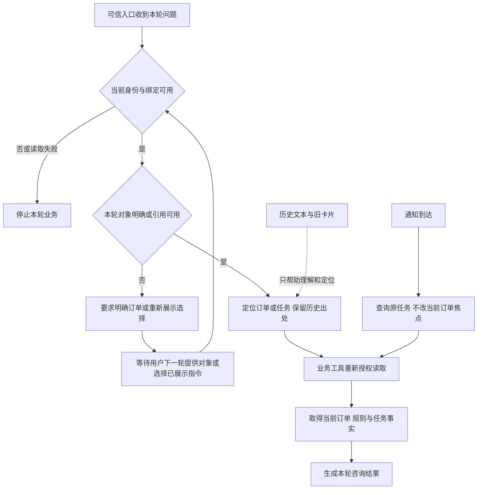

# 为什么现在暂缓通用长期记忆？

更新：2026-10-09。dave-agent 是处理团购券咨询与售后的客服 Agent。当前决定是：保留聊天历史、持久业务结果和有界上下文恢复，暂缓新增跨不同对话自动提炼、检索和更新用户偏好的通用长期记忆。

这个决定针对当前业务范围与验证预算。项目已经有多种“记住信息”的能力；长期记忆也可以有价值。这里要回答的是：它现在能补上哪一个具体业务缺口，是否值得优先投入，以及什么证据出现后应重新考虑。

推荐先读 [Agent Harness 总览](https://www.yuque.com/erha-vrnso/repg3o/3c7971f2134157e0f179aff6c7b0fd30)，再结合 [会话重建与重新授权](https://www.yuque.com/erha-vrnso/repg3o/scb40rh02au61uo6)。本篇解释取舍，后者展开恢复实现。

## 1. 先看客服真正需要记住什么

小林购买了 A、B 两张团购券。他先为 A 发起商家协商，等待结果时又查询 B。服务重启后，小林问：“刚才那次处理有结果了吗？”

这个问题至少涉及三类信息。订单记录客户买了什么、实付多少、券是否核销；协商任务记录哪张订单在等待商家、结果是什么；当前订单焦点记录用户此刻正在咨询哪一单。A 的协商任务与 B 的咨询焦点必须分别定位，通知到达不能悄悄把 B 改成 A。

因此，系统首先需要找到正确对象，再重新核对当前身份、订单归属和任务状态。曾经聊过 A 可以帮助理解指代；曾经说过“可以退”无法证明现在仍有退款权限。写入主线还要经过方案成功展示、本人精确确认、金额与期限复核、事务幂等。

项目中的订单、商家结果和资金使用合成数据，以上身份、状态、确认与存储约束由实际代码执行。网页目前只提供咨询，不办理协商或退款写入。

图 1：把恢复引用理解成一张索引卡：它告诉系统“可能在说哪一单”，后续仍须查证。GPT 插图用于教学；订单卡、历史回复和索引本身都不产生退款批准。

## 2. 聊天历史、业务记录与长期记忆如何区分

“保存到数据库”只说明信息能跨进程存活，不能单凭存储方式判断它属于哪一种记忆。区分时应看保存什么、供谁使用、何时失效，以及是否跨不同对话使用。

| 概念 | 保存或使用的信息 | 在本项目里的用途 |
| --- | --- | --- |
| 会话上下文 | 当前一段对话的消息、工具结果与运行状态 | 支持“这张券”“刚才那个问题”等续问 |
| 聊天历史持久化 | 某段对话的用户原文与公开回复 | 回看和续聊这段旧对话 |
| 有界业务引用恢复 | 订单号、政策原问、历史金额出处、任务选择及失效标记 | 会话重建后定位对象，重新查询并核对依据 |
| 业务数据库 | 订单、核销、协商与退款的持久业务记录 | 查询当前事实，执行受保护的状态变化 |
| 通用长期记忆 | 跨不同对话提炼的用户偏好、长期事实或经验 | 在新对话中个性化回答，维护可检索的记忆 |
| RAG 知识检索 | 某门店、商品和版本下适用的规则资料 | 为咨询找到业务依据 |

本篇“暂缓长期记忆”指表中的第五项。用户在旧对话里看到的订单金额、业务表里的退款结果、知识库里的政策，仍按各自来源使用。

[LangChain 官方概念说明](https://docs.langchain.com/oss/python/concepts/memory)也按召回范围区分会话内记忆和跨不同对话的长期记忆：会话状态可以持久化；长期记忆可以是结构化用户资料，也可以是多个记忆文档。它不要求先引入向量数据库。此处借用的是概念区分，不表示项目采用了 LangGraph 或 LangMem。查阅日期为 2026-10-09。

## 3. 当前项目已经实现到哪一层

以下按当前源码与已有验证记录说明。稳定 QQ 主线、显式候选和网页历史版本分开解释；网页新增历史已提交为 `03b75ea6ea9fe9e588b527f72370774055d1a09a`，不借用更早的源码证明。

先认识表中的工程名词：Pi 是复用的 Agent SDK，负责模型与工具循环；Session 是一段对话的运行上下文；Harness 是项目组织身份、工具与生命周期的代码，Controller 是其中固定业务执行顺序的候选实现；O4 是会话定位与恢复阶段的代号。compaction 指历史压缩，Reply 指项目返回给用户的结构化业务回复。

| 能力 | 当前做法 | 状态与限制 |
| --- | --- | --- |
| QQ / CLI 的 Pi 上下文 | 使用内存 Session；自动 compaction 关闭 | 默认 `memory` 表示进程内模式。QQ 达到 20 次 Harness 处理计数后重建 Session，计数包含通知和 Harness 直接处理，不能解释成 20 次模型调用；也没有自动摘要 |
| 持久业务结果 | 商家任务和退款结果保存在 MySQL | 服务重启后可用明确订单号重新授权查询；模拟结果不等于真实商家或支付系统验收 |
| O4 有界恢复 | 显式 `Controller + mysql` 保存版本化引用，以绑定记录、修订号和有效期约束恢复 | 已有工程、实库、独立进程及部分真实模型证据；完整 O4 仍未完成，默认没有切换 |
| 网页历史续聊 | 文件 SQLite 保存原文和公开 Reply；回访旧对话时注入新 Pi 上下文 | 已有专项、实库只读与浏览器验收记录，源码已提交为 `03b75ea`；仅本机合成客户及浏览器归属，无真实登录与跨设备账号 |
| 跨新对话的偏好与事实记忆 | 尚未实现自动提炼、跨对话检索及合并更新 | 当前新建网页对话的消息为空，不会自动汇总该客户其他对话 |

O4 引用采用原 15 分钟有效期，普通续问不自动续期。过期是停止使用该引用，不意味着所有数据库记录 15 分钟后被物理删除。任务批准和业务历史也不会因引用过期被删除。

网页旧对话可以回访，稳定对话仍受 20 轮上限约束；重新打开不会重获额度。历史限额为每浏览器归属／客户 100 条、全局 1000 条。浏览器归属 cookie 的有效期不等于历史保存期限承诺。当前机制见 [网页重试与历史回访](https://www.yuque.com/erha-vrnso/repg3o/tu9dm4a5wev2otqf)。

## 4. 为什么现在暂缓通用长期记忆

### 先解决查哪一单、当前状态是什么

售后咨询首先要回答“查哪一单、哪次协商、现在处于什么状态”。订单和任务已有业务存储；会话重建导致的指代丢失有专门的 O4 引用恢复。网页旧对话回访则由聊天历史持久化承担。

跨新对话记住“用户喜欢简短回复”可能改善体验，但目前还没有一项完成验收的对照，证明这类能力能改善本项目的核心闭环。这里保留的是收益待验证状态，不能据此断言长期记忆在客服业务中普遍无用。

### 关键业务事实需要明确来源和新鲜度

例如，一张券上次查询时未核销，后来可能已经使用；商家上次批准的退款可能越过截止时间。把旧回复总结成“该订单可退款”，再跨对话使用，会把一个带条件的历史判断压成看似持续有效的事实。

业务记录保存实际状态和结果，恢复引用保存定位及出处，工具重新读取当前事实。这种分工更容易说明每个字段从哪里来、何时不能用，以及哪一层决定能否执行。

### 记忆写入与失效会形成新的验证范围

自动提炼记忆需要区分稳定偏好、临时要求、用户猜测、模型错误和业务事实。还要处理“以后简短回答”变为“这次详细解释”、错误记忆纠正、用户删除、身份重绑以及跨客户隔离。

这些是新增能力必须覆盖的故障场景，并非本项目已经发生的长期记忆缺陷。仅做“把摘要存下来，下次检索出来”无法完成这组合同。

### 实现成本与运行成本都需要对照

若记忆生成使用模型，会增加调用或后台工作；若检索出的内容进入上下文，会改变输入 Tokens。更新、纠错、删除与检索都需要维护。请求内写记忆还可能增加延迟；后台写入则要处理更新时机和暂时陈旧，官方说明也列出了这些取舍。

本项目没有通用长期记忆的质量、延迟或费用 A/B，因此不能填写“节约多少 Tokens”“完成率提升多少”。方案看起来更完整，不能替代收益测量。

### 面试优先级要求先形成可核验的技术深度

当前更值得讲清的链路是：A 的任务与 B 的焦点怎样分开、服务重建后恢复什么、绑定变化怎样失效、引用过期怎样澄清、再次查询为什么必须重新授权。

这些问题能追到个人实现、失败记录和复现入口。新增长期记忆之前，应先确保已有实现的默认配置、候选状态和证据范围可以准确演示。P0 优先级见[项目协作准则](https://github.com/erha1499/dave-agent/blob/4d4868d6a4c74ea99a8558f0a49fa8d3b402f5f5/AGENTS.md)。

图 2：聊天历史可以帮助理解，访问业务事实仍受当前身份、绑定和订单归属约束。这张图强调授权边界，不承诺绑定撤销与网络发送之间具有原子性。

## 5. 有界恢复如何连接到本轮事实

下图概括显式 Controller/mysql 候选的读取原则。默认 atomic 没有因此变成持久引用模式；网页历史恢复也有独立的浏览器归属与当前绑定检查。

政策恢复保存原问和出处，下一轮结合新问题重新检索；历史金额保存当时展示值及来源，比较时分别给出历史值与当前值。任务引用只用于只读状态查询，不能用于准备协商、准备退款或执行确认。

图中只展开咨询与定位。退款执行仍走独立的成功展示、本人精确确认、批准／金额／期限复核及事务幂等链路。当前源码中的最后绑定快照、MySQL 授权读取与网络投递也不是一个跨系统原子事务。

## 6. 替代方案与接受的代价

| 选择 | 可以解决什么 | 本项目当前判断 |
| --- | --- | --- |
| 重建后要求用户明确订单号 | 低成本重新定位，继续查询持久结果 | 稳定主线可用，但用户需要重述 |
| 回访原聊天记录 | 找回原问题与公开回复，续聊这段旧对话 | 网页已实现；不会自动建立跨新对话的用户画像 |
| 保存有界业务引用 | 在有效期内减少对象重述，保留选择与歧义 | O4 已实现候选；每轮增加存储读取与发布，完整验收仍待完成 |
| 保存完整历史并每次全部注入 | 给模型更多原始背景 | 会带来上下文长度、陈旧内容和输入成本问题；保存历史与每次全部注入应分别决定 |
| 跨对话提炼偏好与长期事实 | 个性化新对话，复用稳定用户信息 | 暂缓；先明确实际需求与收益口径 |

当前选择接受了明确的体验代价：新对话不会自动记住所有过去咨询；引用过期或对象有歧义时，用户需要重新说明；QQ 重建也不会恢复全部模型历史。这些限制需要诚实表达，后续若出现具体失败，再补相应能力。

## 7. 已有证据能支持哪些结论

| 证据 | 已有观察 | 不能推广的结论 |
| --- | --- | --- |
| O4 首阶段真实模型开发探针 | 一个固定场景、每模式 20 条输入：mysql 20/20，memory 19/20 | 不能视为生产完成率，不能证明通用长期记忆收益或完整 O4 准入 |
| O4 后续独立新问法对照 | id/current 共 160 条输入：id 79/80，current 78/80，未证明 current 净收益 | 这是任务引用策略对照，不是用户画像记忆 A/B；没有因此切换默认 |
| O4 混合工程 | 末批原严格 159/160；评分修正后的历史离线 160/160 单列 | 离线重评不等于新增完整实库通过；80 轮真实模型与常驻 QQ 重启仍未验收 |
| 网页 `03b75ea` 版本 | 已记录专项、validate、只读 MySQL＋HTTP＋SQLite 恢复检查；真实 Pi 配本地 faux 读取历史 | 证明存储、隔离和历史注入接线；不证明远程模型长期语义质量 |
| 通用长期记忆 | 当前未实现，也没有本项目质量／延迟／费用对照 | 不编造准确率、节约费用或满意度提升 |

这里的 faux 是本地替代模型服务，用于观察实际 Pi 输入和受控输出；它与远程真实模型调用分开。工程检查、实库、模型理解、QQ 传输和商业运行分别回答不同问题。

O4 完整分母、旧失败和未执行项保留在[恢复验证合同](https://github.com/erha1499/dave-agent/blob/4d4868d6a4c74ea99a8558f0a49fa8d3b402f5f5/docs/o4-recovery-validation.md)。网页新版本的验证入口见前述 06.20，以及 [`03b75ea` 的网页记录](https://github.com/erha1499/dave-agent/blob/03b75ea6ea9fe9e588b527f72370774055d1a09a/docs/web-chat.md)。当前文档发布时间和此前业务检查时间分开，后续修改仍需按实际版本解释。

图 3：不同证据回答不同问题。图中的“QQ 送达”只是层级示意，平台接受投递不证明用户已读；本项目没有真实商业交易。

## 8. 什么情况下重新考虑长期记忆

重新启动应从一个可复现需求开始。例如：同一客户在多个新对话中反复要求简短回复，业务明确希望记住这个稳定偏好；或者一次跨对话咨询因为缺少可保留背景而反复澄清，现有历史回访和任务查询无法满足需求。

启动前应写清五项：真实约束、具体面试追问、个人实现与复用边界、验收证据、预算与停止条件。不能只以“Agent 应该有记忆”作为立项理由。

最小候选可以是一个带来源、更新时间、用户修改与删除能力的结构化偏好记录。少量固定字段可按可信客户 ID 读取，不必先建设向量检索服务。偏好只影响回复方式，不能记录或复用退款权限。这里描述未来设计，不表示已实现。

若需自动提炼，先与“不使用记忆”及“用户显式设置偏好”比较。用新的跨对话场景验证保留、纠正、冲突、删除、身份隔离及业务边界，再比较完成率、澄清次数、延迟、完整用量和费用。验收门槛、场景分母、调用／时间上限必须在运行前冻结；预算到即记录结果，没有净收益就暂缓，不靠反复重跑同批题追分。

## 9. 面试时如何解释这个决定

**问：为什么没有做通用长期记忆？**

可以这样回答：“我们先围绕团购券售后闭环实现了业务结果持久化、网页历史回访和有界引用恢复候选。当前主要问题是定位订单和任务，并保证本轮重新授权、读取当前状态。跨新对话的用户偏好提炼还没有明确收益证据，所以暂缓，先把已有恢复链路和失败边界验证清楚。后续若出现反复重述的真实场景，会用最小结构化记忆和无记忆基线比较。”

**问：聊天记录都存库了，为什么还说没做长期记忆？**

存库解决跨进程保存。当前网页续聊的是某段原对话；新对话没有自动检索其他对话中的用户偏好或长期事实。说明保存对象和召回范围，比争论一个术语更准确。

**问：用户上次已同意退款，为什么不能记下来直接执行？**

原确认关联具体订单、已展示方案、金额、批准和期限。历史文本不能迁移成新的执行许可。新的业务动作仍由 Harness 与工具复核，事务中的当前状态和幂等约束决定能否执行。

**问：怎么证明这个取舍合理？**

讲当前需求、已有替代方案、接受的体验代价和重新启动条件。已有 O4 小样本只支持局部恢复观察，项目没有通用长期记忆 A/B；因此这是当前阶段的工程选择，不能表述成已实验证明长期记忆无效。

## 10. 沿源码复现讲解

通用机制以下列 `4d4868d` 固定源码版本为入口；网页新增历史单列为 `03b75ea` 版本。具体依赖与运行配置按对应验证记录复现。

| 要回答的问题 | 源码与文档入口 |
| --- | --- |
| Pi 历史保存在哪里，是否压缩 | [agent.ts：SessionManager.inMemory 与 compaction](https://github.com/erha1499/dave-agent/blob/4d4868d6a4c74ea99a8558f0a49fa8d3b402f5f5/src/agent.ts#L214) |
| QQ 什么时候重建，20 如何计数 | [qq-agent.ts：轮换分支](https://github.com/erha1499/dave-agent/blob/4d4868d6a4c74ea99a8558f0a49fa8d3b402f5f5/src/qq-agent.ts#L172) |
| memory/mysql 怎样选择 | [support-session.ts：配置校验](https://github.com/erha1499/dave-agent/blob/4d4868d6a4c74ea99a8558f0a49fa8d3b402f5f5/src/support-session.ts#L63) |
| 引用存哪些字段、怎样过期 | [conversation-state.ts：版本化值与 TTL](https://github.com/erha1499/dave-agent/blob/4d4868d6a4c74ea99a8558f0a49fa8d3b402f5f5/src/conversation-state.ts#L20) |
| 当前身份怎样与旧引用比较 | [conversation-state.ts：bind/read](https://github.com/erha1499/dave-agent/blob/4d4868d6a4c74ea99a8558f0a49fa8d3b402f5f5/src/conversation-state.ts#L182) |
| 绑定或外部修订变化怎样清上下文 | [support-session.ts：轮前恢复](https://github.com/erha1499/dave-agent/blob/4d4868d6a4c74ea99a8558f0a49fa8d3b402f5f5/src/support-session.ts#L496) |
| 恢复与降级合同怎样复现 | [conversation-recovery.md：实现与检查命令](https://github.com/erha1499/dave-agent/blob/4d4868d6a4c74ea99a8558f0a49fa8d3b402f5f5/docs/conversation-recovery.md) |
| 网页怎样保存和注入历史 | [`03b75ea` 的文件存储接线](https://github.com/erha1499/dave-agent/blob/03b75ea6ea9fe9e588b527f72370774055d1a09a/src/web-chat-server.ts#L159)、[SQLite 历史存储](https://github.com/erha1499/dave-agent/blob/03b75ea6ea9fe9e588b527f72370774055d1a09a/src/web-chat-history.ts#L44)、[Pi 历史注入](https://github.com/erha1499/dave-agent/blob/03b75ea6ea9fe9e588b527f72370774055d1a09a/src/web-chat.ts#L238)；验证范围见 [06.20](https://www.yuque.com/erha-vrnso/repg3o/tu9dm4a5wev2otqf) |

练习一：沿 `QQAgent → Session 工厂 → Pi` 找到内存历史和轮换位置，解释为什么 `.runtime/pi` 路径不能证明完整聊天持久化。

练习二：从 `ConversationStateStore.bind/read → prepare/beforeStart 恢复 → 业务工具` 追踪一条订单定位，标出来源、有效期、绑定代次和重新授权位置；说明引用失效与业务批准失效分别由什么决定。

练习三：按 O4 固定探针阅读“A 协商、B 焦点、通知、重建、任务追问”，核对实际 Session generation、工具事实与状态。默认 memory 重建后正确澄清，安全性与免重述完成度应分别解释。涉及 MySQL 的检查按专用合成环境及现有准备要求运行，不与常驻 worker 并发。

本篇交付的是一项设计取舍说明，沿用现有配置、源码和验证材料；没有新增记忆实现或业务实验。文档检查限事实、链接、目录、配图与 Mermaid，不能计作新的模型、MySQL、QQ 或商业验收。

[← 04.10｜会话重建](https://www.yuque.com/erha-vrnso/repg3o/scb40rh02au61uo6) · [相关：06.20｜网页历史与请求恢复](https://www.yuque.com/erha-vrnso/repg3o/tu9dm4a5wev2otqf) · [相关：07.30｜简历表达与证据](https://www.yuque.com/erha-vrnso/repg3o/ba571017e1270654ce01c930f34673c0) · [返回学习导航](https://www.yuque.com/erha-vrnso/repg3o/vb4ua7gq7zdpthhn)
