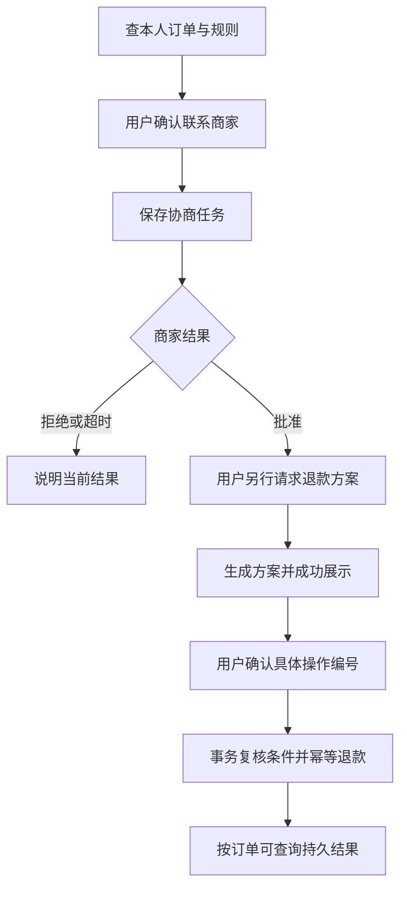

# 从哪里开始学 Dave-Agent？一张阅读路线图

## 先用一个问题认识项目

如果你已经了解 LLM 调用和 RAG，可以从这里开始。我们跟着一位来退款的顾客，看一句话怎样变成可查询、可确认、可恢复的业务流程。先用 1.2 的离线入口跑一次检查，再逐步接数据库和真实模型；最后能按实际具备的环境复现业务路径，并在面试里解释它为什么这样设计。

小林买了一张团购券，到店后发现门店无法接待，于是发来消息：“我要给单号为 1 的订单退款。”客服首先要查清这笔订单是否属于小林、券是否用过、适用什么规则。需要商家处理时，先征得小林同意；商家批准后，再把退款金额和具体方案展示给他，等他确认才执行。

这条流程里，模型负责理解问题、组织语言；Harness 负责把对话接到业务步骤上；工具和存储负责把身份、金额和确认逐项查实。Pi 是本项目复用的 Agent 开发工具包，提供调用模型、执行工具并继续对话的循环；Dave-Agent 在它上面补齐客服业务。

接下来会沿这条退款流程展开，也会看看它在哪些地方容易出错：用户重复发送确认、商家很晚才回复、服务处理到一半重启。网页课程从查订单和问规则讲起，讨论刷新和断线后的恢复；网页入口目前不办理商家协商或退款。

图 1：联系商家与执行退款各需一次明确的用户确认。商家批准后仍要请求、展示并登记退款方案，再确认具体操作编号；批准不会自动触发退款。

## 先认识这些词，再开始读源码

| 术语 | 本项目中的含义 |
| --- | --- |
| Harness | 围绕模型组织上下文、工具、会话与执行的工程层。Pi 提供通用循环，项目补上业务接入、权限、状态与恢复 |
| 工具 | 模型可以请求执行的受限业务函数，例如查本人订单 |
| 可信身份 | 入口与数据库绑定确定的客户身份，不接受用户自报替换 |
| 幂等 | 同一业务操作重复到达时，不产生第二份业务效果 |
| 事务 | 多个数据库变更作为整体提交或回滚 |
| RAG | 先检索相关资料，再让模型利用资料回答；检索结果仍需检查适用性 |
| Controller | Harness 中安排固定业务步骤的组件，例如先查询事实再准备方案；它不是模型，也不等于整个 Harness |
| Skill | 提供给模型的任务说明文档。说明怎么做，并不授予工具或数据库访问权限 |
| Session | Pi 保存当前模型对话和运行状态的会话对象；它与网页聊天记录、数据库业务状态分别管理 |

先有个印象就够了。比如“幂等”，放到退款场景里就是：同一份确认即使收到两次，也只退一次款。后面的课程会把这些词逐一落到代码上。

## 推荐主线：先理解闭环，再理解优化

第一次读先走默认 `atomic + lexical + memory`：模型选择业务工具，Pi 执行循环，Harness 和 Store 检查边界。1.1 提供实际采集的本地查单序列；1.2 提供无需密钥或数据库的起点，再区分实库、真实模型和完整售后。

Controller 的动作协议放在 1.1 末尾进阶区，首次阅读可以跳过。4.1 的持久引用、5.4 的问题还原等候选要连同适用路线阅读，不把候选实验当成默认能力。每读一段代码，都回到场景里问：这一步拿到什么，接下来允许做什么？

| 次序 | 阅读内容 | 读完应能回答 |
| --- | --- | --- |
| 1.1 | [从用户提问到最终回答，Agent 是怎样运行的？](<./01.01-智能客服运行原理.md>) | 沿本地查单样本解释默认循环；Controller 细节留到进阶区 |
| 1.2 | [配置改了，为什么程序没有按预期运行？](<./01.02-配置与运行路径.md>) | 先运行离线检查，再看配置如何选择实际执行路径 |
| 2.1 | [用户说“这是我的订单”，系统该相信吗？](<./02.01-可信身份与订单归属.md>) | 解释为什么用户文字和旧聊天不能提供授权 |
| 2.2 | [Skill 怎么加载，工具权限又由谁控制？](<./02.02-技能加载与工具权限.md>) | 解释 Skill 如何加载，以及流程说明、工具接口和执行权限的区别 |
| 3.1 | [从“想退款”到联系商家，为什么还要确认？](<./03.01-联系商家前的确认.md>) | 区分咨询、用户确认和持久任务 |
| 3.2 | [拿到数据库锁后，为什么还要检查截止时间？](<./03.02-数据库锁与截止时间.md>) | 理解为什么接收商家结果时，拿到行锁后还要检查截止时间 |
| 3.3 | [退款怎样确认，才能不越权、不重复执行？](<./03.03-退款确认与事务幂等.md>) | 贯通方案展示、精确确认、事务与幂等 |
| 3.4 | [商家晚到的回复，怎样通知到正确的人？](<./03.04-商家回复与通知投递.md>) | 理解哪个执行器负责发通知、发给谁，以及发送结果未知时如何查询 |
| 3.5 | [请求超时后，怎样取消并接着处理下一条？](<./03.05-超时取消与会话排队.md>) | 理解同用户串行与取消后的收尾 |
| 4.1 | [会话重启了，哪些内容还能恢复？](<./04.01-会话重启与恢复.md>) | 区分恢复定位、聊天历史和重新授权 |
| 4.2 | [聊天记录、业务引用和长期 Memory 有什么区别？](<./04.02-聊天记录与长期记忆.md>) | 从业务收益判断何时该做、何时暂缓 |
| 4.3 | [上下文快满了，什么时候停止、怎样继续？](<./04.03-上下文预算与恢复.md>) | 解释完整请求测量、输出预留及超限停止 |
| 5.1 | [关键词、向量和 Rerank，RAG 应该怎么选？](<./05.01-检索方案与技术取舍.md>) | 比较词项、向量、重排与事实支持 |
| 5.2 | [查到一条规则，怎样确认它适用于这笔订单？](<./05.02-规则适用范围.md>) | 判断一段规则属于谁、何时有效、内容是否改变 |
| 5.3 | [订单查对了，为什么回答仍可能出错？](<./05.03-订单证据与答复正确性.md>) | 把实时订单事实和规则依据分开 |
| 5.4 | [用户只说“刚才那个”，怎样理解又不猜错？](<./05.04-业务引用与指代澄清.md>) | 理解短回复如何补回原问题而不偷换问题 |
| 6.1 | [网页选的模型，真的用到这次请求了吗？](<./06.01-网页模型选择与生效.md>) | 从表单、配置快照追到 Pi Session |
| 6.2 | [刷新、断线和多标签页，怎样避免丢回复与串会话？](<./06.02-网页断线与会话恢复.md>) | 区分对话、运行会话、请求，以及已保存的处理状态和回复 |
| 7.1 | [Agent 做得好不好，效果、延迟和成本怎么算？](<./07.01-效果延迟与成本评测.md>) | 正确计算失败、计划分母、延迟和费用 |
| 7.2 | [工具成功、回答却错了，怎样验收完整任务？](<./07.02-完整任务联合验收.md>) | 同时检查答复、工具、状态和费用，识别未验项 |
| 7.3 | [换一个模型值不值，怎样做公平对照？](<./07.03-模型对照与选型.md>) | 设计公平对照，用收益和预算决定停止 |
| 7.4 | [面试时怎样讲清自己的实现、取舍和结果？](<./07.04-面试讲解与实现证据.md>) | 把问题、实现、取舍和结果组织成可讲述的答案 |
| 选修 | [选修：仓库太大放不进上下文，Coding Agent 怎么办？](<./08-编程助手与仓库上下文.md>) | 理解代码上下文、搜索、AST / LSP 与 Harness 职责 |
| 案例 | [案例：问“多久到账”和问“已经到账了吗”，差在哪？](<./09.01-退款到账咨询案例.md>) | 区分渠道规则与实际资金到账 |
| 案例 | [案例：一张券用掉了，剩下的钱能直接退吗？](<./09.02-剩余券金额与退款边界.md>) | 区分剩余实付金额与可退权限 |
| 模板 | [Dave-Agent 简历项目描述与职责模板](<./10-简历项目描述与职责模板.md>) | 按岗位选择个人职责，面试时能解释指标来源与工程保障 |

## 用一条消息串起各章

现在把自己放在客服的位置。小林发来“这张券我还没用，帮我退一下”，你会先做什么？沿着下面六步，就能把目录里的各章连起来。

1. **入口与身份**：系统知道哪个客户在说话，但还需要定位订单。没有订单号时，可以列出本人最近订单供选择，或请用户补充订单号。
2. **当前事实与规则**：重新读取订单状态，再查询与门店、商品和时间范围一致的规则。旧回复不能替代当前状态。
3. **业务动作**：先确认用户要处理哪笔订单、遇到了什么问题。联系商家前，由用户完整发送带订单号和原因的确认文字；商家批准后，执行退款前还要让用户确认具体方案，这两次确认不能互相替代。
4. **等待与恢复**：商家处理可能晚于这一轮聊天。把任务保存下来，用户可以继续问别的问题；结果通知仍要回到正确身份和会话。
5. **执行与结果保存**：用户看见订单、金额和方案的操作编号后，完整发送带该编号的退款确认指令。程序在同一事务中重新检查条件并保存退款；同一方案重复确认仍只退一次。网络没回包时，按订单号查询退款状态，确认这笔操作是否已经成功。
6. **评测与表达**：用可检查的工具调用和状态变化判断是否完成；保留失败、未执行与未知费用，再说明为什么选择这个方案。

读源码也可以沿这个顺序走：入口 → Harness → 工具 → 存储 → 回复。每遇到一个函数，就用小林的请求问它一次：你拿到了什么、检查了什么、把结果交给谁？

## 三种学习方式

**第一次动手**：1.2 的“离线闭环” → 1.1 的实际查单轨迹 → 2.1、2.2 的授权与工具边界。先能指出用户输入、两次模型调用、工具结果和最终回复，再接数据库；没有模型密钥也能学会执行链。

**理解退款主线**：1.1 默认部分 → 3.1 → 3.3 → 3.4 → 7.2，串起两次确认、事务结果、通知和联合验收。随后读 1.1 的 Controller 进阶及 4.1、5.4，对照固定编排与候选恢复的收益和代价。

**带着故障学习**：改绑后旧身份失效读 2.1；页面重试与串会话读 6.2；模型超时后下一条卡住读 3.5；商家结果晚到读 3.2；漏通知读 3.4；部分退款读对应业务案例。

准备面试：先用 1.1 讲清分工，再选 3.3、3.4 或 6.2 的一个失败场景，沿着代码讲到恢复办法。接着用 7.1、7.2 和 7.3 回答“怎么验证、花了多少、为什么选它”。7.4 有追问练习，简历模板帮你把已经能讲清的部分写成职责。

## 怎样判断自己学会了

给自己四个检查任务：

- 不看内部阶段名称，说出一次退款从咨询到保存结果经过哪些判断。
- 对照 1.1 采集序列与正文源码，指出身份来自哪里、工具结果如何进入下一次模型输入、谁决定最终回复；再说明退款金额和确认在哪检查。
- 任选一个失败场景，解释数据库留下什么、用户看见什么、下一步能安全做什么。
- 比较一个替代方案，说明收益与代价，而不是只说使用了哪些技术。

练习时不用背函数名。试着从一句用户诉求出发，说清需要查哪些数据、谁有权操作、成功后留下什么、失败后怎样继续。能够把这些问题连起来，就已经抓住了项目的主线。

## 继续查阅

每课文末列出对应实现位置，便于学完后继续看完整代码。项目中的订单、商家结果和资金是合成数据，身份、确认、状态和幂等由代码与存储实际执行；文末的验证记录会分别说明工程检查、模型调用和平台传输的结果。

课程会说明哪些能力已经用于默认流程，哪些仍在比较中。持久业务引用、语义检索与事实支持等候选方案可以帮助理解取舍；是否采用，要看各自结果，而不是看方案复杂不复杂。
