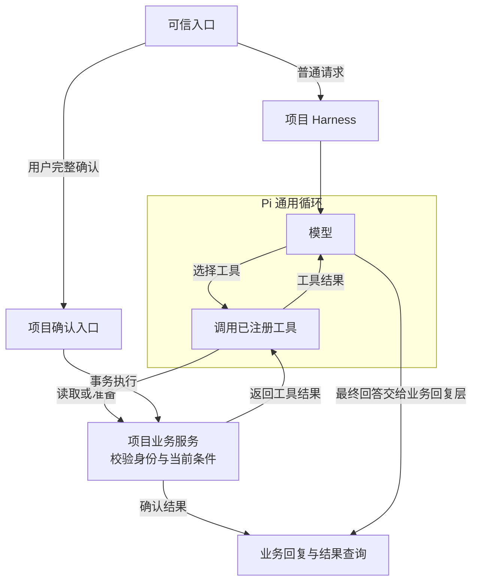
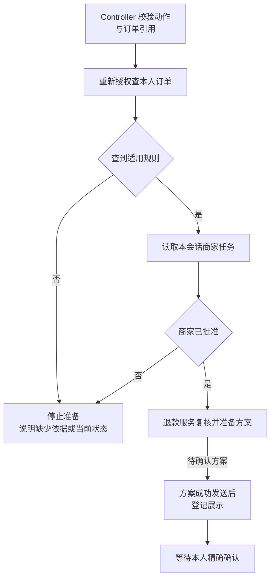

# 1.1 从用户提问到最终回答，Agent 是怎样运行的？

用户说：“团购券用不了，帮我退一下。”一个语言模型能理解“退”是什么意思，却不能仅凭这句话决定退哪一单、退多少钱、是否已经获准。客服系统要把语言理解接到订单、规则、协商和退款上，还要在失败时留下可以继续查询的结果。

这就是 Agent Harness 的工作。Harness 指围绕模型运行的一组程序：准备上下文、提供工具、控制执行、保存状态、处理异常。本项目复用 Pi SDK 的模型与工具循环，再补上业务权限和售后流程。理解它，先抓住一句话：**模型提出要做什么，业务代码决定是否能做以及实际做成了什么。**

本课先学默认 `atomic + lexical + memory`：模型选择独立工具，Pi 执行循环，Harness 和 Store 检查业务边界。最后的“Controller 候选进阶”比较另一种编排方式，首次阅读可以跳过。网页默认只读；完整协商与退款需要 CLI / QQ 的售后服务与用户确认。

## 先认识三个业务对象

订单记录买了什么、实付多少、券是否使用；协商任务记录向商家提出了什么问题、正在等待还是已有结果；退款方案记录待确认的订单、金额和操作编号。这三个对象分别回答“买了什么”“商家怎么说”“这次准备执行什么”。

商家同意只是退款的一个前提。系统还要展示具体方案，用户针对该方案确认，执行时再次核对状态。聊天中出现“可以退款”几个字，不能把这三层合并。

例如小林要退一张未使用的团购券：系统要知道这是谁的券、商家是否同意，以及小林确认的是哪一份方案。我们沿这个例子看每一步如何落到代码和存储。



图 1：Pi 负责模型与工具循环；项目代码负责可信身份、业务校验和持久状态。真实用户的完整确认直接进入项目确认入口，不由模型工具代发。

## 从一句话走到结果

可以把一次完整售后读成一条链：找到本人订单，查询适用规则，准备联系商家的请求，等待用户确认后建立协商任务，读取商家结果，展示退款方案，再接受精确确认并执行退款。下面按负责部件归为六段；等待商家结果时，不会一直占着一次模型请求。

| 顺序 | 谁负责 | 本步要完成什么 |
| --- | --- | --- |
| 1 | 可信入口与会话 | 接收诉求，确定发信人身份 |
| 2 | 模型与受限工具 | 理解需求、选择工具，再检查订单归属 |
| 3 | Harness 与业务读取 | 检查本轮范围，为受保护的业务工具补齐订单和规则依赖 |
| 4 | 确认入口与用户 | 准备协商请求或退款方案，等待对应的具体确认 |
| 5 | 执行服务与数据库 | 重新检查权限与状态，保存唯一业务结果 |
| 6 | 回复与查询 | 说明本次结果；回复丢失时查询已保存的记录 |

没有订单号时，先列出当前用户最近三笔本人订单，选中后再查最新状态。小林可以一边等订单 1 的协商结果，一边咨询订单 2；订单 1 的通知回来时，正在聊的订单 2 不应被悄悄换掉。

## Pi 与项目各自负责什么

Pi 是复用的 Agent SDK，它负责调用模型、执行模型选择的工具、把工具结果交回模型，并管理会话生命周期。项目提供业务工具、可信身份、确认流程和业务存储。这样可以把实现精力放在客服难点上，而不用重写模型与工具循环。

```typescript
// src/agent.ts · 创建 Pi 会话
const { session } = await createAgentSession({
  cwd: projectDir,
  agentDir: `${projectDir}.runtime/pi`,
  modelRuntime, // 已配置凭据与连接方式的模型运行时
  model,        // 本次会话选择的模型
  thinkingLevel: "off",
  tools: tools.map((tool) => tool.name), // 允许模型调用的名字
  customTools: tools,                   // 名字对应的业务实现
  // 加载角色提示词（Prompt）和客服办理流程（Skill）。
  resourceLoader,
  sessionManager: SessionManager.inMemory(projectDir),
  settingsManager: SettingsManager.inMemory({
    compaction: { enabled: false }, // 不自动摘要旧聊天
    retry: { enabled: true, maxRetries: 2 }, // 模型连接的有限重试
    cacheWarming: "off",
  }),
});
```

会话建好后，Pi 负责“调用模型 → 执行工具 → 把结果交回模型”的循环。项目只把允许使用的业务工具交给它；退款确认和数据库权限由业务代码另行把关。

一次回答可能多次访问模型，所以会话还包装了实际发送入口：默认一条消息或事件最多发出 12 次模型 HTTP，后续生成与重试共用这份预算。请求体过大时停止并请用户重述。请求次数和用量见 [7.1 Agent 做得好不好，效果、延迟和成本怎么算？](<./07.01-效果延迟与成本评测.md>)，上下文限制见 [4.3 上下文快满了，什么时候停止、怎样继续？](<./04.03-上下文预算与恢复.md>)。

## 看一份实际采集的默认查单轨迹

先把问题缩小到“查实付金额和券状态”。下面来自一次本地 Pi faux 实跑：使用正式 `createCouponSession`、`runCliPrompt` 和回复渲染，模型输出预先编排，Store 用内存合成对象替代。它展示循环怎样运行，不评价模型会不会自主选对工具，也不验证 MySQL 授权。

| 顺序 | 负责方 | 本次实际输入或输出 |
| --- | --- | --- |
| 1 | Harness | 入口绑定合成身份 `TEACHING_LOCAL / OWNER`；用户输入“查询 COUPON-2042 的实付金额和券状态。” |
| 2 | Pi → 模型替身，第 1 次 | 将用户消息及已加载的系统提示、工具定义交给 faux；返回 `get_order({"orderId":"COUPON-2042"})`，结束原因是 `toolUse` |
| 3 | Pi → Harness 工具 | 发出 `tool_execution_start`，参数只有订单号；执行函数补入入口身份，调用 `store.getOrder(identity, orderId)` |
| 4 | Store 替身 → Pi | 检查身份和订单号后返回下方对象；`tool_execution_end` 的 `isError=false`，Pi 保存对应的 `toolResult` |
| 5 | Pi → 模型替身，第 2 次 | 输入现在含原用户消息、刚才的工具调用及同一个真实 `toolResult`；返回“订单 COUPON-2042 实付 79.80 元，券未使用。”，结束原因是 `stop` |
| 6 | Harness → CLI | 从工具结束事件整理本轮依据，生成下方最终订单回复 |

工具结果的文本内容是这份 JSON。`source` 沿用工具合同的标签；本样本实际由内存替身返回，不能据该字段判断已经查过数据库。

```json
{
  "source": "demo-database", "id": "COUPON-2042", "status": "paid",
  "amounts": { "paidCents": 7980, "refundedCents": 0 },
  "shop": { "id": "SHOP-A" },
  "items": [{ "productId": "PRODUCT-A" }],
  "coupons": [{ "status": "unused" }]
}
```

最终 CLI 实际输出：

```text
客服：订单查询

订单：COUPON-2042
状态：已支付
实付：79.80 元
已退：0.00 元
券状态：未核销

这是刚刚查询到的订单信息。本轮未取得完整适用规则依据，不能据此判断退款资格或可退金额；需要的话可以继续核对规则。
```

这里完整跑通的是一次只读查单。模型原句没有直接成为最终回复：只取得订单、未查规则时，当前出口选择固定订单卡并保留限制。后面会看到相应代码。本次采集有 **2 次本地模型调用、1 次 Store 替身读取、0 次远程模型 HTTP**；faux 合成 usage 不作为真实 Token 或账单证据。订单 `COUPON-2042` 仅属于这个采集脚本，普通数据库演示使用 1.2 中的 seed 订单。

## 查订单时，谁来决定“这是谁的订单”？

```typescript
// src/agent.ts · get_order 的执行函数
async (_id, { orderId }, signal) => {
  // 一轮对应一条消息或事件；turn.scopes 保存刚授权查到的门店和商品。
  // revision 是范围表版本，用来识别等待期间已经失效的读取。
  const turn = currentTurn, revision = turn.revision;
  try {
    // 查询前后都检查：未换轮、范围版本未变，也未收到取消信号。
    assertCurrent(turn, revision, signal);
    // orderId 由模型提供；identity 来自可信入口，模型不能替换。
    const order = await store.getOrder(identity, orderId);
    assertCurrent(turn, revision, signal);
    if (order.source === "demo-database" && order.id === orderId
      && typeof order.shop?.id === "string" && order.shop.id
      && Array.isArray(order.items) && order.items.length
      && order.items.every(item =>
        typeof item.productId === "string" && item.productId)) {
      // 保存本轮刚查到的门店和商品，供后续规则检索使用。
      turn.scopes.set(orderId, {
        shopId: order.shop.id,
        productIds: [...new Set(order.items.map(item => item.productId))],
      });
    } else {
      turn.scopes.delete(orderId);
    }
    return {
      content: [{ type: "text", text: JSON.stringify(order) }],
      details: {},
    };
  } catch (error) {
    // 失败时清空范围并推进版本，较早发起的读取不能再写回旧结果。
    retireScopes(turn, revision);
    throw error;
  }
}
```

小林即使在消息里声称“我是另一个客户”，也改变不了传入存储服务的身份。服务用当前绑定核对订单归属；查得到才返回订单，查不到就拒绝。

查单还有一个作用：给本轮后续检索确定门店与商品范围。若小林查询的订单属于甲店，就只能据此查甲店的适用规则；查单失败后，也不能拿上一次成功的范围继续办理。

这里有两个不同的问题。一个是“用户说的是哪一单”，模型可以协助理解；另一个是“该用户能否访问它”，必须由业务代码裁决。即使模型知道别人的订单号，也不能因此得到查询权限。返回结果还包含当前状态和金额，模型不能拿旧聊天充当最新业务事实。

## 不必先更换架构，也能固定必要步骤

默认工具路线增加了两处明确的 Harness 责任：带门店或商品范围的规则库查询（FAQ），必须已有本轮匹配的订单读取；查询协商、准备协商和准备退款这些入口被选中后，由工具内部补齐依赖。准备退款实际走“订单 → 各商品适用规则 → 当前协商 → 准备方案”，不会因为模型直接选了最后一个工具就省略前面的读取。

这里复用 Pi 的 `ctx.executeTool()`。它会实际调用已注册工具，经过相同参数校验与执行边界，并产生带父调用编号的执行事件。外层业务工具是模型选择的，内层依赖是 Harness 安排的；两者不能都记成模型自主规划。内层不会另造聊天中的 `toolResult` 消息，返回值先交给调用它的外层工具。

这样，即使模型直接选择“准备退款”，必要读取也不会漏掉。模型选错入口或误解资料仍需通过评测发现；普通规则咨询也不会被自动升级成办理退款。

## 一步成功，到底成功了什么

步骤成功要对应可检查的结果，也就是后置条件。工具调用没有抛异常，只能说明这次函数正常返回；用户目标还可能没有完成。

| 步骤 | 应检查的结果 | 不能据此声称 |
| --- | --- | --- |
| 选择业务工具 | 工具已注册，参数形状合法 | 订单一定属于当前客户 |
| 查订单 | 当前身份有权读取，返回对象是目标订单 | 已经获准退款 |
| 查规则 | 范围与所问内容匹配，有可用来源 | 当前订单满足每项前提 |
| 查协商任务 | 返回这个会话与订单的真实任务状态 | approved 就是已退款 |
| 准备方案 | 操作、任务、订单、金额匹配 | 用户已经看见或确认 |
| 展示登记 | 指定方案发送被接受并登记 | 用户一定已读 |
| 确认执行 | 当前授权、期限和状态有效，事务形成唯一结果 | 真实支付机构已经到账 |
| 解释结果 | 最终文字准确描述事实、限制和下一步 | 工具正确就保证文字正确 |

## 工具结果怎样变成用户能看懂的回复

工具返回订单、任务或方案数据，面向用户的 Reply 则表达业务含义。例如 pending 表示任务仍在等待，approved 表示商家同意，退款操作 succeeded 才表示本项目的退款记录已完成。Harness 可以用结构化回复呈现这些状态，避免把模型一句“好了”当成实际执行结果。

结构化回复还要经过发送。展示登记说明发送被接受，不能证明用户已经阅读；发送不明时也不能把方案重新准备或把资金操作再做一遍。把查询、状态变化和对外投递拆开，出现故障后才能判断应该继续查结果、等待确认，还是重建对话。

## 怎样阻止旧事实混进本轮答复

有一个容易遗漏的出口：订单卡的金额来自工具，但卡片后面若直接拼接模型文字，模型仍可能追加没有查过的退款政策，或把历史说成“本轮核实”。所以默认工具路线的最终答复也要看本轮实际查到的事实和规则，不能只验证卡片字段。

CLI、QQ 与 Web 都从工具结束事件收集本轮结果，Harness 内部补做的查询也算在内。失败同样要留下来，否则程序可能跳过失败，继续引用更早的成功结果。

```typescript
// src/reply-from-tools.ts · 把实际工具结束事件交给回复检查
export function toolEvidenceFromEvent(
  event: AgentSessionEvent,
): Evidence | undefined {
  if (event.type !== "tool_execution_end") return undefined;
  return {
    toolName: event.toolName,
    isError: event.isError, // 保留失败，禁止回退成早先的成功证据
    // 格式不对也交给出口拒绝，不悄悄忽略。
    content: (
      record(event.result) ? event.result.content : undefined
    ) as Evidence["content"],
  };
}
```

拿到这些事件后，回复出口再决定显示固定业务卡、当前事实，还是允许模型继续解释。评测还记录父子调用编号，以便分清哪一步由模型选择、哪一步由 Harness 补齐。

```typescript
// src/reply-from-tools.ts · 先排除需要固定回复或缺少证据的情况
// value 汇总本轮工具结果，evidenceIds 保存已接纳规则的来源编号。
// 返回 false 表示不放行模型自由答复，交给固定回复逻辑处理。
if (!value.evidenceIds.size  // 本轮没有可用规则
  || value.toolFailed       // 有工具失败，不能继续引用旧成功
  || value.listed           // 最近订单列表只用于选单
  || value.merchant || value.refund // 已有业务结果，应展示固定卡片
  || value.merchantEmpty || value.refundEmpty) { // 应如实说明本轮未查到
  return false;
}
if (!value.orders.length) return false; // 还需有本轮订单事实
```

没有当前订单与有效规则、当前读取失败、只有最近订单列表，或已经应当使用固定业务卡时，都不能直接使用自由模型文字。只查到订单时，回复展示本轮结构化事实，并说明尚无完整规则依据；只有 FAQ 时，展示本轮规则原文和“尚未核对具体订单”的限制；无当前证据时，请用户明确问题和订单；查询任务或方案返回空值时，准确说明“本轮未查到”，不能扩写成“从未退款”。

同轮也有新旧之分。每次取得新订单快照，会让此前的规则和商家、退款卡失效；重读同一订单时，事实与范围一起替换。只有此后重新成功取得相应业务结果，才能恢复对应卡片。这样先查 A 单、再查 B 单时，不会让旧 A 的确认按钮掩盖 B 的失败；新的订单读取也不能顺便清除另一类工具尚未恢复的失败。

规则还要有来源、标题、正文与合法范围；当前存在具体订单时，门店和全部商品都要被规则范围覆盖。网页还检查本轮目标与实际查单一致，且历史没有混入其他订单，再通过 `createOfferStreamGate` 按分句检查当前渠道做不到的协商或退款邀约；历史曾检索过规则，不会替新一轮放行。新订单快照要求重新查规则，不能用先前检索替它提供依据。配置了协商工具的完整售后入口，仅有订单与规则时也只展示固定事实及缺少当前协商状态的提示；商家或退款卡继续由固定模板解释业务结果，不靠模型文字补金额和许可。

有依据仍可能答错：模型可能误读条件或漏答，邀约检查也只覆盖已观察的句式；已经流出的文字无法在之后收回。订单历史与最终回复详见 [5.3 订单证据与答复正确性](<./05.03-订单证据与答复正确性.md>)，分句流式时序见 [6.2 网页断线与会话恢复](<./06.02-网页断线与会话恢复.md>)；这些默认 atomic 门槛不自动代表 Controller 候选也已覆盖。

## 失败后，哪个部件负责继续

| 情况 | 系统处理 | 接受的代价 |
| --- | --- | --- |
| QQ 同一用户连续发消息 | 同一群与发送者的会话串行；最多接纳三条尚未完成消息，含处理中一条 | 用户可能需要排队 |
| 模型失败或超时 | 提供受控回复，发出取消信号，等待旧工作收尾后重建会话 | 取消不等于远端已停止，收尾无固定上限 |
| 商家结果超过期限 | 得到数据库锁后再次检查截止时间 | 不能仅用开始等待前的时间 |
| 通知发送结果不明 | 记录未知，保留查询，不自动重发 | 可能少一次主动提醒 |
| 用户重复确认退款 | 事务与持久唯一结果返回原处理结果 | 要维护业务状态，单靠消息去重不够 |

任务完成、平台接受发送、用户读到消息和退款到账，是不同事件。例如协商已经批准而通知失败，批准不会消失；用户可以再查进度。反过来，平台接受一条“已处理”消息，也不能证明数据库真的执行了退款。

## 把一个场景讲完整

小林不记得订单号，先说“帮我退款”。系统列出本人最近订单，小林选中订单 1。查清当前状态和规则后，系统给出联系商家的确认文字。小林完整确认，任务便保存下来；等待时，他可以继续问订单 2。

订单 1 获得批准后，小林收到结果，再请求退款方案。看到具体金额和操作编号后，他另发确认。服务重新核对身份、状态、金额、批准和期限，再用事务保存退款。重复发送同一确认会读到既有结果；进程重启后，也可重新授权查询。

沿这个故事应能指出三条边界：选单只定位；批准还不是退款；确认只针对已展示的具体方案。它们让模型的语言能力与可检查的业务执行形成一个闭环。

## 练习与面试追问

试着用两分钟回答：“如果模型判断错了，系统如何保证不退错钱？”答案应分别提到受限工具、当前归属、展示确认、金额计算和事务幂等，不能只说系统提示写得严格。

再在故事中加入一次身份解绑和一次发送未知：前者需要让旧会话失效并在发送前复核，后者需要保留查询。说清每次失败损失的是哪种体验、哪种业务事实仍然存在。

用本课执行样本自检：一次查单为什么调用两次模型？第二次实际收到什么？为什么最后文字与模型原句不同？参考要点是：第一次选择工具，Pi 把真实 `toolResult` 放进第二次输入；Harness 按本轮依据生成最终订单回复。两次本地 faux 调用不等于两次远程 HTTP。

## Controller 候选进阶：把哪些步骤收回代码

读到这里，默认 atomic 的“模型选工具 → Pi 执行 → Store 查当前事实 → Harness 生成回复”已经完整。Controller 是 Harness 中另一个业务流程控制器：模型只提出受限动作，Controller 校验对象并安排固定依赖。它仍是候选，没有替换默认配置；两条路线共用身份、金额、确认与幂等保护。

### 先表达诉求，再核对对象出处

用户说“请为 COUPON-2001 准备退款方案”，模型表达动作和对象，不填写金额或批准：

```typescript
const action = {
  protocol: "v2.2", // Harness 固定协议版本
  kind: "refund_prepare",
  orderRef: { kind: "explicit", orderId: "COUPON-2001" },
};
```

`explicit` 表示订单来自本轮原文；“就这一单”应使用当前唯一焦点 `focus`；对象不清则先 `clarify`。schema 限定字段形状，随后检查出处：

```typescript
// src/support-action.ts · 明确订单或当前焦点，拒绝额外字段
const orderRef = Type.Union([
  Type.Object({
    kind: Type.Literal("explicit"),
    orderId: Type.String({ pattern: "^COUPON-\\d{4}$" }),
  }, { additionalProperties: false }),
  Type.Object({ kind: Type.Literal("focus") }, { additionalProperties: false }),
]);
// 准备方案只接受动作名和订单引用
Type.Object(
  { kind: Type.Literal("refund_prepare"), orderRef },
  { additionalProperties: false },
);
// src/support-controller.ts · trusted.userText 来自本轮入口原文
const ids = [...new Set(trusted.userText.match(/COUPON-\d{4}(?!\d)/g) ?? [])];
if (action.orderRef?.kind === "explicit"
  && !ids.includes(action.orderRef.orderId)) {
  throw new SupportProtocolError(
    "订单引用不在当前用户消息中；历史唯一订单应使用 focus，不能编造显式选单。",
  );
}
```

这样可以拒绝“格式合法，却把历史订单说成本轮明确选择”。通过出处检查以后，仍按可信身份查库授权。

### 固定依赖与返回结果都要检查



图 2：Controller 固定准备顺序，最终确认仍由本人新的完整消息触发。`ready` 只表示当前动作有可用结果，准备方案和执行退款各有自己的状态。

```typescript
// src/support-controller.ts · 已查订单与规则，继续核对协商和方案
const task = await getTask();
if (!task) {
  return result(notice(
    "当前会话尚无这笔订单的协商任务。请提供原因并明确要求联系商家，"
      + "收到确认文字后本人确认。",
  ), "blocked");
}
if (task.status !== "approved") {
  return result({ kind: "merchant_status", task }, "blocked");
}
const operation = await call("prepare_refund", { orderId }, async () => {
  const value = await this.services.refunds!.prepare(
    context.identity, context.sourceKey, orderId!,
  );
  if (!isRefundOperation(value)
    || value.orderId !== orderId || value.taskId !== task.taskId
    || value.amountCents !== order!.amounts.paidCents
    || value.amountCents !== task.approvedAmountCents) {
    throw new Error();
  }
  return value;
});
```

没有任务、尚未批准就停在对应状态；准备成功后还核对订单、任务、实付和批准金额。模型选择外层动作，Controller 安排内部读取，二者在评测中分别记录。默认 atomic 的售后工具也会补齐必要前置，因此应比较两条路线解决了哪种遗漏、增加了多少延迟和维护逻辑。

### 同轮纠错怎样避免重复业务

```typescript
// src/support-controller.ts · accepted 是本轮已经接纳的动作
if (accepted) {
  if (!isDeepStrictEqual(action, accepted)) {
    throw new SupportProtocolError(
      "本轮已有业务动作，不能追加冲突动作；请在下一轮明确需求。",
    );
  }
  return pending!; // 同一动作复用第一次 Promise，包括失败结果
}
```

服务可能已写入却没回包，所以同轮不能换动作再试。字段或出处错误发生在执行前，可有限修复：默认一次，只接受零至二次；政策范围拒绝另有无副作用的受限修复，仍不得换单或申请退款。模型最终解释失败时保留已得到的业务结果；跨进程重复确认交给数据库幂等，而不是这份内存 Promise。

自检四种情况：旧单伪装本轮显式选单应被出处检查拒绝；重复动作复用原 Promise；第一次服务结果不明后换动作应被冲突检查拒绝；准备完成后文字失败只补结果说明，不再准备一次方案。每题要说出“在哪里停止、是否已产生副作用、下一步查询什么”。

### 为什么暂时不需要通用 Planner

当前售后顺序主要由业务规则固定，通用 Planner 的自由拆解和重新安排步骤没有明确收益。项目尚未实现通用任务图、多 Agent 调度或自动选模型。将来若有步骤不固定、需比较多个资料源且能安全调整顺序的请求，再用成功率、错误副作用、调用次数和维护成本与现有路线比较。

## 参考资料与实现边界

机制源码核对基线：`f7dc789b57e5a31b4407ac45aec8c9837ab5892e`。默认查单样本采集于 2026-10-12（北京时间），Node.js 26.10.0、Pi 1.0.0；本地证据为 `.runtime/教学优化-20261012/默认查单轨迹.json`、同名 `.ts` 与 stdout/stderr 日志，包含实际事件、下一次模型输入、断言及源码哈希。样本无数据库、真实模型、QQ 或退款执行；文中已完整摘录学习所需序列。临时采集器只保存在作者本机，读者可在公开仓库运行 `node scripts/atomic-tool-prerequisite-check.ts`，独立检查同类 Pi 循环、工具前置和失败停止；它不重放这份临时采集日志，具体前提与预期输出见 [1.2 配置与运行路径](<./01.02-配置与运行路径.md>)。

实现入口：[会话与工具](<https://github.com/erha1499/dave-agent/blob/f7dc789b57e5a31b4407ac45aec8c9837ab5892e/src/agent.ts>)、[QQ 队列与恢复](<https://github.com/erha1499/dave-agent/blob/f7dc789b57e5a31b4407ac45aec8c9837ab5892e/src/qq-agent.ts>)、[订单授权](<https://github.com/erha1499/dave-agent/blob/f7dc789b57e5a31b4407ac45aec8c9837ab5892e/src/coupon-store.ts>)、[动作 schema](<https://github.com/erha1499/dave-agent/blob/f7dc789b57e5a31b4407ac45aec8c9837ab5892e/src/support-action.ts>)、[引用协议](<https://github.com/erha1499/dave-agent/blob/f7dc789b57e5a31b4407ac45aec8c9837ab5892e/src/support-context-action.ts>)、[Controller 依赖与后置条件](<https://github.com/erha1499/dave-agent/blob/f7dc789b57e5a31b4407ac45aec8c9837ab5892e/src/support-controller.ts>)、[轮次与有限修复](<https://github.com/erha1499/dave-agent/blob/f7dc789b57e5a31b4407ac45aec8c9837ab5892e/src/support-session.ts>)。

本轮事实收集与答复依据检查见 [reply-from-tools.ts](<https://github.com/erha1499/dave-agent/blob/f7dc789b57e5a31b4407ac45aec8c9837ab5892e/src/reply-from-tools.ts>)，确定性反例见 [atomic-evidence-check.ts](<https://github.com/erha1499/dave-agent/blob/f7dc789b57e5a31b4407ac45aec8c9837ab5892e/scripts/atomic-evidence-check.ts>) 与 [工具前置检查](<https://github.com/erha1499/dave-agent/blob/f7dc789b57e5a31b4407ac45aec8c9837ab5892e/scripts/atomic-tool-prerequisite-check.ts>)。这些工程检查不回填旧模型成绩，也不证明任意模型文字已逐句验证。历史结果来源仍保留 [2026-10-10 联合验收记录](<https://github.com/erha1499/dave-agent/blob/fe13c020cf1192de26cf03892df231e356be569d/docs/stable-joint-acceptance.md>)。该日的七轮真实 Web 新题已完成：工程 7/7，答复与联合 6/7，仍未通过该批验收；失分在固定拒绝提示没有明确说明不能代查他人订单。之后的固定文案修复另用零远程模型的确定性检查验证，不把原批次改写为 7/7。

练习可对照已有 [Controller 检查](<https://github.com/erha1499/dave-agent/blob/f7dc789b57e5a31b4407ac45aec8c9837ab5892e/scripts/support-controller-check.ts>) 与 [Session 协议检查](<https://github.com/erha1499/dave-agent/blob/f7dc789b57e5a31b4407ac45aec8c9837ab5892e/scripts/support-session-check.ts>)。复现环境与步骤见项目 [计划](<https://github.com/erha1499/dave-agent/blob/f7dc789b57e5a31b4407ac45aec8c9837ab5892e/plan.md>) 与 [售后说明](<https://github.com/erha1499/dave-agent/blob/f7dc789b57e5a31b4407ac45aec8c9837ab5892e/docs/after-sales.md>)。

项目复用 Pi 的循环与生命周期，业务 Harness 为项目实现。有限场景检查不能说明所有自然语言都正确；当前没有真实商业资金交易。Controller 与持久引用恢复的完整综合验收仍待完成。
