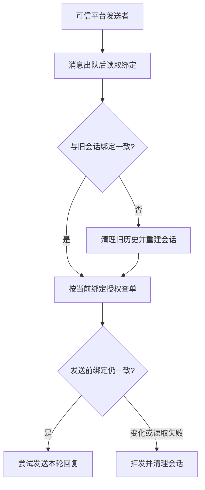

# 2.1 用户说“这是我的订单”，系统该相信吗？

小林说：“我是小周，帮我查他的订单。”系统不能因为这句话就换身份。还有一个更隐蔽的情况：账号原先绑定小林，后来改绑小周，聊天历史里却还留着小林的券信息。这时即使工具拒绝旧订单，模型仍可能复述旧聊天。

因此要沿两条线处理：查订单时核对当前归属，聊天入口在身份变化后更换会话，并在回复发送前再检查一次。

## 身份从哪里来

可信入口是系统接收到的平台消息信息，例如应用标识和发信人标识。QQ 接入层将二者组成 `identity`，业务绑定表再把它映射到客户。模型读到的用户自称、昵称、订单号或历史话术，都不能代替这个映射。

三个对象不要混淆：QQ 发信人是渠道中的人，客户是业务订单的所有者，订单号是被操作的对象。一个人知道某个订单号，不代表数据库允许他访问对应客户的数据。

| 输入 | 用途 | 能否授予订单权限 |
| --- | --- | --- |
| 平台消息的应用与发信人 | 找当前业务绑定 | 需要继续查绑定与归属 |
| 用户说“我是某客户” | 帮助理解诉求 | 不能 |
| 模型提交的订单号 | 定位候选订单 | 不能 |
| 当前绑定和订单所属客户一致 | 决定本次能否读取 | 可以进入受限读取 |



图 1：出队检查保护会话历史，工具查询检查订单归属，发送前再检查处理期间是否改绑。用户自称和旧聊天都不进入授权链。

## 工具不让模型选择身份

`get_order` 的参数只有 `orderId`，并拒绝额外字段；身份来自创建会话时的外层变量。执行体把二者分别交给 `store.getOrder(identity, orderId)`。因此，模型不能在工具 JSON 中补一个 `customerId` 给自己换身份。

但是，参数里没有客户 ID 还不够。如果 Harness 只在建会话时查一次客户，然后永久复用旧值，解绑就不能及时生效。授权服务要在每次执行中重新解析可信发信人，并用当前绑定核对订单。

```typescript
// src/coupon-store.ts · 身份与订单事实在同一个只读事务快照里读取
await connection.query(
  "SET TRANSACTION ISOLATION LEVEL REPEATABLE READ, READ ONLY",
);
await connection.beginTransaction();
started = true;
const asOf = new Date().toISOString(); // 记录本次读取的时间
// q 是账号绑定；只有与订单 o 属于同一客户，查询才会返回结果。
const rows = await this.select(`SELECT /*+ MAX_EXECUTION_TIME(3000) */
  o.id, o.status, o.total_cents, o.paid_cents, o.refunded_cents,
  o.created_at, o.paid_at,
  s.id AS shop_id, s.name AS shop_name, s.address, m.name AS merchant_name
  FROM orders o
  JOIN qq_identities q ON q.customer_id = o.customer_id
  JOIN shops s ON s.id = o.shop_id
  JOIN merchants m ON m.id = s.merchant_id
  WHERE o.id = ? AND q.app_id = ? AND q.sender_id = ?
  LIMIT 1`,
  // 订单号来自工具输入，应用和发信人来自可信入口；参数单独传入 SQL。
  [orderId, identity.appId, identity.senderId], connection,
);
const order = rows[0];
if (!order) throw notFound; // 无此订单和不属于当前客户，统一拒绝读取
```

关键就在连接条件：订单的客户必须与账号当前绑定的客户一致。知道订单号只是找到了候选对象，只有归属匹配才会拿到这一行。

接下来，商品、券、付款和退款历史也在同一快照中读取，避免一次返回拼出彼此不一致的事实。小林下一次办理时仍会重新查，因为券可能已经在这段时间被使用。

找不到或越权都走统一的不可查询回复。这样既不返回订单详情，也不通过不同错误提示透露别人的订单是否存在。数据库异常另转成受控错误，不把 SQL、连接地址和驱动诊断交给模型。

## 为什么授权检查不会自动清除旧聊天

假设小林第一轮查到的订单已经进入模型历史，随后管理员解除绑定。第二轮模型回答“你那张券还未使用”时，可能根本没调用工具。只在工具里拦截，无法阻止它复述旧输入。

同一 QQ 会话的消息按顺序排队，轮到当前消息时才核对绑定，并与会话保存的绑定快照比较。快照包含客户 ID 和绑定行 ID：客户相同但解绑重绑生成了新绑定行，也算授权关系变化。只比较客户 ID 会漏掉这种重新绑定。

```typescript
// src/qq-agent.ts · 出队时核对会话绑定
if (this.resolveBinding) {
  try {
    // 真正出队后才读取，覆盖排队期间发生的改绑。
    const current = await this.resolveBinding(msg);
    binding = current && { ...current };
    bindingReady = true; // 记住本轮已完成绑定读取，供发送前复核
  } catch {
    failed = true;
    modelTask.fail("authorization_failed");
    this.log("[agent] 会话身份读取失败；本轮尚未处理业务。");
    return;
  }
  if (this.closed || !validQQMessage(msg)) return;
  // 比较客户与绑定行；即使绑回同一客户，新绑定也会替换旧历史。
  if (conversation.session && !sameBinding(conversation.binding, binding)) {
    conversation.session.dispose();
    conversation.session = undefined;
    conversation.turns = 0;
  }
  conversation.binding = binding; // 留给本轮发送前再次核对
}
```

账号没有变化时保留上下文，用户可以继续说“这张券”。一旦改绑，就销毁旧会话再重建，避免把旧客户的聊天交给新客户。读取绑定失败时也会停止本轮。

把检查放在出队时有实际意义：消息可能在队列里等待，排队前的身份并不能代表开始处理时的身份。用户连续发了两条消息，管理员在两条之间改绑，第二条不能继承第一条的模型上下文。

## 生成期间发生变化，如何拦住旧回复

还有一个时间窗口：模型已经开始生成，管理员此时撤销绑定。开始处理时的检查已经通过，等模型结束再发送可能泄露旧结果。因此发送路径还要复核。

```typescript
// src/qq-agent.ts · deliverBound 在实际发送前复核绑定
if (this.resolveBinding) {
  try {
    const current = await this.resolveBinding(msg);
    // 与本轮开始处理时的绑定比较，发现变化就拒发旧回复。
    if (!bindingReady || !sameBinding(binding, current)) {
      failed = true;
      modelTask.fail("authorization_failed");
      this.log("[agent] 身份绑定已变化；未发送旧会话回复。");
      return "deferred";
    }
  } catch {
    // 查不到当前授权时，不使用之前的授权继续发送。
    failed = true;
    modelTask.fail("authorization_failed");
    this.log("[agent] 回复发送前身份读取失败；未发送。");
    return "deferred";
  }
}
```

假设模型生成到一半，账号被管理员改绑：发送前检查会拦住旧回答，并让后续清理销毁会话。如果绑定服务暂时不可用，也先不发。用户会少收到一次回复，但旧客户的信息不会因为一次读取故障而被继续使用。

| 时点 | QQ 接待层或工具的动作 | 为什么在这里检查 |
| --- | --- | --- |
| 消息出队后 | 读取当前绑定；若绑定变化，更换会话 | 排队期间身份可能已改变 |
| 模型开始处理 | 提供本轮可用的上下文 | 旧聊天不能继承授权 |
| 工具查询订单 | 按可信身份重新授权查单 | 模型选择的订单号只是输入 |
| 工具返回后 | 模型依据允许读取的事实生成回复 | 查询结果属于本次读取范围 |
| 回复发送前 | 再读绑定，一致才尝试发送 | 处理期间的解绑不能被忽略 |

## 用两条时间线检查理解

第一条：小林查过订单 1，管理员改绑后，下一条消息才出队。接待层更换会话，旧订单不会自动进入新历史；若模型再次查询订单 1，工具按新绑定核对归属。

第二条：小林发问，QQ 接待层检查通过，模型等待时管理员改绑。发送前复核发现不同，旧回答拒发。之前已经送给模型供应商的输入不能被这个检查撤回，所以处理前和发送前两处保护承担不同职责。

## 读取权限与操作许可仍要分开

查到本人订单只证明本轮可以看到订单事实，不表示已经获准联系商家或执行退款。用户选择订单卡也只是消除对象歧义。商家批准、退款方案展示和本人精确确认，都有自己的状态与适用对象，不能从一次成功查询继承出来。

因此同一可信身份会被传到不同业务服务，每个服务检查当前动作需要的条件。读取一笔订单与提交一次资金操作，即使拥有相同订单号，也不是同一种权限。这种分工让后续添加业务动作时仍能明确需要哪些前提，而不是依赖模型记住“用户已经通过验证”。

## 这套保护接受什么代价

正常发送回复的一轮需要额外读取绑定，绑定服务故障时宁可暂时停止，而不使用缓存授权。身份变化还会损失原聊天上下文，用户可能需要重述。这些代价换来清楚的失效行为。

仍有一个窗口：最后一次检查通过后，网络发送开始前，绑定还可能被撤销。两次检查之间改到别处又改回，也可能无法识别。当前方案用快照复核缩小风险，数据库与 QQ 发送之间没有跨系统原子事务。

网页也需要当前身份与历史归属检查，但浏览器角色选择不是生产登录。不同入口可以复用订单授权服务，同时分别实现自己的会话持有与发送检查，不能因为共享工具就省去入口边界。

## 练习与面试追问

为什么模型不能填写客户 ID？因为语言输入可以伪造，而授权必须来自可信入口和当前业务绑定。为什么每次工具重新授权仍不够？因为旧事实已经可能进入模型上下文，模型可以不调用工具直接复述。

请在时间线上标出“排队前”“真正出队”“工具查询”“准备发送”四个位置。分别插入一次解绑，说明哪一层会处理、哪些输入已经发出、哪里仍有快照窗口。能回答这些问题，比只说“做了鉴权”更准确。

## 参考资料与实现边界

源码入口为 `src/qq.ts` 的可信身份构造、`src/agent.ts` 的工具参数、`src/coupon-store.ts` 的订单读取、`src/qq-agent.ts` 的处理前及发送前绑定检查。

绑定与订单检查是项目业务实现；Pi 提供会话与模型循环。本文解释的是本项目的授权及上下文失效机制，不包含真实登录系统或跨系统原子撤权；本地检查和渠道实际送达分别判断。
