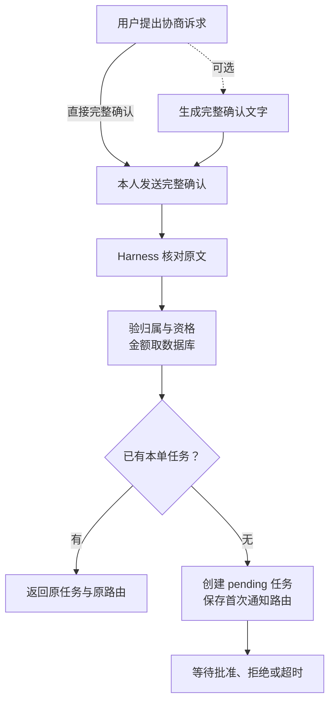

# 3.1 从“想退款”到联系商家，为什么还要确认？

## 从“能不能退”到“请帮我联系商家”

小林临时改变行程，向客服说：“我想退订单 1。”客服先查订单和规则，说明需要联系商家，并给出包含订单与原因的完整确认文字。小林发送这条确认后，系统才建立协商任务。

这里要分清三步：提出退款诉求、同意联系商家、同意执行退款。它们可能出现在同一段聊天里，却分别决定不同的业务动作。本课先看第二步：一次明确确认如何变成可持续查询的协商任务。



图 1：准备确认文字是可选帮助，用户的完整确认不能省略。重复请求保留首任务和原路由；商家结果不会自动发起退款。

## 先认识四个对象

| 对象 | 它保存什么 | 它不能替代什么 |
| --- | --- | --- |
| 订单 | 谁购买了哪张券、实付金额和使用状态 | 用户同意联系商家 |
| 可信身份 | 接入事件中的应用与发送者，再映射到客户 | 用户自己报出的客户编号 |
| 协商任务 | 订单、申请原因、申请额、处理状态与截止时间 | 退款操作 |
| 通知路由 | 原群、原消息编号与时间 | 任意群都可接收结果的许可 |

Harness 负责把输入、模型、工具和业务执行组织起来。本项目复用 Pi 的模型与工具循环，并实现业务接入和控制；Store 是负责读写业务存储的代码。模型可以解释规则、查询事实和准备建议，Harness 判断真实用户输入是否构成确认，Store 再检查当前订单能否申请。

每次业务读写都要把入口身份映射到当前客户，再核对订单归属。订单号是查找线索，不是密码；会话标识用于限制业务来源，也不是绕过归属检查的钥匙。历史聊天里出现过“这是我的订单”，不会改变数据库中的客户关系。

## 为什么准备建议和创建任务要分开

`prepare` 检查当前资格，返回应展示的金额与确认文字，但不创建任务。它让用户先理解申请对象和原因。`request` 才在事务中创建持久记录，只由收到实际用户原文的 Harness 入口调用。

小林也可以直接发送格式正确的完整指令，无需先经过一次 prepare。代码不会检查“历史里是否建议过联系商家”，而是检查这次原文是否明确、当前订单能否申请。准备步骤让用户先看清内容，写入条件由确认入口和存储共同保证。

普通“同意”缺少明确对象；模型生成同样的确认句也只是模型输出。若把模型工具里的 `confirmed: true` 当成授权，就等于让决定执行的人同时伪造用户同意。项目把确认函数排除在模型工具之外，避免这个循环。

```typescript
// src/after-sales-entry.ts · 真实用户消息的协商确认入口
export async function confirmMerchantReply(
  store: AfterSalesStore, identity: QQIdentity,
  sourceKey: string, text: string, route?: MerchantReplyRoute,
): Promise<Reply | undefined> {
  // sourceKey 标识售后来源，例如同一 QQ 群中的同一用户。
  // route 保存发送通知所需的原群、原消息及其时间。
  // 只去掉两端横向空白，保留换行和正文，避免把混合消息改造成确认。
  text = text.replace(/^[ \t]+|[ \t]+$/g, "");
  // 不是确认指令，就交回普通客服流程，不在这里创建任务。
  if (!text.startsWith("确认联系商家")) return undefined;
  // 从用户这一次发来的完整单行文字中提取订单与原因。
  const match = /^确认联系商家 (COUPON-\d{4}) 原因：([^\r\n]{1,200})$/u
    .exec(text);
  // 拒绝不可见控制字符和原因首尾空白，避免展示与解析不一致。
  if (!match || merchantReasonControls.test(text)
    || match[2] !== match[2]?.trim()) {
    return {
      kind: "notice",
      text: "请完整发送单行确认文字，例如："
        + "确认联系商家 COUPON-2001 原因：行程变化。"
        + "原因限1–200字；这只会发起模拟协商，不会执行退款。",
    };
  }
  try {
    // identity、sourceKey、route 由入口提供，不从这句话里猜。
    const task = await store.request(
      identity, sourceKey, match[1]!, match[2]!, route,
    );
    return { kind: "merchant_status", task };
  } catch {
    // 结果不明时提示用户查询任务，避免把已落库的申请说成失败。
    return {
      kind: "notice",
      text: "暂未能确认模拟协商结果，请核对本人订单和原确认文字，"
        + "或查询订单协商进度。"
        + "协商指令不会执行退款；退款状态请另行查询。",
    };
  }
}
```

比如只发“同意”、夹带第二行指令，或没有填写原因，都不会进入任务创建。通过格式检查后，存储服务还会用当前身份核对订单；解析出一个订单号本身不会获得权限。

这里限制原因长度和单行格式，是为了让展示内容与实际解析保持一致。更重要的归属、资格和金额检查继续放在存储层。

## 当前资格为什么必须由存储核验

创建申请前，Store 在事务中读取并锁住本次判断需要的事实：身份绑定、订单、商品明细、券、支付与已有退款。当前范围要求本人订单、全额支付、未退款、单张未核销且未过期的券。申请金额直接取订单 `paid_cents`，用户和模型都没有申请金额参数。

例如，用户说“我付了 99 元”，数据库记录为 79.80 元，不能因为用户表达自信就把申请额改为 99 元。又如，前一轮查询时券尚未使用，现在已经核销，创建申请时仍应拒绝；聊天中刚得到的事实也可能过期。

金额用整数“分”保存，7980 表示 79.80 元。整数分避免浮点表示误差，但不自动解决优惠分摊、多券退款等业务问题，因此项目没有把这些状态纳入当前写入范围。

## 重复确认怎样保持同一份申请

网络重发、用户连点或再次发送相同文字，都可能把同一个请求送进来多次。只在内存里记住“处理过”不够：程序重启后记忆会消失，多进程也可能各自认为没处理过。项目选择用订单唯一约束保留一份持久协商任务。

```typescript
// src/after-sales.ts · request 在事务中保存任务
// due_at 是预设商家回复时刻，deadline_at 是接受结果的截止时刻。
// 前者由场景延迟计算，后者固定为创建后 8 秒。
await connection.execute(`INSERT INTO merchant_requests
  (task_id, order_id, customer_id, identity_id, source_key, reason,
   amount_cents, mock_outcome, due_at, deadline_at)
  VALUES (?, ?, ?, ?, ?, ?, ?, ?,
    TIMESTAMPADD(MICROSECOND, ?, UTC_TIMESTAMP(3)),
    UTC_TIMESTAMP(3) + INTERVAL 8 SECOND)
  ON DUPLICATE KEY UPDATE task_id = task_id`,
  // 订单重复时保留原任务，不覆盖原因和期限
  [
    taskId, orderId, order.customer_id, order.binding_identity_id, sourceKey,
    reason.trim(),
    order.paid_cents, // 申请金额取当前实付，用户和模型不能指定
    order.outcome,
    Number(order.delay_ms) * 1000, // 合成商家场景的回复延迟，换算成微秒
  ],
);
```

小林重复发送确认，或者换个原因再发一次，仍会回到第一次创建的任务。代码随后读取原记录并核对客户和来源；原来的原因、金额、截止时间和会话不会被悄悄覆盖。

任务和通知路由在同一个事务里建立：要么二者一起保存，要么一起回滚。只有首次插入的 QQ 任务才记录路由，重复请求不能刷新原消息时间，也不能给原本没有 QQ 路由的任务补一条路由。

这也解释了“幂等”不等于每次都返回成功：重发时仍会检查当前资格，券已过期或已经退款就可能拒绝。只想知道原任务怎样了，应使用查询入口。

## 等待期间，聊天可以继续

任务状态从 `pending` 开始，后续可能变为 `approved`、`rejected` 或 `timed_out`，分别代表同意、拒绝和超时。后台 worker 定期处理到期任务；它不需要把原用户请求一直挂在那里等待。原会话可以继续询问别的订单，协商事实则留在数据库中。

本项目的商家回复来自预设合成场景，用于演练异步状态和失败恢复，没有真实商家外呼。真实执行的部分是任务持久化、资格检查、状态更新、查询与通知边界。批准结果也不会主动变成退款；用户还要请求具体方案、看到方案并精确确认。

聊天可以前进，后台任务继续等待；任务完成只产生一个结果事件，不替用户发起下一次资金操作。

## 用三条路径检验理解

正常路径：本人有效订单 → 完整联系商家指令 → 返回待处理任务 → 稍后查到同意 → 用户另行请求退款方案。每一步都能指出输入、输出和状态变化。

重复路径：同会话再次提交不同原因 → 当前资格仍满足时返回首任务 → 原因与截止时间保持最初值。这里保护的是原申请，若产品未来需要撤回、修改或重试，必须另建明确状态，而不是偷偷覆盖旧行。

拒绝路径：另一个客户猜到订单号，或者原客户的券已经核销 → 存储资格检查失败 → 不创建新任务。回复可以说明无法处理，但不能泄露他人的订单详情。

练习：把“模型建议联系商家”“用户完整确认”“商家批准”“用户确认退款”写在四张纸上，分别放在时间线上。只有第二张会创建协商任务；第三张提供后续资格；第四张才可能触发已展示方案的执行。能解释这四张纸，就理解了为什么一个聊天机器人需要业务状态机。

## 方案取舍

按订单只保留一份任务，状态简单，容易复现，也便于解释重复消息。代价是不能直接支持多轮重新协商。异步 worker 让用户无需一直等待，但增加了截止时间、结果查询和通知失败的处理。完整指令稍显严格，却能让对象和原因明确，避免把含糊同意升级成写入。

项目复用了 Pi 的循环与会话生命周期；个人实现集中在 Harness 确认入口、可信身份、当前资格、事务任务和后续恢复。理解这些约束，比记住工具或框架名字更有助于回答“为什么模型说能退，代码仍然拒绝”。

## 参考资料与实现边界

- 实现位置：`src/after-sales-entry.ts`、`src/after-sales.ts`、`src/qq.ts`。
- 复现资料：`docs/after-sales.md`；工程检查入口为 `scripts/merchant-agent-check.ts`、`scripts/merchant-db-check.ts`。历史结果与运行配置保留在项目资料中，不要求先读才能理解本课。
- 订单、商家结果与资金均为合成数据；没有真实商家或支付交易。本文是教学整理，没有新增模型、数据库或 QQ 验收。
