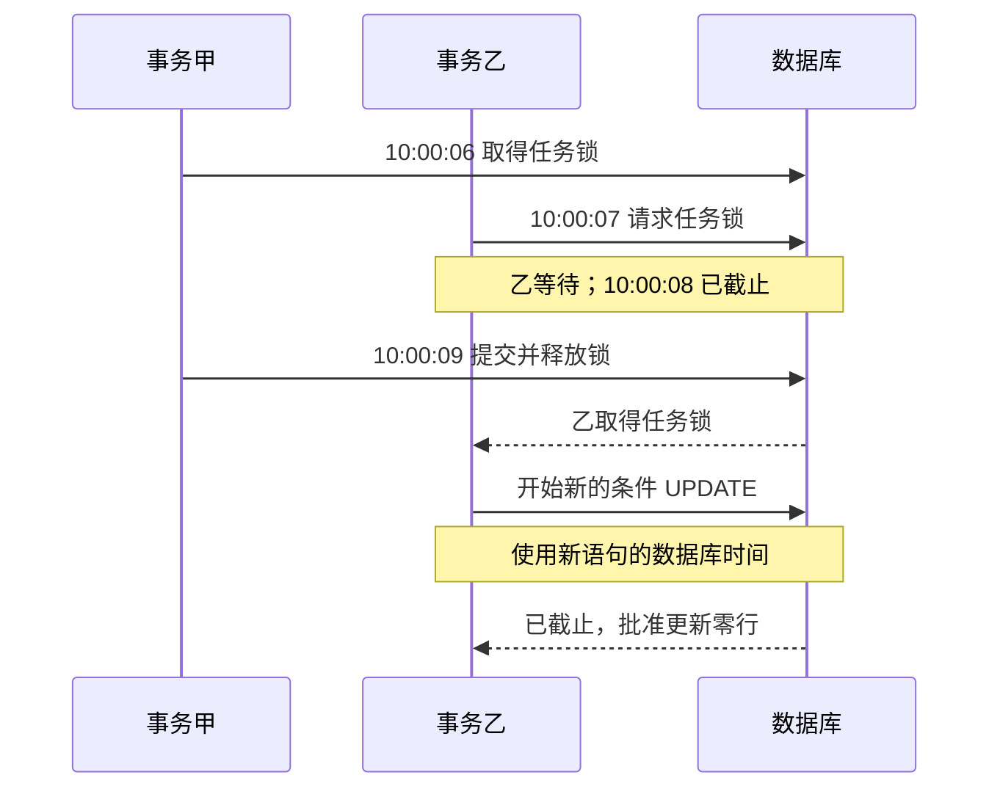

# 3.2 拿到数据库锁后，为什么还要检查截止时间？

## 发出请求时没过期，拿到锁时呢

商家协商任务约定了处理截止时间。某次“同意退款”的结果在截止前来到服务端，但数据库中该任务正被另一事务锁住。结果处理只能等待。等锁释放时已经过了截止，程序还能接受这次同意吗？

按当前规则，答案是不能：任务在真正判断时必须仍未截止。问题出在时间读取的位置，而非模型理解。行锁决定谁先修改，取锁后的时间复核决定轮到它时还能不能修改。

结果到达、开始等待、拿到锁与完成判断是不同时间点。阅读本课时，把这四个点分开。

## 用一条时间线看见错误

假设任务截止时间为 10:00:08。事务甲在 10:00:06 锁住任务，事务乙在 10:00:07 开始处理批准结果，直到 10:00:09 才获得锁。

| 时间 | 发生的事 | 需要回答的问题 |
| --- | --- | --- |
| 10:00:07 | 乙开始更新语句 | 此时尚未截止，但能修改吗？ |
| 10:00:07～09 | 乙等待甲释放锁 | 业务时间继续前进 |
| 10:00:09 | 乙获得锁 | 现在已经截止，还能用两秒前的时间吗？ |
| 之后 | 乙决定更新或拒绝 | 必须使用约定的业务判断点 |

在 MySQL 中，当前时间函数在一条语句执行期间保持该语句的时间语义。把 `deadline_at > UTC_TIMESTAMP(3)` 写在会等待行锁的同一条更新里，不能因此假设时间会在拿到锁后自动刷新。这里的陷阱是“条件写了”与“条件在正确时点计算了”不是一回事。

也不要简单改成应用程序提前生成 `Date.now()`。应用时钟与数据库时钟可能不同，锁等待仍然存在；换一个时间来源没有消除检查与使用之间的间隔。

## 先理解三个术语

**行锁**限制同一数据库行的并发修改。在事务里使用 `SELECT ... FOR UPDATE`，取得目标任务的排他锁，其他冲突修改需要等待。

**事务**把一组数据库动作作为一个提交单位。锁在事务结束时释放；查询、条件更新与提交必须使用同一个连接，否则先拿到的锁并不能保护后面另一连接执行的修改。

**业务判断点**是规则规定的时间基准。这里选择任务锁已取得之后的更新语句时间。它不等于请求接收时刻，也不等于事务最终提交时刻。先说清时间规则，才知道测试应该跨越哪个边界。

## 核心代码：拿到锁后，再开始判断语句

`applyResult` 的输入是任务编号、订单号、结果状态与批准金额。进入事务前先检查格式；批准金额必须是正整数分，拒绝结果不应携带批准金额。随后执行下面的关键片段。

```typescript
// src/after-sales.ts · applyResult，输入校验通过后进入事务
return this.transaction(async connection => {
  // 先等待并取得这条任务的锁，这条语句只负责取锁。
  await connection.execute(
    "SELECT task_id FROM merchant_requests "
      + "WHERE task_id = ? AND order_id = ? FOR UPDATE",
    [result.taskId, result.orderId],
  );
  // 取锁后另起 UPDATE，让截止判断使用这条新语句的数据库时间。
  const [changed] = await connection.execute<ResultSetHeader>(
    `UPDATE merchant_requests
    SET status = ?, approved_amount_cents = ?, completed_at = UTC_TIMESTAMP(3)
    WHERE task_id = ? AND order_id = ?
      AND status = 'pending'
      AND deadline_at > UTC_TIMESTAMP(3)
      AND (? IS NULL OR ? <= amount_cents)`,
    [result.status, result.approvedAmountCents, result.taskId, result.orderId,
      result.approvedAmountCents, result.approvedAmountCents],
  );
  return changed.affectedRows === 1; // 只有确实更新一行，才表示采纳了结果
});
```

回到 10:00:07 到达、10:00:09 取锁的例子：第一条语句结束后才开始 UPDATE，此时再算时间，批准就会因为已截止而被拒绝。同时，状态、任务、订单和金额条件也仍要满足。

更新零行可能是任务已结束、已截止，或者金额不合规。调用方应据此读取当前状态，不能统一解释为数据库故障。非法输入则会在进入这段事务前被拒绝。

代码中的严格大于也有业务含义：当前时间恰好等于截止时间时，不接受结果。边界不应由前端显示精度决定；显示到秒，不代表存储中的毫秒可以随意忽略。

## 已过期任务由谁收尾

拒绝迟到批准，只说明不能把这条结果写成成功。任务仍可能暂时保留 `pending`，需要后台处理器将到期任务转为 `timed_out`。项目的 `processDue` 先处理超时，再挑选已到模拟回复时间但尚未截止的任务。

```typescript
// src/after-sales.ts · processDue 先收尾到期任务
const [expired] = await this.pool.execute<ResultSetHeader>(
  `UPDATE merchant_requests
  SET status = 'timed_out', completed_at = UTC_TIMESTAMP(3)
  WHERE status = 'pending' AND deadline_at <= UTC_TIMESTAMP(3)`);

// 再找已到回复时间 due_at、仍未到截止时间 deadline_at 的候选。
const [rows] = await this.pool.query<RowDataPacket[]>(`
  SELECT task_id, order_id, mock_outcome, amount_cents
  FROM merchant_requests
  WHERE status = 'pending' AND mock_outcome <> 'timeout'
    AND due_at <= UTC_TIMESTAMP(3) AND deadline_at > UTC_TIMESTAMP(3)
  ORDER BY due_at LIMIT 100`);
```

候选读出后，worker 逐个调用前面的 applyResult。排进候选列表只说明扫描时满足条件，等待锁的过程中仍可能截止，所以最后判断必须留在事务中。

这体现了一个通用模式：批量查询负责找“可能需要处理”的对象，单项提交负责判断“此刻是否仍允许处理”。把所有资格只放在批量扫描阶段，一旦扫描与更新之间有延迟，就会留下竞争窗口。



图 1：时间会在等锁时继续前进。先取锁，再启动新的判断语句；取锁后的判断仍在截止前，且其他条件满足时，才可更新。

## 状态条件如何阻止重复结果

两个 worker 都读取到同一候选时，可能同时尝试批准。第一个获得锁并把状态改成 `approved`，第二个之后获得锁，仍会重新看到任务已经不在 `pending`，因此更新零行。锁和条件共同作用：锁让两个修改串行，状态条件让后来的请求知道业务已经结束。

超时与批准也遵守这组条件：超时先把状态改成 timed\_out，迟到批准就更新不了；批准先成功，后来的超时更新也会跳过它。终态因此不会被后来的处理随意覆盖。

拒绝结果也要经过截止和等待状态检查。不能认为“拒绝不会退钱，所以可以随时覆盖”：终态反复变化会让用户看到互相矛盾的通知，也会破坏后续退款资格的解释。

## 退款方案也会遇到同一种时间问题

另一个场景是用户确认退款方案：方案还有几百毫秒有效，但在等待订单、券或批准记录的锁时已经过期。如果只相信第一次查询计算出的 `valid`，仍然可能接受过期确认。项目在相关锁检查完成后，单独读取数据库当前时间再判断。

```typescript
// src/refunds.ts · decisionTime，在资格与授权所需的锁都取得之后调用
const [rows] = await connection.query<RowDataPacket[]>(
  "SELECT UTC_TIMESTAMP(3) AS decision_at",
);
const now = rows[0]!.decision_at as Date; // 后续检查与记录共用这次数据库时间
// existing 是已有退款方案，coupon 是当前券；两者各有自己的有效期。
if (existing && (existing.expires_at as Date).getTime() <= now.getTime()) {
  throw new BusinessError("退款方案已过期，请重新获取方案并确认新的操作编号。");
}
if ((coupon.expires_at as Date).getTime() <= now.getTime()) {
  throw new BusinessError("团购券已过期，请联系人工客服。");
}
return now;
```

同一个原则也保护退款确认：用户点确认时还有效，排队等锁后却可能过期。把时间复核放在这些锁之后，才不会沿用等待之前的判断。

## 先区分“超时”和“执行失败”

任务超时是一个可解释的业务终态：在约定窗口内没有采纳有效结果。数据库连接失败则是基础设施异常，调用者可能尚不确定任务是否变化。前者可以按已记录状态告诉用户，后者应先查询或保留未知，不能为了给出明确答案而统一写成“商家拒绝”。状态命名应描述实际发生的事，而不是描述程序希望它发生什么。

## 如何设计能抓住问题的检查

只测试“早一分钟同意成功”和“晚一分钟同意失败”，会漏掉本课的缺陷。关键检查必须让时间跨过等待窗口：一个连接先锁住任务；另一连接在截止前启动结果处理；确认它正在等待；经过截止后释放第一个连接；最后断言迟到结果没有写入。

对照场景则在截止前释放锁，允许符合条件的结果成功。还要检查恰好截止、已是终态、任务与订单不匹配、批准金额超过申请额。测试关心的是状态和金额实际如何变化，而不是只检查日志里有没有“超时”两个字。

这种检查需要真实数据库锁语义。内存替身可以验证调用顺序，但如果它不会阻塞，也没有数据库时间函数的行为，就无法证明本课的竞争窗口已被覆盖。合成订单不妨碍验证真实锁等待；合成商家结果也不会因此成为真实商家验收。

## 取舍与练习

先锁后判断多了一条数据库语句，也可能等待更久；收益是把时间规则放到明确位置，便于推理和复现。当前规则接受判断点有效的结果，提交可能发生在稍后。如果业务要求“必须在截止前完成提交”，就需要另定更严格的时间要求，本课代码没有提供这个承诺。

练习：分别写出“以接收时刻为准”“以取锁后判断时刻为准”“以提交时刻为准”三条产品规则。对同一条 10:00:07 到达、10:00:09 取锁的结果判断是否接受，再指出各自要记录或校验的时间。不要先挑实现，再含糊地补一句“支持超时”。

## 参考资料与实现边界

- 实现位置：`src/after-sales.ts` 的 `applyResult`、`processDue`，以及 `src/refunds.ts` 的 `decisionTime`。
- 专项复现入口：`scripts/merchant-deadline-lock-db-check.ts`；锁等待场景与局限记录在 `docs/after-sales.md`。本课没有重新运行数据库检查。
- 本文解释当前判断点与迟到拒绝机制，不把它扩大成提交时刻保证、完整分布式仲裁或真实商业验收。
