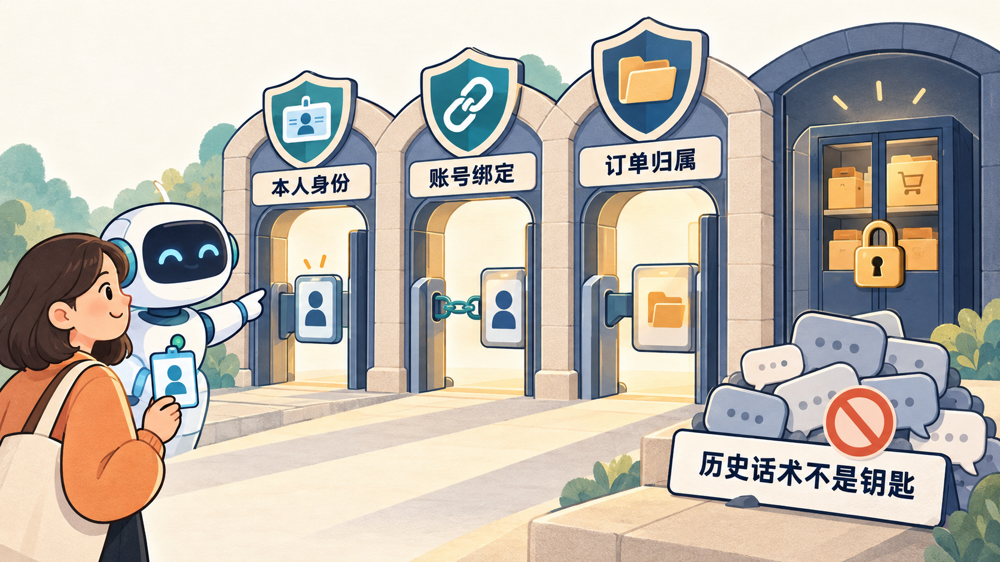
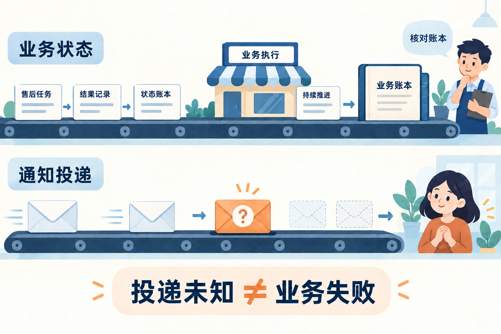

# 3.4 商家晚到的回复，怎样通知到正确的人？

## 商家回复了，怎样通知到正确的人

小林在群里确认联系商家处理订单 1，随后开始咨询订单 2。几秒后，订单 1 的商家结果来了。通知要送回原会话，并明确说这是订单 1 的结果；它不能替小林切单，也不能顺便替他确认退款。

通知还可能遇到程序重启、队列拥挤、账号重新绑定，以及“发送接口报错但平台可能已收到”。因此，**业务结果是否成立、谁可以读取结果、是否已经尝试发送**需要分别记录。用一个“完成”字段混在一起，无法解释到底成功了哪一步。

后台任务与正在进行的聊天相互独立。结果事件只说明指定任务结束，不代表用户同意下一步操作。

## 两种状态机，各自回答一个问题

协商任务的 `pending / approved / rejected / timed_out` 回答商家协商发生了什么。通知记录则回答这次主动发送走到了哪里。

| 通知状态 | 含义 | 自动再次发送？ |
| --- | --- | --- |
| `pending` | 还没有取得发送权 | 条件仍满足时可以继续调度 |
| `claimed` | 某次处理已唯一领取 | 不再自动领取 |
| `sent` | 发送及相关交付步骤返回成功 | 不重发 |
| `deferred` | 本次发送条件不满足而结束 | 不重发，用户可主动查询 |
| `unknown` | 尝试发送后无法确认结果 | 不重发，避免重复送达 |

`busy` 是调度返回值，不是上述持久终态：队列满时尚未领取，可保留 `pending` 等下次有位置再处理。已经领取后进程崩溃，则会留在 `claimed`，项目同样不自动重试。这个取舍宁可少一次主动提醒，也避免无法确认的重复发送。

不要把这种设计叫作“消息保证只送达一次”。它约束的是每条通知最多一次主动尝试；网络和平台仍可能产生无法观察的结果，主动提醒也可能丢失。

## 通知收件位置和消息编号从哪里来

首次用户完整确认时，QQ 确认入口把原群、原消息编号与时间和任务一起保存。后续通知使用这份路由，不能由模型任意指定收件群，也不能让重复确认刷新原消息时间。

通知只能在本机接入规则允许的原消息窗口内发送，入口还会检查群白名单与路由一致性。消息太旧或群不再允许，不能伪造一个新时间绕过限制。窗口只是发送条件，绝不改变协商终态；不能因为无法通知就把商家批准改成失败。

`sourceKey` 把应用、发送者与会话关联起来，防止跨会话沿用申请。真正授权仍需数据库检查：当前账号绑定、客户、订单归属和精确任务都要一致，不能仅相信这个关联值。

## 先排队，轮到时再唯一领取

后台扫描只能找到候选，候选可能已经被另一进程处理，也可能在等待中失去资格。项目让通知进入与用户消息相同的会话队列，在实际开始处理时才领取。

```typescript
// src/merchant-notifications.ts · 先进入会话队列，出队后才运行回调
// item 是待通知记录；msg 按其中保存的原群、原消息和发送者构造。
outcome = await agent.resumeMerchant(msg, async () => {
  // claimed 记住本次已领取；发送前再次执行回调时，只重查任务。
  if (!claimed) claimed = await store.claimNotification(item.taskId, appId);
  if (!claimed) return undefined;
  const task = await store.getTask(
    { appId, senderId: item.senderId },
    item.sourceKey,
    item.orderId,
    { referenceTaskId: item.taskId }, // 必须是这条通知对应的精确任务
  );
  return task?.taskId === item.taskId && task.status !== "pending"
    ? task : undefined;
});
```

领取成功后，当前身份还必须有权读取这条精确任务。账号改绑、任务不匹配或仍在等待，都会让本次通知停止。发送前再次进入回调时无需重新领取，但仍要重查授权与结果。

这段代码之所以把领取放在回调里，而不是扫描后立刻改状态，是因为队列可能没有位置。若排队前就领取，连排队都没成功的通知也会消耗唯一尝试机会，增加不必要的丢失。

## 数据库领取如何挡住并发发送

两个进程都扫描到同一条 `pending` 很正常。安全不来自“扫描时没有别人在发”，而来自数据库中的条件更新只允许一方获胜。

```typescript
// src/after-sales.ts · claimNotification 用一次条件更新决定谁取得发送权
const [changed] = await this.pool.execute<ResultSetHeader>(
  `UPDATE merchant_notifications n
  JOIN merchant_requests r ON r.task_id = n.task_id
  JOIN qq_identities q
    ON q.id = r.identity_id AND q.customer_id = r.customer_id
    AND q.app_id = n.app_id AND q.sender_id = n.sender_id
  JOIN orders o ON o.id = r.order_id AND o.customer_id = q.customer_id
  SET n.status = 'claimed', n.claimed_at = UTC_TIMESTAMP(3)
  WHERE n.task_id = ? AND n.app_id = ?
    AND n.status = 'pending' AND r.status <> 'pending'`,
  [taskId, appId],
);
// 同时匹配通知、任务、当前绑定和归属，且确实更新一行，才算领取成功。
return changed.affectedRows === 1;
```

两个进程都扫描到这条通知，也只有一个能把 pending 改成 claimed。后一个更新零行就退出。扫描期间发生的绑定和状态变化，也会在这次更新中重新核对。

通知身份关联到创建任务时的绑定记录，并再次核对客户。一个 QQ 账号后来改绑，不应继续拿到原客户的售后结果。用户文字声称“还是我”或模型记忆里的旧客户名字，都不能代替当前绑定。



图 1：本人身份、账号绑定和订单归属共同约束访问范围，历史话术不能作为授权凭据。

## 等模型和队列之后，还要再检查一次

即使出队时授权有效，在准备回复期间也可能发生改绑。`deliverMerchant` 在发送前再次调用同一个解析回调，读取当前任务；随后 `deliverBound` 再比较本轮绑定快照。任何一次读取失败都保守拒发，不能为了“保证通知成功”绕过授权。

```typescript
// src/qq-agent.ts · 发送前重新核对通知内容
const deliverMerchant = async (): Promise<ContinuationOutcome> => {
  setPhase("authorization");
  let current: MerchantTask | undefined;
  // resolve 就是前面传给 resumeMerchant 的回调，会重查授权与任务。
  // merchant 是出队时读到的任务，current 是这次发送前重读的结果。
  try { current = await resolve!(); } catch {
    modelTask.fail("authorization_failed");
    this.log("[agent] 通知发送前授权读取失败；未发送。");
  }
  // 缺少任务、仍在等待，或任务/订单换了，都不能继续发送。
  if (!merchant || !current || current.status === "pending"
    || current.taskId !== merchant.taskId
    || current.orderId !== merchant.orderId
    || this.closed || !validQQMessage(msg)) {
    failed = true;
    modelTask.fail("authorization_failed");
    return "deferred";
  }
  merchant = current;
  // 固定回复使用当前任务；deliverBound 还会复核绑定。
  return deliverBound({ kind: "merchant_status", task: current });
};
```

这样，即使模型写出了别的金额，通知仍按重新读到的当前任务生成。它始终指向原任务和原订单；模型文字不能决定收件对象、批准状态或金额。

末次读取与网络发送之间仍有很短的间隔，这不是数据库与 QQ 的原子事务，不能保证授权撤销与发送完全同时生效。项目通过多次读取缩小窗口，并在发现变化时拒发；不能将它描述成无条件实时撤回所有已发内容。

## 切单为什么不能改变结果的对象

订单 1 的事件有自己的任务和订单，即使小林现在正在聊订单 2，也只说明订单 1 的协商结果。事件以系统业务消息写入历史，不冒充用户发言，更不会成为退款确认。

默认通知直接使用固定模板，不需要模型。显式启用模型事件路线时，也只临时保留三个只读工具：

```typescript
// src/qq-agent.ts · 保存原集合，通知期间只保留已开放的只读工具
activeTools = session.getActiveToolNames();
session.setActiveToolsByName(activeTools.filter(name =>
  ["get_order", "search_faq", "get_merchant_request"].includes(name),
)); // 使用交集，既不能创建申请，也不会补开原本不存在的能力
```

协商查询需要前两个工具，是因为它内部会重新读取订单和规则：

```typescript
// src/agent.ts · get_merchant_request 的执行函数
async (_id, { orderId }, signal, _update, ctx) => {
  const turn = currentTurn, revision = turn.revision;
  await orderRules(ctx, orderId, signal); // 用本轮本人订单逐个查询商品适用规则
  assertCurrent(turn, revision, signal);
  const value = await afterSales.store.getTask(
    identity, afterSales.sourceKey, orderId, // 按可信身份、会话和订单查询
  ) ?? null;
  // 读取期间取消或失效，旧结果不能继续使用
  assertCurrent(turn, revision, signal);
  return {
    content: [{ type: "text", text: JSON.stringify(value) }],
    details: {},
  };
}
```

前置失败就不继续读任务，等待期间失效也不会接纳迟到结果。内层工具留下真实的父子调用事件，便于追查失败发生在哪一步。最终通知仍由发送入口重查精确任务并生成固定回复。

临时工具集合只是原集合的交集，不会补开未注册能力。成功结束后恢复原工具集合，失败时清理会话；两条通知路线都不能创建新申请或准备退款。想继续执行，用户必须另行提出请求，再经过方案展示和确认。



图 2：业务状态和通知投递走两条线。投递结果未知时，应核对持久账本，不能自动认定业务失败。

## 发送不明为什么不能重试

假设平台已接收消息，但响应在回程中丢了。服务端看到异常，若直接重发，用户可能收到两条相同结果。反过来，如果平台确实没收到，不重发就会少一条提醒。当前实现选择记录 `unknown`，保留业务结果，让用户按订单主动查询。

这条选择使失败恢复简单且可解释：查询是只读且会重新授权，重复查询不会重复退款。若将来要求更强的通知可靠性，需要平台可核验的去重键、回执或明确重试规则；其中回执必须说明确认的是平台接收、客户端显示还是用户已读，不能混为一谈。不能把一个定时循环加长就叫可靠投递。

正常路径是任务结束 → 排队 → 唯一领取 → 重新读取 → 原路发送 → 记为 `sent`。拥挤路径是在领取前返回 `busy`，保留待处理。身份变化路径是拒发并结束本次通知。发送异常路径是记录 `unknown`，转向查询。每条路径都保留任务原来的业务结果。

## 查询怎样补上丢失提醒

用户主动询问某订单的协商进度时，程序重新授权读取持久任务。它不依赖通知是否记为 `sent`，也不需要先把 `unknown` 改成成功。任务已经批准就说明批准，任务超时就说明超时；如果归属不再允许读取，则拒绝展示。这样，业务真相始终以任务记录为准，通知表只负责描述交付过程，不反过来决定事实。

## 练习与取舍

练习一：让两个 worker 同时读到同一候选，指出究竟哪一条 SQL 决定只有一个能发送。练习二：把账号改绑定在“扫描后”“排队后”“发送前”三个位置，说明下一次检查应阻断什么。练习三：程序在领取后、发送前崩溃，解释为何查得到批准但没有主动通知。

持久通知表和唯一领取增加了状态管理，却换来了清楚的并发及恢复边界。复用现有会话队列避免同一个人的消息随意交错；保留主动查询则为缺失通知提供一条不依赖历史聊天的恢复路径。

## 参考资料与实现边界

- 实现位置：`src/merchant-notifications.ts`、`src/after-sales.ts`、`src/qq-agent.ts`、`src/agent.ts`。代码节选保留领取、发送前复核和通知工具前置的关键段。
- 复现资料：`docs/after-sales.md`；检查入口 `scripts/merchant-notification-agent-check.ts`。工程替代发送、数据库检查与真实 QQ 送达各有不同范围。
- 当前每任务最多一次主动通知尝试，未知不自动重发；这不是网络恰好一次送达保证。本文没有重新开展平台验收。
