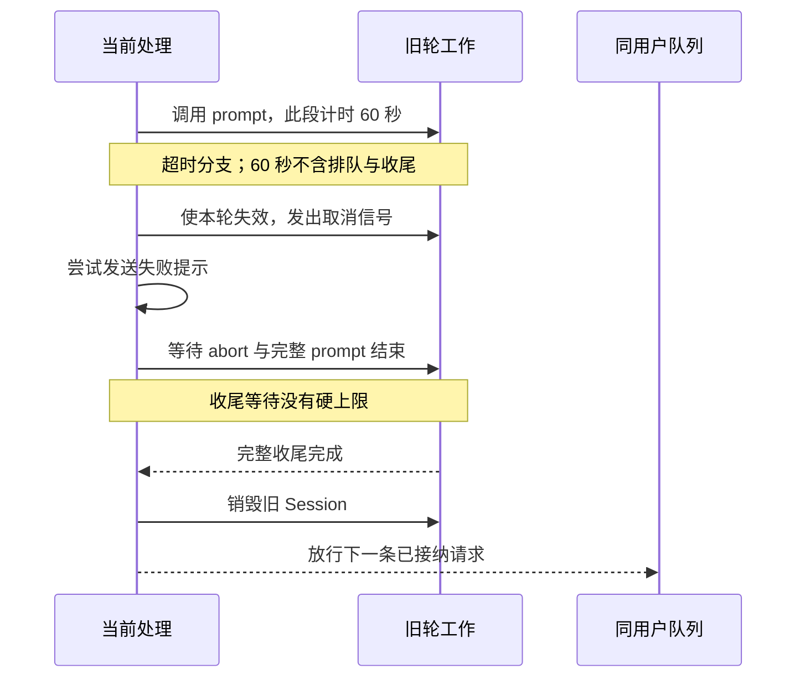
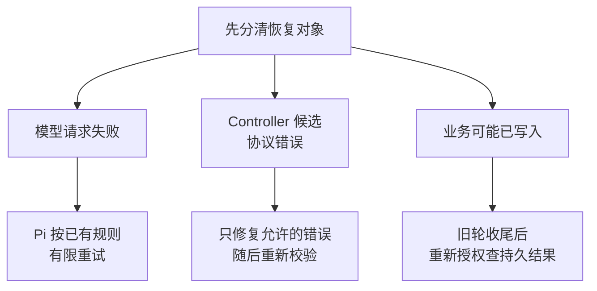

# 3.5 请求超时后，怎样取消并接着处理下一条？

## 同一个人按顺序处理，不让整群一起等

小林刚发出退款确认，紧接着问“进度怎样”。如果进度查询先开始，就可能读到确认前的旧状态。与此同时，小周也在群里询问自己的券，不应因为小林的模型请求很慢而一起被挡住。

项目按“群＋发送者”划分会话队列：同一对话的已接纳请求排队，不同用户使用不同队列。这里解决的是调度顺序；谁能读订单、是否可以退款，仍由业务存储验证。**队列不会赋予权限，也不代替数据库幂等。**

小林自己的请求按顺序走，小周有独立队列。即使小林这一轮很慢，也不该把整群的接待堵住。

## Session、队列、退款记录有何不同

`Session` 承载模型对话历史与一次次工具循环，项目复用 Pi 管理这些生命周期。队列则决定某个 Session 下一次何时开始工作。退款结果保存在数据库里，决定钱和券的业务状态。

| 对象 | 当前保存位置 | 重启后的含义 |
| --- | --- | --- |
| 会话队列 | 进程内存 | 未处理工作不会自动恢复 |
| QQ 模型历史 | 当前进程的 Session | 不自动完整恢复旧聊天 |
| 协商、退款操作 | 数据库 | 重新授权后仍可明确查询 |

程序重启导致用户需要重述订单，不等于已经提交的退款消失。相反，销毁旧模型历史也不是撤回业务操作的方式。把这三类状态拆开，才能正确回答“取消后还能退款吗”“重启后为什么查得到结果”。

本节的队列和内存历史指 QQ 接待入口。网页公开聊天另有 SQLite 持久记录和授权回访，不能把 QQ 的内存边界扩写成“所有入口都没有持久历史”。

## 用 Promise 链保持顺序

一个队列不一定需要新框架。项目给每个会话保存一个 `tail`，表示目前已接纳工作的尾部 Promise。新工作通过 `tail.then(...)` 接在后面，上一项完成后才进入本项；不同键拥有不同尾部，因此彼此不会共用同一条等待链。

```typescript
// src/qq-agent.ts · pending 包括正在处理与已排队的请求
// 有 resolve 回调表示商家通知；普通用户消息没有这个回调。
if (entry.pending >= 3) {
  if (resolve) return "busy"; // 商家通知尚未领取，下次再调度
  await this.deliver(msg, "你的消息仍在处理中，请等待回复后再发送。");
  return "busy";
}
entry.pending++; // 接纳后才增加计数
const conversation = entry;
let outcome: ContinuationOutcome = "deferred";
const queuedAt = Date.now(); // 记录入队时刻，出队后另算 queueMs
let queueMs = 0;
```

接纳后，实际处理接在 entry.tail.then(...) 后面，前一项完整结束才轮到这一项。第三条以内会排队，第四条收到忙碌提示；通知事件则把 busy 返回调度器，等有位置再试。

出队时才建立 withModelTask：本条消息或事件共用一份模型预算与完成记录，排队耗时单独计为 queueMs，交付结果记为 delivery。后面介绍的 60 秒计时器只包住模型 prompt，不包含排队。

这意味着“已接纳请求有序”，不能说“所有可见回复都严格先进先出”：第四条忙碌提示可能先于第一条慢请求的正式回复出现。把超额消息也无限加入队列，会让等待越来越长，并可能超过平台可回复窗口，因此项目明确限制积压。

会话容量和空闲清理同样有界：当前最多保留二十个会话，长时间空闲后会回收，轮数过多时重新创建 Session。这些是小规模接入的简化选择，并非跨进程队列或持久会话系统。

## 等待中变化的条件，出队后要重看

一条消息进队时有效，等到出队时可能已经太旧或服务已关闭，所以执行前再次检查。业务 QQ 入口还向队列注入 `resolveBinding`，用于读取当前账号绑定：若绑定与旧 Session 保存的不一致，就销毁旧历史，再为当前绑定创建会话。这个保护依赖入口实际提供读取函数，不能只看到队列类有一个可选参数就认为所有构造方式都已启用。

发送前同样重新核对绑定，防止排队或模型等待期间发生改绑后仍发送旧客户内容。历史清理与发送前校验配合，分别解决“旧上下文进入新客户对话”和“旧回复向变化后的身份发出”。业务工具自身仍会重新授权，不能因为队列刚检查过就取消工具边界。

创建 Session 后，QQ 接待层先尝试处理完整确认、固定咨询与选单等入口。已有固定回复时直接交付，并以不触发新生成轮的消息记入历史。普通问题才调用 Pi 的 `prompt`。因此不是每条客服消息都需要远程模型推理。



图 1：60 秒只包住 prompt。超时后先取消，再等旧轮完整收尾，才销毁会话并放行下一条；已经提交的业务结果仍保留。

## 超时到底限制了哪一段

当前默认六十秒计时器围绕 `session.prompt`，它和实际调用在 `Promise.race` 中竞争。

```typescript
// src/qq-agent.ts · 两个 Promise 竞争，先完成的决定本次等待结果
prompting = session.prompt(prompt, { expandPromptTemplates: false });
await Promise.race([
  prompting,
  new Promise<never>((_resolve, reject) => {
    timer = setTimeout(() => {
      modelTask.cancel(); // 超时先阻止本轮继续发起受控模型请求
      reject(new Error("模型处理超时"));
    }, this.timeoutMs);
  }),
]); // race 返回不会自动终止另一项，失败路径还要等待旧 prompt 收尾
```

模型先结束，就继续整理结果和发送；计时器先到，就进入取消与清理。用户总等待还包含排队、建会话、业务回调、发送和取消收尾，因此可能超过 60 秒。

`Promise.race` 只决定哪个结果先返回，不会自动停止另一个 Promise。计时器获胜时，旧模型请求或工具仍可能运行。如果马上允许下一轮使用同一 Session，两轮可能改写同一历史、读取旧上下文或互相覆盖输出。

## 先发取消，再等旧轮真正结束

失败分支先调用 `cancelSupportTurn` 和 Session 的 `abort()` 发出停止信号，再尝试发送明确的失败提示。取消信号不能等 QQ 发送完成后才发，否则网络发送一旦卡住，旧模型还会继续工作。

最后的收尾等待两件事：Pi 的取消结束，以及完整 `prompt` Promise 结束。后者很重要，因为 Harness 包装的结果整理可能在 Pi 已空闲后仍未完成；只等“模型不再生成”不等于整个调用已经收尾。

```typescript
// src/qq-agent.ts · 失败后先让旧会话完整停止，再允许下一项开始
// aborting 保存已发出的取消请求；prompting 保存完整处理任务。
if (failed && conversation.session) {
  try {
    if (!aborting) {
      cancelSupportTurn(conversation.session); // 取消业务轮次
      aborting = conversation.session.abort(); // 向 Pi 发出取消信号
    }
    await aborting;
  } finally {
    // Pi 空闲后，外层结果整理仍可能没结束；必须等待完整 prompt。
    await prompting?.catch(() => {});
    conversation.session.dispose();
    conversation.session = undefined;
    conversation.turns = 0;
  }
}
```

完整任务的 finally 最后减少 pending 并更新活跃时间，队列尾部再接住任务异常并记录受控诊断。这样旧轮未收尾时，下一条不会抢跑；旧轮失败后，下一条也不会因一个拒绝的 Promise 永远跳过。

这段等待没有硬上限。若某个供应商不配合取消，或工具已经进入不能立即中断的操作，收尾可能继续等待。提前返回超时提示只是改善用户感知，不表示底层请求已经消失，也不能保证供应商马上停止计费。

## 已开始的工具怎么办

当前默认工具还维护一份只在本轮有效的订单范围。它解决一个更小但常见的并行问题：一条订单读取已经失败，另一条更早发起的读取稍后才成功，后者不能悄悄让旧范围重新可用。`src/agent.ts` 的核心检查如下：

```typescript
// src/agent.ts · 每轮单独保存刚授权读取的订单范围
// scopes 按订单号保存门店和商品；revision 标记这张表的当前版本。
const newTurn = () => ({ revision: 0, scopes: new Map<string, OrderScope>() });
let currentTurn = newTurn();

function assertCurrent(
  turn: typeof currentTurn, revision: number, signal?: AbortSignal,
) {
  signal?.throwIfAborted();
  // 换轮或范围版本变化，都说明这次异步读取已经过时。
  if (turn !== currentTurn || revision !== turn.revision) {
    throw new Error("本轮订单取证已失效，请重新查询本人订单。");
  }
}

function retireScopes(turn: typeof currentTurn, revision: number) {
  if (turn === currentTurn && revision === turn.revision) {
    turn.scopes.clear(); // 一次读取失败，清空同轮旧范围
    turn.revision++;    // 让还在等待的旧读取也无法重新写回成功范围
  }
}
```

例如查询甲先发出，查询乙随后失败：失败会推进范围版本。甲稍后成功时带着旧版本，返回前就被拒绝。本轮仍可重新发起授权读取，成功后再建立新范围；失败不会永久禁止用户重试。

准备协商、查询协商和准备退款会通过 Pi 原生嵌套工具执行必要依赖。内层沿用取消信号，每一步失败就停止该入口的后续调用。内层结果会产生真实执行结束事件，回复出口据此处理失败；没有必要伪造聊天消息或假装模型已经自行完成前置。

模型调用准备退款方案的工具后，方案可能已经持久保存，而后续模型生成发生超时；取消不能删除已经保存的方案。实际退款执行走 Harness 确认入口；若事务已提交但结果回复发送失败，应按订单查询持久结果。若工具正在等待数据库，不应简单把“abort 已调用”当作数据库已回滚；取消如何传播、底层连接是否支持中断，需要具体实现和验证。

本项目的安全策略是保留已发生的持久事实，后续重新读取。失败消息避免断言“一定未执行”，也不自动重复已尝试发送的内容。用户可以根据订单查结果，而不需要让模型从残缺历史中猜上一次究竟做了什么。

这与进程终止也要分开：取消信号是要求活着的任务停止，强制终止进程则让它失去继续清理的机会。提交前终止应回滚未提交事务；提交后、结果回复前终止应保留成功结果。两个窗口都要由新进程重新授权查询，不能因为客户端没收到文字就重复退款。完整时序见 [3.3 退款怎样确认，才能不越权、不重复执行？](<./03.03-退款确认与事务幂等.md>)。这类进程检查仍不能推出普通 `abort()` 一定中断数据库。

另一个容易混淆的情况是普通发送失败。发送返回不明确，并不总会触发模型失败和 Session 销毁；它是交付状态问题，应与模型循环异常分开分析。否则会错误地把每次网络波动都解释成整段业务回滚。

## 用四个问题检查实现

正常顺序：同一人连发两条已接纳请求，第二条是否只在第一条完整收尾后开始？用户隔离：小林阻塞时，小周能否使用自己的队列？取消顺序：是否在等待发送前就发出 abort，销毁前又确实等到完整 prompt 结束？业务恢复：准备方案后模型超时，或 Harness 退款提交后结果回复发送失败，按订单查询是否返回各自的持久状态？

这些问题应分别使用适合的检查：可控模型替身验证排队与取消时序，数据库场景验证持久结果，真实平台验证消息显示。不能用一个本地取消测试推导所有网络都有硬截止，也不能从一次正常回复推导取消安全。

## 取舍与练习

内存 Promise 队列改动少、顺序清楚，适合当前有限接待范围；代价是重启丢失排队工作，没有跨进程协调。等待旧轮结束更保守，却避免为了尽快接待下一条而造成两个活跃轮次。数据库授权和幂等继续存在，是因为它们保护的对象超出了单个内存队列。

练习：在纸上画出“入队 → 创建 Session → 业务处理回调（hook） → prompt → 发送 → 收尾”，只给实际计时器覆盖的部分着色。再加入一次超时，标出取消、明确的失败提示、完整 prompt 结束、销毁与下一轮开始的位置。若最后两个位置交换，就找到了会话重叠的风险。

## 失败之后，先决定恢复方式

面试官问“工具失败了怎么办”，不能只回答“重试三次”。先看失败发生在读还是写、是否已经产生副作用、还有没有足够预算，以及当前授权能否重新建立。相同的网络异常，放在规则查询和退款提交后，需要不同的动作。

先区分恢复动作：原操作再试一次是重试；改正非法参数是协议修复；问清订单是澄清；核实可能已经完成的写入是持久查询。它们各有适用前提，不能统一回答“让模型重新规划”。

| 观察到的失败或状态 | 当前合理动作 | 为什么这样处理 | 当前实现位置与范围 |
| --- | --- | --- | --- |
| 用户没有明确订单，或多个历史对象竞争 | 澄清、让用户选单，然后重新查询事实和规则 | 猜出一个订单不等于获得选择与授权 | 订单发现与 Controller 引用处理；前者有默认入口，后者按候选方案的约定使用 |
| 确认格式不完整、身份不符、券已核销或方案过期 | 拒绝当前写入；解释重述或重新取方案的条件 | 重试不能把业务不允许改成允许 | Harness 确认解析、`RefundStore`<br><br> 当前资格与期限检查 |
| 模型请求失败 | 由已有模型层按其规则有限重试；最终失败则取消并收尾 | 模型请求恢复和业务写入恢复是两条链 | Pi Session 配置 `maxRetries: 2`<br><br>；这不是整轮所有 HTTP 请求的共同上限 |
| Controller 动作尚未开始，schema 或当前消息引用错误 | 在限定预算内修复动作，或澄清 | 此时尚未启动该业务动作，可以改正表达 | 显式 Controller 候选；不能反推默认业务工具已执行相同协议 |
| Controller 已完成一个无副作用的特定范围拒绝 | 只允许 Controller 认可的受限修复或澄清 | 可修复的错误必须确定完成且没有未知写入 | 候选的 `SupportPolicyScopeRepairError`<br><br>，不允许换单或借修复扩成写入 |
| 动作可能已写入，但调用异常或结果缺失 | 结束当前尝试，按本人订单与操作查询 | 异常不证明没有提交；重新生成动作可能重复产生效果 | 退款持久查询；Controller 保留已接纳动作及其失败 Promise |
| 商家 worker 某次扫描数据库失败 | 下一次轮询重新扫描当前待处理状态 | 扫描恢复依据数据库当前状态，不复制旧结果直接覆盖 | `startMockMerchant`<br><br>；终态仍由条件更新保护 |
| 通知尚未领取但队列忙 | 返回 `busy`<br><br>，下次在原窗口内再调度 | 没有消耗唯一发送尝试，且仍须重新检查资格 | 通知 dispatcher 与同用户队列 |
| 通知已领取后进程退出，或发送结果未知 | 不自动重发；保留 `claimed`<br><br>／`unknown`<br><br>，引导查询 | 可能已送达，重发会制造重复提醒 | 持久通知状态机；接受漏提醒的代价 |
| 来源变化、规则冲突或覆盖不全 | 拒绝承诺本轮规则答案；必要时重新发起只读咨询 | 不拼接不同版本的依据，也不由模型补齐未知条件 | 完整到账命令的来源复核与拒答分支 |
| 本轮订单查询失败，或业务工具的必要依赖未完成 | 使旧范围失效，停止该入口；重新查询或明确说明缺证据 | 不能由迟到成功恢复失效范围，也不能用历史跳过前置 | 默认 atomic 的轮次版本检查、原生嵌套依赖与共享回复边界 |
| 请求预算到达、取消信号发出 | 停止新的受控模型 HTTP，保留已发生事实，等待受控收尾 | 剩余模型请求不能挤过预算；停止也不撤销既有副作用 | 正式 CLI／QQ／网页已接入 `withModelTask`<br><br>；默认每条入口消息或事件最多 12 次实际模型 HTTP，后续重试也不能绕过 |

有的拒绝是系统正确完成了边界检查。例如他人订单被拒绝，工具从用户角度“没有查到”，但安全检查通过。记录时应同时保留业务结果和技术状态，不能把所有拒绝算成系统故障，也不能把模型给出了一段解释算成业务目标完成。

## 判断一个步骤是否成功，要看哪四层

“这个 step 成功了吗”至少要说清评判的是哪一层。同一次处理可以技术执行成功、业务未获批准，而结果通知仍然成功送达。

| 层次 | 要检查的事实 | 本项目的例子 | 不能据此推出 |
| --- | --- | --- | --- |
| 输入与协议 | schema、对象引用、身份入口和动作范围有效 | 工具参数合法，确认原文精确匹配 | 用户已获退款资格，或回答已正确 |
| 调用与执行 | 本次工具或 Harness 调用有可靠返回，写入满足事务的预定要求 | `request`<br><br> 已保存 `pending`<br><br>；`prepare_refund`<br><br> 已保存方案 | 商家同意，或资金操作已执行 |
| 业务结果 | 当前权威状态满足目标，并通过必要结果检查 | `confirm`<br><br> 后订单、券、退款与操作一致；拒绝场景没有错误写入 | 自然语言没有遗漏，或真实款项到账 |
| 交付与解释 | 固定回复与状态一致，发送结果可区分，最终回答完整 | 平台接受方案后登记展示；回答说明仍待用户确认 | 用户已读，或失败回程代表平台未收到 |

默认业务工具把部分步骤选择交给模型；Harness 与 Store 强制关键写入边界，并不因此保证每句自然语言都回答充分。回答、实际调用、持久状态与费用需要联合验收。一次工具没有报错，不能证明这四层都通过。



图 2：重试、修复与查询分别处理不同问题。Pi 的重试共用本轮 HTTP 预算，最终失败或超时后先取消并等完整 prompt 收尾；Controller 候选只在修复预算内改正允许的协议错误；业务可能已写入时，收尾后重新授权查询，不能因没收到结果就自动再做一次。

## 为什么候选 Controller 不重复未知写入

Controller 在一轮内记住已接纳动作与正在执行的 Promise。相同动作再次出现，返回原 Promise；冲突动作被拒绝。它连失败的 Promise 也保留，因此模型重试不能凭一次异常重新进入同一个不确定写入。

```typescript
// src/support-controller.ts · 同轮重复动作复用第一次执行
if (accepted) {
  if (!isDeepStrictEqual(action, accepted)) {
    throw new SupportProtocolError(
      "本轮已有业务动作，不能追加冲突动作；请在下一轮明确需求。",
    );
  }
  return pending!; // 第一次执行的 Promise，失败也保留
}
try {
  validate(action); // 尚未执行业务时，先校验格式和当前消息引用
} catch (error) {
  return Promise.reject(error);
}
accepted = structuredClone(action); // 固定接纳的动作，后面才开始业务执行
```

如果第一次调用可能已写入，失败也不会清空已接纳动作，再给模型一次执行机会。只有指定的、已完成且无副作用的范围拒绝，才允许解除限制，做一次有界修复。

这仍不能代替数据库幂等：进程退出后，内存 Promise 消失；另一个进程也有自己的内存。因此退款 Store 继续以订单锁、操作编号、当前授权与持久状态保护写入。两个层次分别约束同一轮模型的重复意图，以及跨轮、跨进程的业务重复。

## 多用户队列不等于多租户与多实例

当前接入的一个进程服务固定 AppID，按群和发送者拆分队列。这个设计回答“同一人的已接纳工作是否串行”和“另一个人能否继续”，并没有提供企业租户隔离平台。

| 能力 | 当前做到了什么 | 还不能声称什么 |
| --- | --- | --- |
| 用户隔离 | 工具重新按入口身份查客户归属，会话按群＋发送者分开 | 一个企业管理员可以配置完整成员角色和数据策略 |
| 容量限制 | 会话数及每会话待处理数有上限，数据库连接池也有界 | 有实测吞吐、全局公平调度或分租户费用配额 |
| 业务幂等 | 数据库保护同订单退款与通知唯一领取 | 两个实例不会同时处理同一入站消息或同时生成回复 |
| 进程恢复 | 新进程可以重新授权查业务持久结果 | 进程内排队消息、模型历史和正在运行的步骤会自动续跑 |

如果将来确实需要多实例，第一步应先定义可信入站事件的持久键、领取与结果未知时的处理规则，再决定怎样按会话分配工作。单纯共享聊天记录，不能保证两个实例不会同时改同一会话；增加分布式锁也不能自动解决模型、数据库与消息平台之间的所有提交窗口。当前没有这些平台能力。

## 为什么重试也要消耗同一份预算

模型通常不只调用一次：先决定查订单，读到工具结果后再请求模型解释；遇到可重试的连接失败，还可能多发一次 HTTP。因此限制“逻辑调用次数”或在最外层数一次 `prompt`，都可能漏算真正付费的尝试。

入口给一条消息或事件建立预算，实际传输在每次 HTTP 发送前检查：

```typescript
// src/model-request-budget.ts · httpRequests 统计实际发出的模型请求
// state 属于本条消息或事件；summary 记已发次数，limits 保存上限。
if (state.summary.httpRequests >= state.summary.limits.httpRequests) {
  state.summary.blockedRequests++; // 记录被拦住的尝试，不冒充已发请求
  stop(state, "http_limit", "http_limit"); // 保存原因并取消后续工作
  throw new ModelRequestBudgetError();
}
```

默认上限为 12 次。`stop` 记录停止原因并发出取消信号，因此第 13 次尝试在调用底层传输前就被拒绝。已发出的 12 次不会因为最后一步失败而从账本消失；没有返回用量的请求保留未知，也不能记成免费。

网页内部还复用 CLI 的回复驱动。为了避免内层重新获得 12 次，`withModelTask` 遇到已有外层任务时直接使用它：

```typescript
// src/model-request-budget.ts · storage 沿同一异步调用链保存当前任务
const existing = storage.getStore();
if (existing) {
  if (existing.closed || existing.controller.signal.aborted) {
    throw new ModelRequestBudgetError(); // 结束或取消后，迟到工作不能重新开请求
  }
  return work(existing.task); // 内层继续使用外层预算，不额外获得 12 次
}
```

因此网页调用 CLI 回复驱动时，内层不会重新拿到一份预算。异步上下文只在这个进程内传递任务记录；完整请求体过大还会触发另一道检查，见 [4.3 上下文快满了，什么时候停止、怎样继续？](<./04.03-上下文预算与恢复.md>)。

## 测量延迟与承诺 SLO 是两件事

SLO 是在指定时间范围和业务对象上承诺达到的服务目标，例如“某类有效请求有多少比例在约定时间内完成”。它需要明确分母、成功定义、起止点和观察周期。一个超时参数、一次本机测试或一个 P95 数字，本身都不是完整 SLO。

| 指标 | 起止点应如何定义 | 当前解释边界 |
| --- | --- | --- |
| 排队等待 | 接纳请求到开始处理 | QQ 的正式任务摘要单列 `queueMs`<br><br>；旧 `duration_ms`<br><br> 从出队后开始，不包含这段 |
| 模型阶段 | 真正发起请求到相应响应结束 | 一个用户轮可能多次请求；包括 retry 的实际 HTTP 另计 |
| 工具阶段 | 工具开始到结束 | 成功返回、明确拒绝和未完成应分开 |
| 用户可用的结果回复 | 接纳请求到平台接受最终结果回复 | 不等于客户端显示或用户已读 |
| 取消收尾 | 发出取消到旧完整工作结束 | 当前没有硬上限，不能用 60 秒 timer 代替 |
| 完整业务完成 | 用户目标开始到满足业务状态与回答条件 | 等待用户确认、等待商家和技术处理耗时需分别呈现 |

正式 CLI、QQ、网页入口的任务摘要保存请求标识的哈希、入口、当前阶段、首次失败阶段与固定原因、任务时长，以及各模型 HTTP 的完成状态、耗时和用量；QQ 另外保存排队耗时及交付结果。请求标识用于关联同一轮记录，不需要保存用户原文才能解释“在哪一层失败”。

阶段记录使用 `authorization/session/host/model/render/send/receipt` 固定枚举，分别表示授权、建会话、Harness 办理、模型处理、回复整理、发送和展示登记。Harness 处理失败、模型失败、发送结果未知与展示登记失败分别记录；清理时发出的取消不能覆盖原故障。没有更早失败的主动取消仍记为取消，HTTP 上限触发单独记为预算停止。

这些记录尚不是完整的逐阶段时间轴。常驻摘要没有为每个工具、业务处理和发送单独保存起止时间段（span），也没有跨进程分布式追踪；网页任务记录结束不代表客户端已显示最终答复。上表仍包含需要另行采集的指标定义，不能全部说成已有测量结果。原文、完整订单和真实账号不应为了排障直接进入公共日志。

有观测之后，先看小样本里哪类失败和耗时最多，再决定是否值得设置对用户有意义的目标。身份、金额或确认错误不能为了达成延迟目标被跳过。当前未承诺企业生产可用率，也没有用本机替身调用推算真实供应商容量。

练习：给“收到确认但数据库结果未知”“模型 JSON 不合法”“通知队列忙”“规则已经变更”各选一种恢复方式。再为同一退款例子分别写出协议、执行、业务和交付四层结果，最后标出哪些时间需要等待真实运行记录才能评价。

## 参考资料与实现边界

- 请求预算与完整参数见 [正式请求预算说明](<https://github.com/erha1499/dave-agent/blob/fe13c020cf1192de26cf03892df231e356be569d/docs/model-request-budget.md>)。入口确定性检查可运行 `node scripts/model-task-entry-check.ts`，覆盖 Harness、会话、回复生成与展示登记、零模型办理、嵌套预算及晚请求拒绝；QQ 时序和发送归因见 `scripts/qq-agent-check.ts`。这些替代传输检查不代表真实供应商的取消速度或计费终止。
- 2026-10-10 的真实 MySQL 事务中断专项两个窗口均通过，2/2；范围见 [事务中断验收记录](<https://github.com/erha1499/dave-agent/blob/fe13c020cf1192de26cf03892df231e356be569d/docs/refund-crash-window-validation.md>)。它验证进程终止与持久退款结果，没有验证 QQ 送达，也没有证明模型推理可以断点续跑。
- 实现位置：`src/qq-agent.ts`、`src/qq.ts`、`src/support-session.ts`。
- 默认工具范围与嵌套依赖见 `src/agent.ts`；`scripts/atomic-tool-prerequisite-check.ts` 使用 Pi faux 检查取消、并行失败、迟到读取与跨轮范围，`src/eval-capture.ts` 记录父子调用编号。这些本地检查没有证明数据库可被 abort 中断，也不构成当前真实模型或 Web 接线验收。
- 本地时序检查入口为 `scripts/qq-agent-check.ts`；生命周期与恢复说明保存在 `docs/qq-integration.md`。
- 本轮动作固定与受限修复见 `src/support-controller.ts`、`src/support-session.ts`；两者属于显式 Controller 候选，默认直接工具路线不能据此声称使用了相同协议。持久通知调度见 `src/merchant-notifications.ts`、`src/after-sales.ts`。
- 当前默认 QQ 队列和模型聊天在内存；网页公开历史另存 SQLite。六十秒是 prompt 等待阈值，收尾无硬上限。取消不回滚已提交退款，也不证明远程供应商停止计费。
