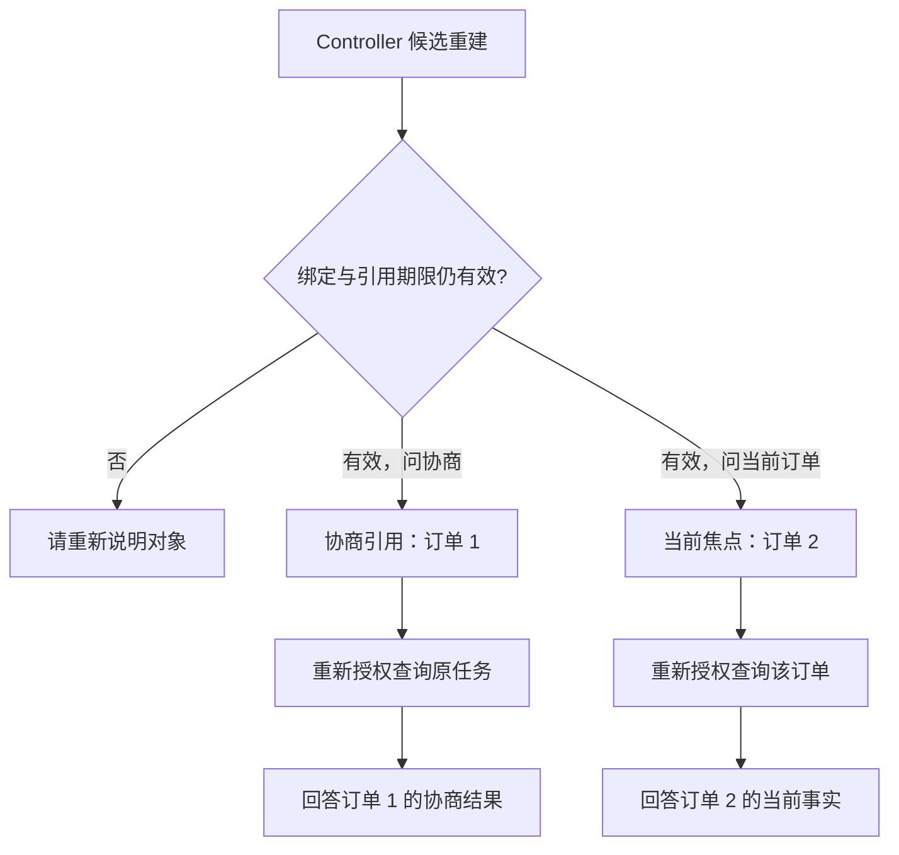

# 4.1 会话重启了，哪些内容还能恢复？

小林为订单 1 联系了商家，等待答复时又选中订单 2 咨询。服务重启后，他先问“那次协商怎样了”，接着问“我选中的订单呢”。前一句要找订单 1 的协商任务，后一句要找订单 2。恢复会话时，系统得把这两件事分别记清楚。

可以把恢复想成重新接手一位同事的工作：聊天告诉你前面谈过什么，业务引用告诉你该找哪一单，数据库告诉你事情现在办到哪一步。接手人不能因为看到昨天的“已批准”，就认定今天仍能退款。

## 三种状态放在不同地方

| 状态 | 保存什么 | 重建后怎样使用 |
| --- | --- | --- |
| Pi 消息上下文 | 用户消息、模型回复和工具结果 | 帮模型理解当前对话；QQ 更换 Session 后不自动还原全部消息 |
| Harness 保存的业务引用 | 当前订单焦点、候选选择、政策原问与任务指向 | 帮代码找到对象；有效期和身份仍要检查 |
| 持久业务记录 | 订单、券、协商任务和退款结果 | 重新授权读取当前事实；不会随聊天消失 |

Session 就是一段对话的运行上下文；Harness 是模型之外负责身份、工具和业务步骤的控制层。它保存的业务焦点是“当前咨询哪一单”，任务引用是“在问哪次协商”。它们可以指向不同订单，系统应该分别保存与读取。



图 1：Controller 候选分别保存任务引用与当前焦点。问订单 1 的协商，不会把当前选择从订单 2 改掉；默认 QQ 重建仍可能需要用户重述订单。

## 默认短会话如何重建

QQ 把 Pi 会话保存在进程内。接待处理累计到 20 次后，下一次处理会释放旧会话并创建新会话：

```typescript
// 每 20 次接待处理更换 Pi 会话；确认、选择和通知也可能计数。
if (conversation.turns >= 20) {
  conversation.session?.dispose(); // 释放旧会话及其模型历史。
  conversation.session = undefined;
  conversation.turns = 0;
}
setPhase("session"); // 记录处理进度。
conversation.session ??= await this.createSession(msg);
```

这个计数控制会话寿命，输入预算则控制每次请求的大小。两轮包含长工具结果的对话，可能比十轮短问答更占空间，所以后面还需要独立的请求预算。

这样做容易预测和排查：模型历史结束了，数据库中的协商和退款结果仍在。用户重新说明订单号，就能继续查询；代价是之前选中的对象可能需要再说一次。

## 持久引用保存到什么程度

如果希望重启后少问一句“您指哪一单”，就需要额外保存业务引用。项目的 Controller 候选正在解决这件事：它负责固定业务步骤，属于 Harness 的一部分，保存的是有限的定位信息。

一条订单焦点包含订单号、来源、选择时间、原到期时间和请求出处。政策引用保存原问题与来源，下次重新检索；历史金额保留当时展示的值与出处，便于与当前值比较；任务引用只帮助查指定任务，不携带新的批准。

这些字段回答四件事：指向谁、为什么选它、何时得到它、现在还能否用于定位。引用沿用原有效期，普通续问不自动延长。恢复时，为重新展示的候选生成新的选择令牌，用它把用户的选择对应到这一次展示。旧展示证明不能从数据库读出后直接当成新确认。

## 为什么一轮开始就先写“需要重述”

假设数据库还记着订单 2，小林这轮刚改查订单 1，进程就退出了。若只在整轮成功后更新引用，重启后读到的仍是订单 2，系统便可能接错话。

因此，在执行本轮业务前，先把持久记录标为“需要重述”。校验过的引用仍留在内存中供本轮使用；如果进程中途退出，下次就会请用户说清对象。下面是恢复成功后的这一步：

```typescript
// next 是已读取并校验的快照；当前轮继续使用恢复出的内存引用。
contextSnapshot = next;
// 恢复读取成功；是否有可用焦点，仍由恢复出的引用决定。
state.focusUnavailable = false;

// 先给下一次恢复留下“需要重述”，防止本轮中断后误用旧定位。
await saveContext(blockedContext(), abort);
assertCurrent(); // 写入返回后，再确认当前轮仍有效。
```

如果读取旧快照或写入标记失败，就清理内存定位并停止本轮处理。多付出一次写入，换来一个明确的恢复动作：状态拿不准时先问用户，不沿用可能过时的选择。

1. 读取当前绑定与旧引用，检查来源和有效期。
2. 可用时在内存恢复对象定位；不可用时清理旧引用或要求明确对象。
3. 先持久保存“需要重述”状态，避免本轮失败后误用旧引用。
4. 重新授权读取当前业务事实，执行业务并形成本轮结果。
5. 保存本轮仍然有效的新引用。
6. 尝试发送回复。引用保存与发送分别可能失败，需要按各自结果恢复。

## 两个写者为什么不能互相覆盖

另一个问题是并发：旧一轮读到修订号 7，另一个写者已经保存修订号 8，旧一轮随后完成，不能把新选择覆盖回去。

CAS（Compare-And-Swap）就是“比较后写入”：我读到修订号 7，提交时也必须仍是 7。数据库事务先锁定记录，再进行比较：

```typescript
// 在事务中锁定这段会话，避免比较与写入之间又被别人修改。
const [rows] = await connection.execute<RowDataPacket[]>(
  "SELECT revision FROM conversation_state WHERE source_key = ? FOR UPDATE",
  [sourceKey],
);
const currentRevision = rows[0] ? revision(rows[0].revision) : 0;
// expectedRevision 是调用方上次读到的版本；不一致就拒绝覆盖。
rejectUnless(currentRevision === expectedRevision, conflict);
```

事务先核对当前绑定，再比较修订号，随后检查订单与任务归属，并按原到期时间复核引用。都通过以后才递增修订号并提交；首次创建使用插入，已经有人写入就交由冲突处理。

锁和修订号解决覆盖顺序，身份和归属解决访问许可，两者不能互相替代。持久引用若指向已不属于当前客户的订单，即使修订号完全一致，也不能恢复后直接使用。

## 订单 1 的任务和订单 2 的选择怎样一起恢复

重建后问“那次协商怎样了”，先找到订单 1 的确切任务，重新核对当前用户的权限，再查询任务结果。这次查询只回答协商进度，当前选中的订单仍是订单 2。

接着问“我选中的订单呢”，就检查订单 2 的引用和当前身份。仍然有效便查询订单 2；找不到、过期或同时存在多个可能对象，就请小林重新说明。刚查过订单 1，并不代表他改选了订单 1。

检查恢复效果时，要同时看两件事：有没有查错单，有没有免去重述。要求用户重新说明可以守住第一点，但体验上仍没有恢复原选择。

## 取消或最后一次引用保存失败，怎样继续

本轮业务已经完成，但最终引用保存失败时，不能再次执行业务来修补上下文。应保留实际业务结果回复，清理不可信定位，下一轮必要时要求重述。业务结果与会话便利信息的优先级不同。

取消也不能撤回已经发出的数据库写入。如果引用保存正在进行，系统等待它结束，再尝试按新修订号补写“需要重述”状态。QQ 接待层还要等完整 prompt 的结果整理结束，才能销毁旧 Session 并放行同用户下一轮；只看 Pi 空闲不够。

收尾需要等待正在进行的工作结束，补写标记也可能失败。用户看到的超时表示系统开始取消和恢复，而不是所有远端工作瞬间停止；远端模型的执行和计费仍需供应商侧结果确认。

## 网页历史回访为何是另一件事

网页已把用户原文和公开回复保存在本机 SQLite。稳定 `conversationId` 标识同一段可回访对话，运行 `sessionId` 标识这次打开后的活动会话；重新打开旧对话会换新的运行身份，并检查浏览器归属、客户与当前绑定。

这解决的是旧对话回看和续聊，不是把 QQ 全部内部历史持久化，也不是跨新对话自动提炼用户偏好。网页对话的轮数随稳定记录保存，重新打开不会重获额度。公开历史注入新 Pi 上下文后，订单当前状态仍须重新查询。

读到这里，可以分别回答三个问题：“聊天还在吗？”“系统知道我选了哪一单吗？”“现在能退款吗？”它们需要不同的记录，也按不同条件失效。

## 练习与取舍

在流程的读引用、保存“需要重述”、读订单、保存新引用、网络发送五个位置分别插入进程退出。逐项回答：数据库业务是否已发生、旧引用是否还能用、用户是否需要重述、重试会不会重执行业务。

有限引用把恢复问题缩小到了“找到用户所指的对象”，代价是每轮多出读取、暂时停用和保存，还要处理身份、修订号与期限。当前它仍是候选方案，收益主要是少让用户重复订单和任务。

## 参考与复现

会话轮换见 `src/qq-agent.ts`；引用恢复、暂时停用与保存见 `src/support-session.ts`；持久快照与 CAS 见 `src/conversation-state.ts`；网页记录与历史注入见 `src/web-chat-history.ts`、`src/web-chat.ts`。

现有恢复观察包含有限工程、数据库与模型场景，不能推广成生产恢复率。QQ 完整持久引用综合验收仍待完成；网页历史属于本机合成客户能力，没有真实登录或跨设备账号保证。
