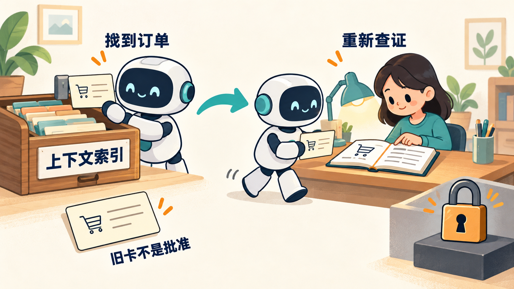

# 4.2 聊天记录、业务引用和长期 Memory 有什么区别？

“既然是 Agent，为什么不做长期记忆？”回答这个问题前，先想一次实际售后：用户昨天咨询过某张券，今天问“还能退吗”。系统需要记住昨天的回答，还是需要找到那张券并查询今天的状态？如果昨天未核销、今天已使用，越牢固地记住旧结论，反而越容易答错。

本项目先保留三种有明确用途的信息：让当前聊天接得上、让用户回看旧对话、让业务结果重启后仍可查询。至于跨新对话提炼偏好，先等一个值得解决的具体需求。

## 先按信息用途分类

“把内容保存到数据库”只说明它能跨进程存活。要判断是哪种记忆，还要问：保存什么、什么时候读、由谁负责更新、是否跨不同对话使用。

| 信息 | 主要用途 | 不能代替什么 |
| --- | --- | --- |
| 当前对话消息 | 理解“这张券”“刚才那个问题” | 当前业务事实 |
| 某段聊天的持久历史 | 回访原问题与公开回复 | 跨新对话用户画像 |
| 有界业务引用 | 重建后定位选中的订单或任务 | 当前身份和许可 |
| 订单、协商与退款记录 | 查询实际业务状态和结果 | 模型自然语言理解 |
| 跨对话偏好记忆 | 在新对话中记住稳定偏好 | 退款批准、金额与确认 |
| 规则知识库 | 检索适用门店和商品规则 | 用户身份与订单状态 |

例如，“用户喜欢简短回答”可以成为稳定偏好；“订单 1 当前可退”却随状态、规则、批准和期限变化。前者可以影响语气，后者必须在办理时重新核实。



图 1：上下文索引帮助找到订单，当前事实仍要重新查询。旧引用不等于持续有效的批准。

## 当前上下文已经解决什么

Pi 保存当前会话的消息和工具结果。QQ 接待处理累计 20 次后，按下面的逻辑换一段新的模型上下文：

```typescript
// 每 20 次接待处理更换 Pi 会话；确认、选择和通知也可能计数。
if (conversation.turns >= 20) {
  conversation.session?.dispose(); // 释放旧会话及其模型历史。
  conversation.session = undefined;
  conversation.turns = 0;
}
setPhase("session"); // 记录处理进度。
conversation.session ??= await this.createSession(msg);
```

释放旧 Session 后，内存消息不再延续。用户可能需要重述，但业务数据库里的任务和退款记录还在。这样的短会话管理容易实现，也容易解释代价。

另一方面，协商任务和退款结果保存于业务数据库。即使 QQ 会话消失，用户提供明确订单号后仍可重新授权查询。业务结果的持久化不依赖模型记住“上次处理成功了”。

## 网页保存旧对话，为什么还不是通用长期记忆

网页还提供了另一种便利：把原问题与公开回复保存在 SQLite，用户可以打开某段旧对话继续聊。打开后先创建运行会话，再把这段历史交给 Pi：

```typescript
// entry 是当前网页运行记录；agent 是这段对话的 Pi 会话。
if (!entry.agent) {
  task.setPhase("session");
  // 用这段对话保存的身份和设置创建独立会话。
  const agent = await this.createAgent(
    { ...entry.identity }, entry.public.id, { ...entry.public.settings },
  );
  if (!entry.active || abort.signal.aborted) {
    agent.dispose();
    throw new Error("网页会话已失效");
  }
  entry.agent = agent;
  // 回访历史不能扩大网页原有的只读工具范围。
  if (agent.getActiveToolNames().sort().join(",")
    !== "get_order,list_orders,search_faq") {
    throw new Error("网页工具必须只读");
  }
  if (entry.messages.length) {
    await agent.sendCustomMessage({
      customType: "web-consultation-history",
      display: false,
      content: JSON.stringify(entry.messages), // 这段对话的公开历史。
    }, { triggerTurn: false }); // 只注入上下文，暂不让模型回答。
  }
}
```

此时历史已经进入上下文，模型还没有作答。下一步才处理用户新发的问题，这样回访动作本身不会多产生一次回答。

这里召回的是用户打开的那段对话。稳定 `conversationId` 标识历史记录，运行 `sessionId` 标识当前活动会话；回访会更换运行会话并核对浏览器归属和绑定。新建对话的消息为空，不会自动搜集该客户其他对话形成画像。

回访旧聊天解决“上次说了什么”，跨对话记忆解决“下次新聊时仍记住我的偏好”。是否保存、是否跨对话使用，需要分别设计。

## 历史注入后，怎样限制旧事实冒充新依据

昨天的文字可以帮助理解“那张券”，却不能证明今天的券状态。因此 Harness 在每轮开始时新建一份证据列表，只收集这一次实际执行的工具结果：

```typescript
// 每一轮都从空列表开始，只接受本轮真正完成的工具执行。
const results: Evidence[] = [];
const unsubscribe = session.subscribe(event => {
  const evidence = toolEvidenceFromEvent(event);
  if (evidence) results.push(evidence); // 成功和失败都留下。
});
```

提取函数接收 Pi 的真实工具结束事件，包括 Harness 经 Pi 发起的内层查询。历史文本不会进入这份列表；本轮结束就取消订阅，下轮从空列表重新开始。

最终答复依据这个列表区分三种情况：只有订单时显示当前事实；只有 FAQ 时显示已经校验的规则标题、来源编号和原文，明确尚未核对具体订单；订单读取后又取得范围匹配的规则，才允许附加模型自由解释。网页只有后一种满足条件的解释可以公开真实 Pi 文字片段，FAQ 单独返回不会解锁历史订单话术。

同一轮重新查询订单时，也不能自动沿用此前规则或业务卡片。回复模块在接受新订单快照前清空旧规则依据、协商与退款卡，以及“未查到任务”的标记：

```typescript
// 重新读单后，规则也要重新查，避免旧条件搭配新订单状态。
evidenceIds.clear();
ruleScopes.length = 0;
documents.length = 0;

// 协商、退款卡片及“未查到任务”标记也重新取得。
merchant = undefined;
refund = undefined;
merchantEmpty = false;
refundEmpty = false;
```

旧卡一旦失效，后续规则或任务查询失败不能使它重新可用；必须重新成功查询对应业务对象，才能再次展示业务卡和按钮。同一订单的新读取会替换旧事实与适用范围，避免旧门店或商品范围混进新判断；别的工具尚未解决的失败也不会因订单读取成功就被清掉。

例如模型先说“昨天商家拒绝”，今天只补查订单和 FAQ，没有查询当前协商结果。在开放协商查询工具的售后会话中，最终答复会保留订单事实，并明确尚未取得当前协商状态，不让自由文字沿用旧拒绝或批准。取得当前任务后再按实际结果生成固定卡片；没有任务也只说明本轮未查到，不能反推从未办理。

当前事实和规则齐备以后，模型仍可能把条件解释错。这个检查先管住来源、结构和范围，完整回答还要用新场景检查；已经流给用户的文字也无法在之后查询失败时撤回。

## 有界引用怎样夹在历史与事实之间

小林等订单 1 的协商时，选中了订单 2。重建后，“那次协商”与“当前订单”需要找回不同对象。与其让模型从全部聊天里猜，不如直接保存对象、来源和到期时间。

引用快照和读写接口把这几件事分开保存：

```typescript
export type SupportContextSnapshot = {
  revision: number;       // 写入版本，用来发现并发覆盖。
  customerId?: string;    // 保存引用时对应的业务客户。
  bindingId?: string;     // 当时的账号绑定，用来识别换绑。
  value?: SupportContextValue; // 有限的订单、问题和任务引用。
};
export type SupportContextPort = {
  read(): Promise<SupportContextSnapshot>;
  // expected 携带旧版本与身份；通过检查后才能写入新值。
  write(
    expected: SupportContextSnapshot,
    value: SupportContextValue,
  ): Promise<SupportContextSnapshot>;
};
```

写入时同时提交“我读到的快照”和“我要保存的新值”。服务据此发现身份变化或并发覆盖，再决定是否接受更新。

具体恢复时还要看有效期与当前绑定。订单焦点只用于定位，任务引用只用于查询原任务；历史金额保留旧值和出处，不能充当当前可退金额。定位成功后重新读取当前订单、规则与任务状态，才形成这一轮可用的事实。

这条持久引用路线仍是 Controller 候选。它聚焦订单、规则和任务的定位，让用户少重复对象；默认 QQ 继续使用短会话管理。

## Memory 越存越多，当前具体怎样限制

TTL 表示一条数据还能使用多久。不过，限制容量和限制有效期是两件事：网页可以限制对话段数，引用可以限制保留时间。当前配置如下，引用部分属于 Controller 候选。

| 对象 | 当前限制 | 到达边界后的行为 |
| --- | --- | --- |
| QQ 进程内对话 | 最多 20 个对话；单对话在处理及排队总数最多 3 个 | 拒绝继续接纳并提示等待，不无限排队 |
| QQ 空闲会话 | 无待处理工作且至少 30 分钟未触及时，在后续清理检查中移除 | dispose Pi Session 并从内存 map 删除；不是定时永久存档 |
| QQ 消息上下文 | 20 次接待处理计数后更换 Pi Session | 接受必要重述；不生成摘要，不等于 20 次模型请求 |
| 网页持久历史 | 每段最多 20 次接纳请求；每组浏览器归属（owner）与客户资料（profile）最多 100 段，全库最多 1000 段 | 满额拒绝继续接纳或新建，已有记录仍可查看 |
| 订单和政策引用 | 候选分别最多 3 个，引用有效期 15 分钟 | 过滤过期候选，保留多义或溢出标记，必要时请用户重新明确 |
| 历史实付来源 | 最多 2 个候选，有效期 15 分钟 | 不能把保留下来的数字自动视为用户所选基准 |
| 协商任务引用 | 最多 3 个当前候选；选择只在原引用有效期内生效 | 过期后重新定位任务；不继承旧状态或延长批准 |

这些阈值是小规模原型的工程选择。达到容量时明确拒绝，已有历史仍可读；继续使用的体验会受影响，但系统不会为了腾空间悄悄删掉用户记录。

新建网页历史时，先查当前客户和全库各有多少段对话：

```typescript
// count 统计当前浏览器、当前客户的历史；total 统计整库历史。
const count = Number(this.db.prepare(
  "SELECT COUNT(*) AS count FROM conversations WHERE owner=? AND profile=?",
).get(owner, profile)!.count);
const total = Number(this.db.prepare(
  "SELECT COUNT(*) AS count FROM conversations",
).get()!.count);
if (count >= 100 || total >= 1000) {
  throw new WebChatError(429, "会话记录数量已达上限，已有记录仍可查看。");
}
```

这解决的是“能保存多少段”，一段里有多长内容还需要另一层控制。模型发送前检查完整请求，防止短短几轮也把窗口撑满。

完整请求体序列化后，系统把输入大小、输出预留和安全余量相加：

```typescript
// payloadBytes 是完整请求的字节数，output 是声明的输出预留。
// 两者相加得到本地预算单位，用于提前停止，并非实测 Token 用量。
const required = result.payloadBytes!
  + output + contextBudgetPolicy.safetyUnits;
if (!Number.isSafeInteger(required)) return result;
result.requiredUnits = required;
result.decision = required <= result.effectiveLimit!
  ? "allowed" : "context_limit";
```

输入按最终 JSON 的 UTF-8 字节数计量，输出使用请求里声明的预留，固定安全余量为 1024。本地默认上限是 65536，并受模型目录窗口限制。每次工具返回后继续请求模型，都会重新检查；超限就停止发送，让用户重新说明。

因此当前方案并不是“有了长期记忆就不怕窗口满”，而是分别限制历史保存、引用范围和单次实际请求。代价是长对话可能要求重述；怎样选阈值、区分模型用量与本地估算，以及各入口如何恢复，见 [4.3 上下文快满了，什么时候停止、怎样继续？](<./04.03-context-budget.md>)。

## 为什么过期后不能自动选“剩下的那个”

假设用户在两个金额基准间还没选定，第一个先过期，只剩第二个。如果系统因此自动选中第二个，清理数据就替用户做了决定。同样，保留最近几项时丢掉旧项，也不能证明剩下的就是用户想选的。

所以，候选列表还要保留“仍需选择”和“曾经溢出”两个状态：

```typescript
// 移除过期引用，同时检查用户原来的选择是否还在。
const remaining = candidates.filter(candidate => candidate.expiresAt > now);
const selectedRequestId = remaining.some(
  candidate => requestId(candidate) === input.selectedRequestId,
) ? input.selectedRequestId as string : undefined;
return {
  candidates: remaining,
  overflow: input.overflow,
  // 原先的歧义、溢出、失去已选项，都继续要求用户明确选择。
  selectionRequired: input.selectionRequired || input.overflow
    || candidates.length > 1
    || Boolean(input.selectedRequestId && !selectedRequestId),
  ...(selectedRequestId ? { selectedRequestId } : {}),
};
```

即使清理后只剩一个候选，之前没解决的歧义仍在。系统要等用户明确选择，才能继续使用这个引用。

历史实付候选最多保留两项，也遵守同一规则：

```typescript
return {
  ...binding,
  version: amountChoicesVersion,
  candidates: candidates.slice(-2), // 只存最近两项。
  // 裁剪数据不能抹掉“曾有更多候选”和“用户还没选”的事实。
  overflow: Boolean(before?.overflow) || candidates.length > 2,
  selectionRequired: Boolean(before?.selectionRequired)
    || candidates.length > 1,
};
```

完成选择后，这个历史金额可以用来比较前后变化。它并不决定现在能退多少钱，部分退款是否允许仍由业务流程判断。

## 先验证，再丢弃过期数据

“已经过期，直接忽略”也可能掩盖损坏。一个重复的 requestId、非法时间或错客户的引用，不应因为恰好过期就被当成正常记录。

订单候选先校验字段、重复项和时间范围，再执行下面的过期过滤：

```typescript
// candidates 已通过格式、重复项和时间检查，随后才丢弃过期项。
const remaining = candidates.filter(candidate => candidate.expiresAt > now);
value.orderChoices = {
  candidates: remaining,
  overflow: choices.overflow,
  // 是否还在等待用户选择，也随候选一起保留。
  pending: choices.pending,
  selectionRequired: choices.selectionRequired || choices.overflow
    || candidates.length > 1,
};
// 候选减少且没有可用焦点时，请用户重新说明对象。
if (remaining.length !== candidates.length && !value.focus) {
  value.requiresRestatement = true;
}
```

解析数据库快照遇到无效结构，会降为需要重述的状态；读取还核对当前绑定与记录绑定。这样做的代价是宁可让用户再次明确订单，也不根据不可信旧引用继续处理。修改当前绑定后再读旧记录，不能自动把旧客户的选择带给新客户。

有效期解决的是“还能否使用这条定位信息”。它没有证明订单仍属于当前客户、批准仍有效，也不会延长退款方案期限。这些事实必须在实际服务调用中重新检查。

## 过期、逻辑失效与物理删除不是一回事

QQ 清理会实际移除内存会话。引用过期则是在读取时不再使用，数据库里的旧 JSON 可能要等下次写入才被覆盖。因此“读不到”和“已从磁盘删除”需要分别实现。

网页历史也没有通用的“删最旧一段腾空间”机制。当前只会在切换或新建时清理满足所有条件的尚无用户请求或回复的空白历史记录：同一 owner、零轮、消息为空、状态 ready、没有请求结果记录、没有活动 owner 引用，并排除正要打开的目标。有用户请求或回复的历史不能借这个分支删除。

若后续增加历史删除，需要同时回答：处理中能否删除、请求结果和业务审计怎样保留、备份何时清理。当前尚未提供用户历史删除界面和跨存储清理作业。

## 为什么当前优先做好这些能力

第一个原因是业务问题更具体。团购券售后最常需要确定哪一单、哪个任务、现在什么状态。订单与任务已有持久记录，网页可回访原聊天，有界引用研究重建后的对象定位。跨新对话记住回复偏好，尚未对应到必须先解决的核心缺口。

第二个原因是新鲜度不同。券可能核销，批准可能过期，绑定可能撤销。若摘要把“在这些条件下可申请”压缩成“用户可以退款”，就会丢失条件。让当前事实回到业务工具读取，能清楚说明来源与失效条件。

第三个原因是记忆需要维护。系统要区分长期偏好与这次临时要求，接受用户纠错与删除，处理冲突和身份变化。仅实现“抽摘要、存下来、搜出来”，没有完成这套更新规则。

最后还要付出运行成本：自动提炼可能增加模型调用，检索内容会占输入 Token，请求内写记忆可能增加等待，后台写入则要处理暂时陈旧与失败恢复。当前没有本项目的长期记忆质量、延迟或费用对照，不能填写节约比例。

## 一个错误记忆如何影响售后

昨天，订单 1 未核销、商家批准仍有效，用户看到了一份退款方案。假设系统只记成“用户同意退款”。今天用户新开对话问“处理了吗”，若直接沿用这句话，就丢掉了方案、金额、展示状态和有效期。

正确做法是重新授权查询原操作结果：如果已完成，解释持久结果；如果仍待确认，按原操作状态和期限处理；如果需要新的方案，重新展示并接受对应确认。历史可以帮助定位，但不能迁移成新的许可。

同样，“用户希望简短回复”可以影响文字长度，却不能让系统省略必要的订单澄清或金额说明。记忆是否有用，要看它作用在哪一个决策上，而不是召回越多越好。

## 如果确实需要长期偏好，最小方案是什么

可以先从一个尚未实现的设计练习开始：客户每次新聊都要求简短回答，让他显式设置“回复简短”。第一版按可信客户身份保存枚举值即可；退款资格、批准和确认仍留在原业务流程里，也不需要为这一个偏好先建向量库。

| 设计问题 | 一个最小选择 | 必须回答的反例 |
| --- | --- | --- |
| 写入来源 | 用户显式设置，记录来源与时间 | “这一次简单说”不能自动永久化 |
| 数据形状 | 例如 responseStyle=concise/default，附 revision | 不接受任意文本装入系统提示 |
| 读取范围 | 新对话按当前可信客户身份读取 | 换绑或撤销后不能读取旧客户偏好 |
| 冲突顺序 | 当前用户要求优先于历史默认 | 用户这轮要求详细解释时应覆盖简短默认 |
| 修改与删除 | 基于版本更新；删除后新会话不可再召回 | 延迟写入任务不能把已删除偏好重新写回 |
| 生命周期 | 明确是否长期保留、何时失效以及如何查看 | 不能只有“写入”而没有纠错或删除入口 |
| 权限边界 | 仅影响表达，不能影响订单授权或确认 | “以后都替我同意”不成为资金操作许可 |

如果未来采用后台自动提炼，删除还要有版本或删除标记，使旧任务提交时发现版本过时而拒绝；重试不能把删除前的摘要恢复。这是需要实现和验收的竞态，不是今天已有的保证。对于显式枚举偏好，先做同步更新往往更省复杂度。

先固定新场景、运行次数和预算，用确定性检查验证隔离、版本、删除、当前要求优先以及禁止授权用途，再比较“不使用记忆”“用户显式设置”与候选自动提炼。观察重述次数、是否遵守当前要求、误用旧信息、延迟和完整费用；自动提炼只有在对照确有收益时才加入。保留失败和未知用量，预定次数结束就收尾，没有净收益则暂缓。当前没有这些实验结果，不能声称已提高记忆准确率或降低成本。

## 练习与面试回答

请把“用户喜欢简短回复”“订单 1 已退款”“用户选中了订单 2”“套餐预约规则”分别放进偏好、业务结果、引用和知识库。逐项说明谁更新、何时失效、是否能用于资金操作。

面试时可以这样解释选择：“我先实现持久业务结果和网页历史回访，用有限引用处理重建后的对象定位。当前关键事实都需要重新授权读取；跨新对话偏好提炼还没有明确收益，所以先不扩建。出现具体重述需求后，会用最小结构化偏好与无记忆方案比较。”

这段回答交代了需求、选择和代价。面试官继续追问时，就可以从“什么时候值得加入长期偏好”往下讨论。

继续做三道源码练习：

1. 构造两个未选金额候选，让第一个过期。预期只剩一个数据项，仍不能自动形成基准；定位 `selectionRequired` 的保留逻辑。
2. 构造一个已过期且 requestId 重复的快照。预期先拒绝非法结构，不能用过期过滤隐藏重复；查找验证发生在过滤之前的位置。
3. 查看网页的第 101 段历史创建路径。预期返回容量错误，已有记录仍可查看；清理尚无用户请求或回复的空白历史记录不等于允许删除最旧的真实记录。

练习的关键是观察清理前后哪些业务含义必须保持不变：删掉数据不能替用户作选择，删除过期引用不能掩盖坏结构，达到容量也不能擅自删除已有对话。纯函数检查适合验证这些规则；跨进程保存和恢复需要另行检查实际存储。

## 参考与复现

上述确定性检查分别见 [conversation-state-value-check.ts](<https://github.com/erha1499/dave-agent/blob/fe13c020cf1192de26cf03892df231e356be569d/scripts/conversation-state-value-check.ts>)、[support-amount-context-check.ts](<https://github.com/erha1499/dave-agent/blob/fe13c020cf1192de26cf03892df231e356be569d/scripts/support-amount-context-check.ts>)、[support-task-context-check.ts](<https://github.com/erha1499/dave-agent/blob/fe13c020cf1192de26cf03892df231e356be569d/scripts/support-task-context-check.ts>)、[web-chat-history-check.ts](<https://github.com/erha1499/dave-agent/blob/fe13c020cf1192de26cf03892df231e356be569d/scripts/web-chat-history-check.ts>)。实库配置见 [实验配置](<https://github.com/erha1499/dave-agent/blob/fe13c020cf1192de26cf03892df231e356be569d/docs/experiment-controls.md>)，完整请求预算的实际版本、独立批次与默认值边界见 [上下文预算记录](<https://github.com/erha1499/dave-agent/blob/fe13c020cf1192de26cf03892df231e356be569d/docs/context-budget-contract.md>)。读取材料或通过纯函数检查不等于新增真实模型或实库验收。

本轮事件采集与证据出口分别位于 `src/cli.ts`、`src/qq-agent.ts`、`src/web-chat.ts` 和 `src/reply-from-tools.ts`；对应检查为 `node scripts/atomic-evidence-check.ts`、`node scripts/web-chat-stream-check.ts`。本课描述已经写入代码的保护，不把它算作本次修复的真实 Web 模型验收，也不覆盖历史批次的失败结论。

项目当前范围与取舍见 [plan.md](<https://github.com/erha1499/dave-agent/blob/fe13c020cf1192de26cf03892df231e356be569d/plan.md>) 和 [optimization-plan.md](<https://github.com/erha1499/dave-agent/blob/fe13c020cf1192de26cf03892df231e356be569d/docs/optimization-plan.md>)；消息与轮换见 [agent.ts](<https://github.com/erha1499/dave-agent/blob/fe13c020cf1192de26cf03892df231e356be569d/src/agent.ts>)、[qq-agent.ts](<https://github.com/erha1499/dave-agent/blob/fe13c020cf1192de26cf03892df231e356be569d/src/qq-agent.ts>)；有界引用的结构与恢复见 [conversation-state.ts](<https://github.com/erha1499/dave-agent/blob/fe13c020cf1192de26cf03892df231e356be569d/src/conversation-state.ts>)、[support-session.ts](<https://github.com/erha1499/dave-agent/blob/fe13c020cf1192de26cf03892df231e356be569d/src/support-session.ts>)，容量、过期和选择见 [support-reference-selection.ts](<https://github.com/erha1499/dave-agent/blob/fe13c020cf1192de26cf03892df231e356be569d/src/support-reference-selection.ts>)、[support-context.ts](<https://github.com/erha1499/dave-agent/blob/fe13c020cf1192de26cf03892df231e356be569d/src/support-context.ts>)、[support-task-context.ts](<https://github.com/erha1499/dave-agent/blob/fe13c020cf1192de26cf03892df231e356be569d/src/support-task-context.ts>)；网页持久记录与注入见 [web-chat-history.ts](<https://github.com/erha1499/dave-agent/blob/fe13c020cf1192de26cf03892df231e356be569d/src/web-chat-history.ts>)、[web-chat.ts](<https://github.com/erha1499/dave-agent/blob/fe13c020cf1192de26cf03892df231e356be569d/src/web-chat.ts>)。

概念延伸可阅读 [LangChain 官方记忆说明](<https://docs.langchain.com/oss/python/concepts/memory>)，其中区分会话内与跨不同对话的记忆。项目未采用该框架，也没有实现通用长期偏好记忆。现有局部恢复观察不能证明这类记忆的收益或无效；网页历史仅面向本机合成客户，无真实登录与跨设备账号。
