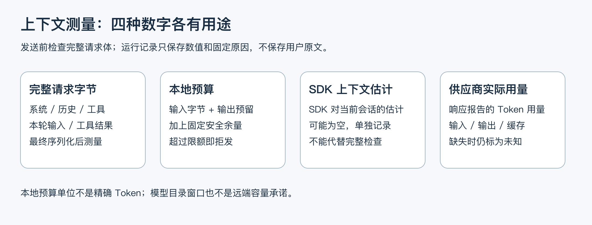
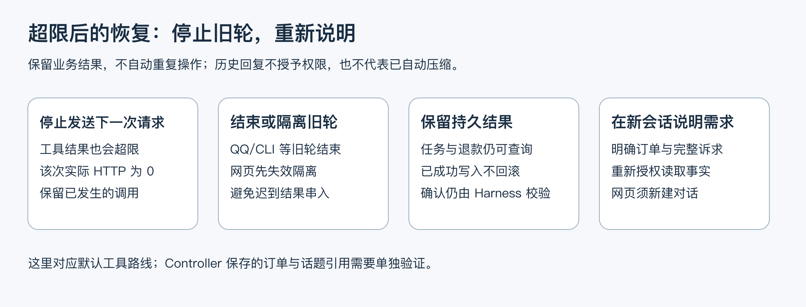

# 4.3 上下文快满了，什么时候停止、怎样继续？

用户说“只看这个订单”，模型收到的却不止这一句话：系统流程、工具定义、历史消息、订单和规则都在请求里。尤其是工具返回一大段资料后，下一次请求可能突然装不下。这里把一次模型请求尝试叫作“一跳”。

本课顺着一次请求看四件事：窗口多大、实际内容多长、何时停止，以及停止后怎样继续。项目在每次发送前检查完整请求，超限就停下，让用户在新会话中重新说明。当前尚未加入自动摘要。



图 1：本地预算、SDK 估计和供应商实际用量分别回答不同问题，不能互相替代。

## 1. 先把四类信息讲清楚

| 数字 | 什么时候得到 | 用途与边界 |
| --- | --- | --- |
| 模型目录的 `contextWindow` | 选择模型时 | 本地声明的窗口上限；不是远端服务实时承诺 |
| Pi `getContextUsage()` | 会话已有消息时 | SDK 根据当前会话消息给出的用量估计，可能为空；不等于下一次完整 HTTP 请求的精确用量 |
| 最终请求字节与输出预留 | 序列化完成、真正发送前 | 本地发送前检查依据，包含系统、历史、工具、用户输入及工具结果 |
| 响应中的 wire usage | 已发送请求返回后 | 记录供应商报告的输入、输出、缓存用量；流中断或 usage 缺失时保持未知 |

“模型支持 128K”只描述目录中的窗口。判断眼前这次请求能否发送，还要看实际配置、最终请求大小和输出预留；供应商返回的用量则留到事后记账。

## 2. 为什么先用保守预算，而不立即做摘要

客服历史中既有可以概括的闲聊，也有不能模糊的订单、金额、批准、方案编号和用户确认。通用摘要容易把“可以申请”压成“允许退款”，或者把旧状态当成当前事实。仅把上下文缩短，不会自动保留这些业务约束。

当前先选择简单可解释的做法：发送前检查，超限就请用户重述。它可能提前拦住供应商本来放得下的请求，换来的好处是没有额外摘要调用，也不用立即解决摘要怎样保留批准和确认条件。

如果真实使用中反复出现长对话失败，再用新题比较摘要方案：是否保留事实与条件、任务能否完成、增加多少延迟和费用。有收益以后再接入业务流程。

## 3. 预算怎样计算

先用一个公式看预算；它在代码中的策略名是 `utf8-byte-plus-output-v1`。

```plain
# 输入使用最终请求的 UTF-8 字节数，包括系统、工具、历史与本轮结果。
输入预算单位 = 最终 JSON body 的 UTF-8 字节数

# 输出留足空间，再增加固定安全余量。
所需单位 = 输入预算单位 + body 中声明的输出 Token 预留 + 1024
有效限额 = min(本次应用限额, 模型目录窗口)

# 等于限额仍可发出，超过限额就停止这一跳。
允许发送：所需单位 <= 有效限额
```

应用的默认限额为 **65,536**，`MODEL_CONTEXT_BUDGET_UNITS` 严格接受 4096..262144 的整数。这是项目自己的预算阈值，不是“所用模型支持 65,536 Tokens”。阈值需要根据正常业务链的完整请求测量来选择：过低会截住必要的订单和规则历史，过高则无法达到预期的提前停止效果。

这里统一叫“本地预算单位”。按输入字节计量容易复现，连 JSON 结构也算在内；它偏保守，但字节与 Token 没有固定换算关系，不能拿这个数当作实际用量。

输出预留读取最终 body 中唯一的 `max_tokens` 或 `max_completion_tokens`，要求合法正整数且不超过当前会话批准的输出上限。模型主调用通常最多 2048，网页可更低，咨询解析也有自己的上限。Pi 可能进一步缩小请求输出值，所以不能假定每次预留都等于 2048。字段缺失、冲突或未知格式应拒绝，不能偷偷按一个方便的默认数继续发送。

例如一个完整 body 为 18,000 字节，实际输出预留为 1,024，余量为 1,024，则所需单位为 20,048。应用限额为 24,576 且目录窗口更大时允许发送；工具结果增加 8,000 字节后，下一跳就超过应用限额。这个算例是教学数字，不是项目实测 Tokens。

下面按“准备诊断记录 → 校验请求格式 → 计算预算”阅读判定函数：

```typescript
// object 排除 null 和数组；count 检查非负安全整数。
const object = (value: unknown): value is Record<string, unknown> =>
  !!value && typeof value === "object" && !Array.isArray(value);
const count = (value: unknown): value is number =>
  typeof value === "number" && Number.isSafeInteger(value) && value >= 0;

function inspectContext(
  info: ModelRequestInfo, // Harness 确定的模型与输出上限。
  body: BodyInit | null | undefined, // 即将发送的完整 JSON。
  applicationLimit: number,
  logicalCall: number, // 一次模型调用的编号，HTTP 重试时仍沿用。
  attempt: number,     // 这次调用准备进行第几次发送尝试。
): ModelContextCheck {
  const metadata = info.context;
  const contextWindow = count(metadata?.contextWindow)
    && metadata.contextWindow > 0
    ? metadata.contextWindow : null;
  const projection = metadata?.projection; // SDK 估计只用于观察。

  // 默认拒绝：每一项检查通过后，才把 decision 改成允许发送。
  const result: ModelContextCheck = {
    logicalCall, attempt,
    phase: info.phase, policy: contextBudgetPolicy.version,
    decision: "context_invalid",
    payloadBytes: typeof body === "string"
      ? Buffer.byteLength(body, "utf8") : null,
    outputTokenField: null, outputReserve: null,
    safetyUnits: contextBudgetPolicy.safetyUnits,
    requiredUnits: null, applicationLimit, catalogContextWindow: contextWindow,
    effectiveLimit: contextWindow
      ? Math.min(applicationLimit, contextWindow) : null,
    projection: projection
      && (projection.tokens === null || count(projection.tokens))
      && count(projection.contextWindow) && projection.contextWindow > 0
      && (projection.percent === null
        || Number.isFinite(projection.percent) && projection.percent >= 0)
      ? { tokens: projection.tokens, contextWindow: projection.contextWindow,
          percent: projection.percent }
      : null,
  };
  if (typeof body !== "string" || !metadata || !contextWindow
    || !count(metadata.maxOutputTokens) || !metadata.maxOutputTokens)
    return result;

  // 无法解释请求格式，就不猜测预算。
  let payload: unknown;
  try { payload = JSON.parse(body); } catch { return result; }
  if (!object(payload) || !Array.isArray(payload.messages)
    || !payload.messages.length || payload.model !== info.model) return result;

  // 只允许一个已知输出字段；重复或陌生字段都拒绝。
  const fields = ["max_tokens", "max_completion_tokens"]
    .filter(key => Object.hasOwn(payload, key));
  if (fields.length !== 1
    || ["max_output_tokens", "max_new_tokens", "maxTokens"]
      .some(key => Object.hasOwn(payload, key))) return result;
  const field = fields[0] as "max_tokens" | "max_completion_tokens",
    output = payload[field];
  result.outputTokenField = field;
  if (!count(output) || !output || output > metadata.maxOutputTokens
    || metadata.outputTokenField !== undefined
      && metadata.outputTokenField !== field) return result;
  result.outputReserve = output;

  // 按本地策略相加，不把这个值写成供应商实际 Token 用量。
  const required = result.payloadBytes!
    + output + contextBudgetPolicy.safetyUnits;
  if (!Number.isSafeInteger(required)) return result;
  result.requiredUnits = required;
  result.decision = required <= result.effectiveLimit!
    ? "allowed" : "context_limit";
  return result;
}
```

例如所需单位恰好等于限额，结果是允许发送；只增加一个单位，就会返回超限。请求格式不明则停在无效状态，避免在输出预留未知时继续发送。

## 4. 为什么检查必须落在实际发送之前

只限制用户输入长度，拦不住系统提示、工具参数定义（schema）或检索结果增长。只在 `session.prompt()` 前看历史，又看不到随后工具返回的内容。Pi 构造请求后，项目接入的回调（hook）还可能修改内容；因此要在这些步骤都结束后检查，每次真正发出 HTTP 前都执行。

执行顺序是：检查完整请求 → 记录允许发送的请求 → 调用网络传输。发送前被拦下的请求单独记为拒发，不增加已经发出的 HTTP 次数。

本项目把这层发送包装器称为 transport，它最终调用底层 `fetch`。同一包装器还限制一条正式消息最多实际发送多少次 HTTP。一次消息可能经历多次模型推理、工具调用与重试，每次 HTTP 都计数；上下文拒发不能重置这份预算。

代码把两份记录分开：`contextChecks` 保存预算判断，`attempts` 保存已经进入发送阶段的尝试。先看检查，再看记录创建的位置：

```typescript
// 生成模型的请求，先检查最终内容，再决定是否进入发送阶段。
if (info.format === "openai-sse") {
  const check = inspectContext(
    info, init?.body, state.summary.limits.contextBudgetUnits,
    logicalCall, attempts + 1,
  );
  state.summary.contextChecks.push(check);
  if (check.decision !== "allowed") {
    state.summary.blockedRequests++;
    if (check.decision === "context_limit") {
      stop(state, "context_limit", "context_limit"); // 记录原因并取消当前轮。
      throw new ContextBudgetError();
    }
    fail(state, "context_invalid");
    state.controller.abort();
    throw new Error("模型请求上下文或输出预留配置无效，未发送请求。");
  }
}

// 走到这里才创建实际发送记录；用量与费用要等响应后补入。
const started = performance.now();
const row: ModelRequestAttempt = {
  logicalCall, attempt: ++attempts, phase: info.phase,
  provider: info.provider, model: info.model,
  observedAt: new Date().toISOString(), durationMs: null,
  httpStatus: null, outcome: "pending", usage: null,
  currency: info.pricing?.currency ?? null,
  pricingSource: info.pricing?.source ?? null,
  estimatedCostUsd: null, estimatedCostCny: null,
};
state.summary.httpRequests++;
state.summary.attempts.push(row);
```

超限时先保存停止原因并发出取消信号，入口据此给用户明确提示。向量化和重排也受 HTTP 次数预算约束，但没有相同的输出预留含义，不使用这段生成请求计算。

日志只保留字节、预算、输出预留、模型元数据和固定失败原因。为了调试上下文，不应把用户长原文、工具完整结果、密钥或请求 header 放入正式账本。

一次业务工具内部可能再查订单和规则，产生多个工具结束事件，却未必增加模型请求。工具事件用来追踪本轮取得了什么事实；实际 HTTP 用来追踪发出多少请求。上下文预算始终测量最终请求体。

## 5. 停止后怎样继续



图 2：新会话只重建语言上下文。已持久化的业务结果仍在数据库中，下一次查询重新授权读取。

| 入口 | 处理方式 | 用户下一步 |
| --- | --- | --- |
| QQ | 沿用失败路径，取消并等待旧工作结束，再销毁 Session | 下一条重新写明订单号和完整问题 |
| CLI | 等待旧调用结束，释放旧 Session，再由工厂创建新对象 | 不自动重试长输入；重新说明订单和诉求 |
| 网页 | 立即使会话失效，发出取消并释放 Session，保留原有历史及结果未知的请求记录 | 新建对话；重开旧记录仍可能注入相同长历史 |

CLI 换会话时，要连 Session 对象一起换。只清空消息数组，仍可能留下绑定在旧对象上的订单选择。替换过程先取消、等待、释放，再创建：

```typescript
export async function replaceCliSession(
  previous: AgentSession,
  create: () => Promise<AgentSession>,
) {
  cancelSupportTurn(previous); // 先通知业务控制停止旧轮。
  await previous.abort();     // 等待 Pi 结束旧调用。
  previous.dispose();        // 释放旧消息和绑定在对象上的状态。
  return create();            // 由工厂创建全新的会话。
}
```

QQ 同样会等待取消和整轮处理结束，再释放旧 Session。网页则先让旧会话失效并释放，通过会话和请求归属检查挡住迟到结果。三种入口的恢复顺序由各自生命周期决定。

已经成功执行的工具不会因为最后一句解释失败而自动重做。商家任务和退款结果仍可按订单查询；用户确认、批准与幂等由原 Harness 和工具检查。不能把旧聊天中的“同意”迁移成新操作许可。

默认方案由模型选择对外业务工具，Harness 在需要时补齐工具内部的必要只读查询，配置名为 `atomic`。网页仍仅开放三项只读业务工具。另一条 Controller 候选由业务控制器维护任务上下文，可能从 MySQL 重新加载当前订单等持久焦点。清掉 Pi 历史不代表清掉这些引用；CLI 遇到该候选超限时退出，不自动套用上述重建流程。要支持它，需要另行设计持久焦点失效、旧写入结束和带版本校验的更新机制。

恢复历史后，还要防止“旧文本变回新依据”。每次请求都重新收集真实工具结束事件；新的 `get_order` 结果会使此前 FAQ 依据及协商、退款卡片失效，同一订单的旧事实和范围也由新读取替换。后续查询失败不能恢复旧按钮，重新取得对应业务结果才有新卡。只有 FAQ 的回答由规则标题、来源与原文构成，明确尚未核对订单，不释放模型自由文字片段。当前订单与后续适用规则齐备时，网页仍可输出真实 Pi `text_delta`；这只是答复依据检查，不是逐句语义证明，已发送的片段也不能在后续失败时撤回。

窗口预算回答“装不装得下”，本轮证据回答“现在能不能相信”。新会话可以解决前者，当前订单、批准和确认仍要按业务流程重新核对。

## 6. 如何证明这一层确实生效

先用本机替代 HTTP 验证边界：系统、schema、用户输入和工具结果分别单独造成超限，实际 transport 都不能被调用；等于限额可发，超过一单位拒发；非法输出预留拒发；usage 缺失不补零；旧轮迟到工作不能继续发出请求。

再用预声明的新题做一次限额真实批次：短查询放行，长用户原文首跳拒发，长规则结果回填后下一跳拒发，新 Session 明确重述后恢复。长规则是声明过的长度故障注入，不能包装成真实线上事故。若模型没有选到预定规则工具，就如实记录该场未触达目标，不强制改题或重跑。

完整计划分母、请求预算、冻结源码、实际参数、结果、失败和费用保存到专项结果文档。零 HTTP 的拒发题有实际工程意义，但不能称为一次成功远程模型调用。CLI / QQ / 网页的替代传输检查、真实模型、真实 MySQL 和真实 QQ 也分别说明。

## 练习与面试回答

假设一条“查订单 → 查规则 → 回答”轨迹每跳调用一个工具，标出三次模型请求各自包含什么。第二个工具返回长文时，拒发发生在规则查询之前还是之后？之前已经发生的工具能否自动重做？用户重开原历史为什么仍可能失败？用上面的检查顺序和恢复表即可回答，再对照源码定位实现。

可以这样回答：“我们测量最终请求，而不是只数聊天字数。当前使用明确命名的保守本地预算，保留输出余量，每次生成模型 HTTP 前检查。超限后停止该轮，各入口按自己的生命周期隔离旧工作，让用户在新会话明确重述，持久业务结果重新授权查询。自动摘要尚未实现；若要做，必须验证订单、金额、批准、确认和时间条件不会被摘要改变。”

进一步讨论自动摘要时，可以沿用同样的检查思路：先规定哪些条件必须保留，再做质量、延迟和费用对照。

## 参考与复现

实现入口：`src/model-request-budget.ts` 中的 `inspectContext`、`createModelRequestFetch`；`src/cli.ts` 中的 `replaceCliSession`；QQ 的失败清理和网页的会话失效分别位于 `src/qq-agent.ts`、`src/web-chat.ts`。复现边界检查使用 `node scripts/context-budget-check.ts`，该命令执行本机替代传输检查，不发起远程模型调用。

2026-10-10 的一次真实模型批次使用独立限额 **30,000**：短查询、长输入首跳拒发、长工具结果下一跳拒发、新 Session 重述四条路径符合预先规定的要求，实际 HTTP 分别为 2、0、2、2。两条生成答复经 Codex 独立审阅通过；另外两条按预定条件停止。合计 22,001 Tokens，目录估算 USD 0.001341372，无未知用量或费用；审阅供人工复核，不等于作者已完成人工验收，也不是供应商账单对账。

正式默认 **65,536** 来自付费前离线校准：原拟定 32,768 会截住已知退款历史，回放最大所需单位为 33,889。独立限额下的长输入拒发结果不能推广到默认值。真实模型批次使用生产 Pi 请求构造与只读合成存储；三入口恢复另由替代传输工程检查覆盖，没有新增真实 MySQL、QQ 传输或完整网页验收。完整参数和结果保存在 `docs/context-budget-contract.md`、`data/context-budget-results-20261010.json`。

此处保存的是上述预算批次当时的结果。后续工具依赖与证据出口发生变化，不能用这份历史成绩证明本次修复后的真实 Web 效果；新验收另行记录，先前其他批次的失败不被覆盖。
