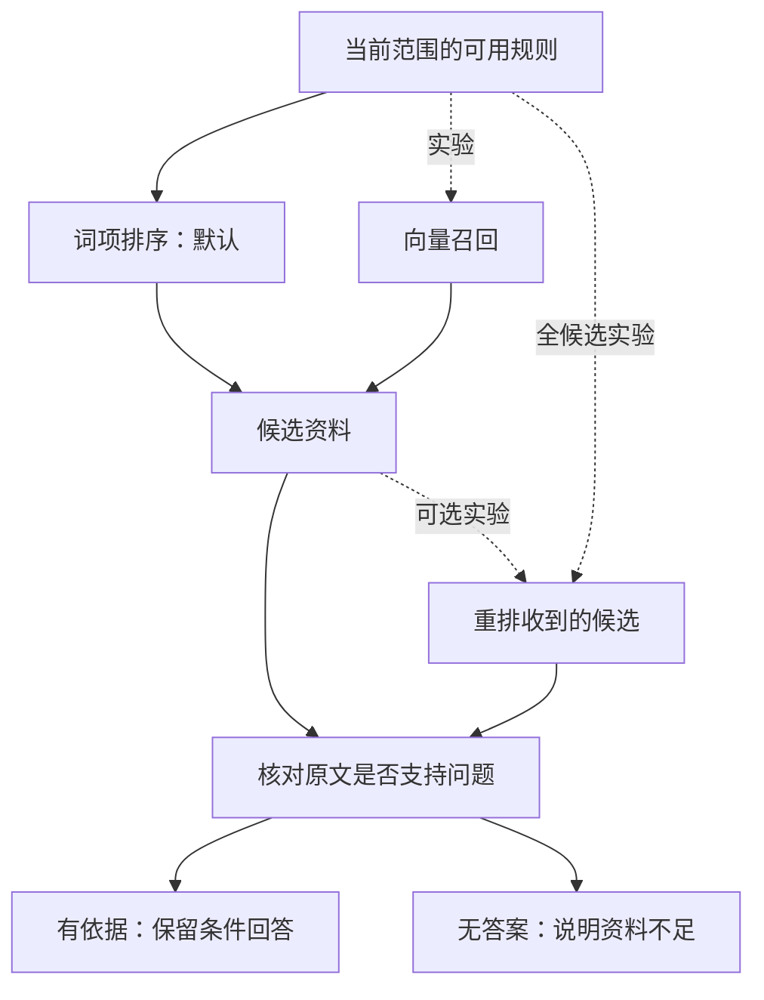

# 5.1 关键词、向量和 Rerank，RAG 应该怎么选？

用户问：“这张券还没去用，能把钱拿回来吗？”要回答这句话，客服需要先查本人订单，再找本店适用规则，最后区分“可以申请”“商家已经批准”和“退款已经完成”。检索只负责找到可能有用的资料，后面的判断仍有各自的依据。

RAG 是“检索增强生成”：先取回外部资料，再让模型围绕资料回答。它的价值不在于给模型塞更多文字，而在于把所需事实从可维护的来源带进本轮对话。本课从默认的词项排序出发，解释向量、融合、重排分别解决什么问题，以及为什么找到资料以后还要判断它是否足以回答。



图 1：词项是默认路线，虚线表示实验选择。重排只能处理收到的资料；小规则库也可把全部规则交给它，之后仍要核对原文能否回答。

## 1. 先把四个问题分开

| 问题 | 例子 | 负责的机制 |
| --- | --- | --- |
| 资料相关吗 | 用户问退款，找到了退款规则 | 检索与排序 |
| 资料适用吗 | 该规则属于本人订单的门店和套餐 | 范围过滤与本轮订单事实 |
| 资料足够吗 | 规则写办理流程，却没给出这单的批准结果 | 事实支持判断 |
| 现在能执行吗 | 用户是否确认、批准是否有效、金额是否一致 | Harness 与事务校验 |

比如一篇退款规则会说“原路退回”，却不知道这一笔钱今天是否到账。找到它之后，仍需查询这笔退款的实际结果。这就是相关资料和具体答案的差别。

后文把参与检索的文档集合叫“语料”，把本轮可能有用的文档叫“候选”。排序决定先看谁，取前五则控制交给后续阶段的资料数量。

## 2. 默认词项排序怎样工作

本项目的默认规则库很小，原创规则按整篇保存。先由数据库筛出当前可用的通用、门店或套餐规则，再在进程中排序。直接工具路线由模型选择查询工具；工具本身负责参数检查与数据读取。

词项就是分词与归一化后用于匹配的词。排序时先统一全角、半角和大小写，再把“退钱、退费”归一成“退款”，把“没用过”归一成“未核销”。中文分词得到词项后，标签、标题和正文按不同权重计分；多个文档都出现的常见词，区分力比少见领域词更弱。同分按文档 ID 排序，使同一输入的顺序可复现。

查词得到分数以后，再过滤和排序。把代码中的三个字段想成三处提示：标签最明确，标题次之，正文最宽泛。

```typescript
// terms 是归一后的查询词；weights 给少见词更高的区分权重。
return candidates.map(({ document, tags, title, body }) => {
  let score = 0;
  for (const term of terms) {
    // 完整标签 5 分、部分标签 2 分、标题 2 分、正文 1 分。
    score += weights.get(term)! * (
      (tags.includes(term) ? 5 : tags.some(tag => tag.includes(term)) ? 2 : 0)
      + (title.includes(term) ? 2 : 0)
      + (body.includes(term) ? 1 : 0)
    );
  }
  return { document, score };
})
  .filter(({ score }) => score > 0) // 没命中的文档不进入结果。
  .sort((a, b) => b.score - a.score
    || a.document.id.localeCompare(b.document.id))
  .map(({ document }) => document); // 同分按 ID 固定顺序，再返回原文档。
```

例如同样命中“退款”，完整标签比正文偶然出现更有分量。最终返回的仍是原文档，排序只改变阅读顺序。

例如“吃不完能带回家吗”，归一以后可以命中“外带”。如果分词把领域词拆得过碎，应该先检查归一结果、保留词和命中字段。给查询预处理补齐一个通用领域词，通常比为某条题目写专用答案更可靠。

这套实现是词项加权排序。BM25 是另一种词项方案：它还处理词频饱和和文档长度，避免某词反复出现、或者正文很长就一直加分。默认代码没有这些完整机制，因此学习时应把两者分开。

## 3. 向量、融合与重排分别补哪一层

向量检索把问题和文档变成一串数，再按方向相近程度排序。它更容易关联“没去成想退钱”和“未核销退款条件”这类字面不同的表达。代价是要调用嵌入模型、维护文档向量，并处理文档更新后的同步。

混合检索同时取词项和向量结果。如果两条路线漏掉的是不同资料，合并可能更好；如果噪声也被一起加进来，效果未必提升。不同路线的原始分数含义不同，不能因为都叫 `score` 就直接相加。

实验里的 RRF 按名次合并两路结果：同一文档在各路线越靠前，累积贡献越大。这样无需把含义不同的原始分数强行放到同一尺度。

```typescript
export function reciprocalRankFusion(
  rankings: readonly (readonly RankedDocument[])[], // 每条路线各给一份排名。
  options: { k?: number; topK?: number } = {},
): RankedDocument[] {
  const { rrfK: k, rrfWindow: topK } = resolveRetrievalParameters({
    // k 越大，相邻名次的贡献差距越小。
    rrfK: options.k ?? parameterDefaults.rrfK,
    // 每条路线只累加前 topK 篇文档的贡献。
    rrfWindow: options.topK ?? parameterDefaults.rrfWindow,
  });
  const scores = new Map<string, number>(); // 按文档 ID 累积贡献。
  for (const ranking of rankings) {
    const ids = new Set<string>(); // 同一路线不能把文档重复计分。
    ranking.forEach((document, index) => {
      if (!document || typeof document.id !== "string" || !document.id.trim()
        || ids.has(document.id) || !Number.isFinite(document.score)) {
        throw new Error("Invalid or duplicate ranked document.");
      }
      ids.add(document.id);
      if (index < topK) {
        // index 从 0 开始，因此实际名次要加 1。
        scores.set(document.id,
          (scores.get(document.id) ?? 0) + 1 / (k + index + 1));
      }
    });
  }
  return ranked([...scores].map(([id, score]) => ({ id, score })));
}
```

假设文档在两路分别排第一和第三，就累积两次贡献；只在一路出现则只加一次。两路都漏掉的文档仍然进不来，所以融合效果取决于它们是否真正互补。

Rerank（重排）把问题与候选正文一起交给专用模型，重新比较哪个最相关。它比仅比较向量能看到更完整的交互，但也只能排列已经送进去的候选。如果词项只召回错误资料，再强的重排也无法凭空恢复没收到的正确文档。

| 路线 | 主要收益 | 主要成本或限制 |
| --- | --- | --- |
| 词项 | 便于解释，明确术语稳定 | 口语和省略容易漏召回 |
| 向量 | 补充语义接近但字面不同的表达 | 模型请求与向量更新 |
| 词项与向量融合 | 利用两路互补 | 多维护一条链，未必净改善 |
| 全候选重排 | 小语料时避免前置召回遗漏 | 文档越多，输入和延迟越高 |
| 先召回再重排 | 限制重排输入规模 | 保留召回阶段的质量上限 |

小语料可以直接试全候选重排，先观察质量是否值得那次额外请求。语料增长后再测量规模和成本。当前默认仍是词项排序，语义重排与事实支持保留为实验候选。

## 4. 排名很好，为什么还要证据接收

看两道问题：“这张券哪天到期？”和“去哪里查到期日？”对于第一题，原文“以订单中显示的有效期为准”并不充分；对于第二题，它正好回答了问题。证据接收就是把候选与当前诉求逐篇比较，接收能支持回答的资料，拒收只相关却不充分的资料。

候选方案会检查返回的文档 ID、连续原文引文和必要条件，之后再次读取来源，变化则放弃本次结果。这里有两种不同的检查：程序能判断引文是否真的存在；模型判断这段引文是否足以回答。前者通过，后者仍可能出错。

客服可以诚实地说“现有资料没有提供具体日期”，但不能把这句诚实说明记成“具体日期已被答对”。同样，规则里的“需要商家确认”可以回答流程题，却不能回答“商家是否已经同意”。

## 5. 用小例子理解指标与选型

若每题只有一篇相关文档，十道题有八道的相关文档进入前五，Recall@5 是 80%。若每题可能需要多篇资料，应先算每题相关文档覆盖比例，再对题目平均。MRR@5 看第一个相关文档的位置：第一名记 1，第二名记 1/2，五名外记 0。一个看有没有找到，一个看找得够不够靠前。

一次困难题对照中，词项路线 Recall@5 为 44.74%，全候选重排为 97.37%；词项先取候选再重排仍只有 46.05%。这个现象提示瓶颈在召回。混合路线低于单独向量，也说明“组件更多”不自动等于“效果更好”。这些是检索指标，不能改名为客服准确率或退款完成率。

做新对照时，把语料、问题、标签、参数和调用预算一起固定。先看漏召回、无答案误接收和范围混入，再比较延迟与费用；这样才知道复杂组件解决了什么问题。

## 6. 练习：先定位层级，再决定改什么

给规则库一篇“工作日可用，节假日除外”，用户问“周六可以用吗”。请分别回答：有没有召回这篇？周六是否属于原文已覆盖条件？能否直接答“可以”？需要补充什么信息？

如果正确文档根本不在候选里，研究归一与召回；如果已经排第一但条件缺失，改排序不是主要解法；如果证据足够而最终回复丢了例外，要检查生成与回复层。按失败层级修复，才知道新复杂度是否花在真正的问题上。

## 参考与复现

实现参考：`src/knowledge-retrieval.ts`、`src/retrieval-ranking.ts`、`src/knowledge-service.ts`；实验说明：`docs/retrieval.md`、`docs/a1-support-results.md`。上面的核心代码已在正文展开，不要求跳转仓库阅读。

历史数字来自 35 篇独立参考资料的 76 道困难开发题，属于构造题集；另有 136 道常规题，不与重叠子集相加。参考资料未导入业务规则库。项目复用外部嵌入、重排和生成模型，未训练这些模型；在线知识候选尚未通过整体在线验收。本课图片用于解释机制，订单、商家结果和资金均为合成数据。
