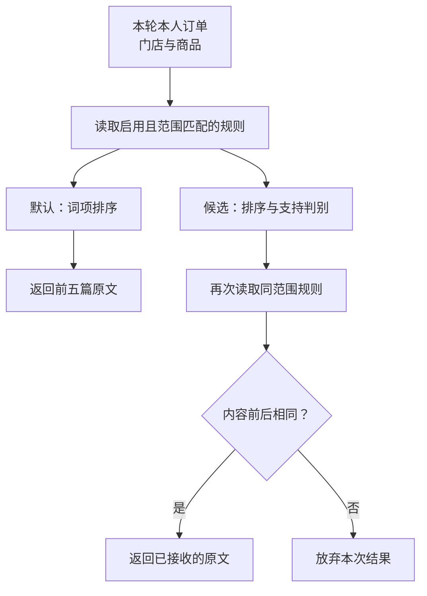

# 5.2 查到一条规则，怎样确认它适用于这笔订单？

用户问：“我的券还没用，但已经过期了，能自动退吗？”检索到了两篇规则：一篇说过期要商家确认，另一篇说支持过期退。即使两篇文字都真实存在，也不能把更方便的一条直接套到当前订单。

要决定使用哪篇规则，先沿着资料走一遍：规则怎样进数据库，查询怎样限定门店和套餐，返回后怎样发现内容已经改变。

## 1. 一条规则有哪些组成部分

“语料集合”是一组共同使用的文档。项目的原创规则服务当前团购券咨询，外部参考资料用于独立实验；两组资料的业务承诺不能混用。规则通常包括以下字段。

| 字段 | 作用 | 例子 |
| --- | --- | --- |
| ID | 定位同一篇文档 | 过期退款规则的编号 |
| 标题、正文、标签 | 表达规则并参与检索 | 过期处理、退款、商家确认 |
| 门店、商品范围 | 限定谁可以使用这条规则 | 本店某套餐，或通用规则 |
| 启用状态 | 控制当前是否可读 | 启用、停用 |

ID 像书的索引号。即使正文修改，ID 也可以不变，因此“还是那个编号”不表示内容没变。门店与商品范围像书的适用对象，决定能否拿给这次咨询使用。启用状态则决定服务现在是否允许读取。

## 2. 从文件到数据库，为什么要区分三个位置

初始化 SQL 保存默认规则。首次创建空数据库时，它把整篇规则写入知识表；之后服务查询的是数据库里的行。已有数据卷不会因为文件被修改或容器重启就自动重新导入。

因此要区分：源码中的初始化文件、离线实验保存的快照、正在运行的数据库。文件是预期导入内容，快照是某次固定的实验输入，数据库行是服务此刻真正读取的数据。更新知识时要明确修改哪一个位置，不能把它们当作自动同步的三份副本。

例如把 SQL 文件里的“需要确认”改成“允许自动退”，已有数据库不会跟着变化。更新服务正在使用的规则，需要明确执行数据更新并准备回滚；删除整个数据卷会把别的业务数据一起丢掉。

当前小规则库按整篇读取，优点是容易看懂、容易核查来源，不需要额外切块服务。未来若长文很多，再考虑分段；那时每个片段还要保留所属文档、适用对象和上下文，避免把条件与结论切开。

## 3. 先限定范围，再做相关性排序

数据库访问层 `CouponStore` 先确认门店和套餐参数合法，再读取适用规则：

```typescript
// 套餐必须和门店一起提供，标识也只接受规定格式。
if ([shopId, productId].some(
  id => id !== undefined && !/^[A-Za-z0-9_-]{1,64}$/.test(id),
) || (productId && !shopId)) {
  throw new Error("请提供有效且关联的门店和套餐标识。");
}
if (shopId) {
  // 门店须启用；指定套餐时，还要确认套餐启用且归属该门店。
  // SQL 中的 ? 是占位符，后面的数组按顺序提供参数。
  const scope = await this.select(`
    SELECT /*+ MAX_EXECUTION_TIME(3000) */ s.id FROM shops s
    WHERE s.id = ? AND s.status = 'active' AND (? IS NULL OR EXISTS (
      SELECT 1 FROM products p
      WHERE p.id = ? AND p.shop_id = s.id AND p.status = 'active'
    )) LIMIT 1`, [shopId, productId ?? null, productId ?? null]);
  if (!scope.length) return [];
}
// NULL 表示通用规则；具体范围只允许与本次参数匹配。
const rows = await this.select(`
  SELECT /*+ MAX_EXECUTION_TIME(3000) */
    id, shop_id, product_id, title, body, tags
  FROM knowledge_documents WHERE status = 'active'
  AND (shop_id IS NULL OR shop_id = ?)
  AND (product_id IS NULL OR product_id = ?)
  ORDER BY id LIMIT 201`, [shopId ?? null, productId ?? null]);
if (rows.length > 200) throw new Error(databaseFailure); // 多读一篇检测超限。
```

因此，指定门店套餐时可以读到通用规则及匹配范围的规则，其他门店会被排除。没有指定范围，就只读通用规则；查不到通用资料时，仍可能需要进一步明确套餐。

这里故意多取一篇：允许处理 200 篇，读到第 201 篇就报错。这样容量超限会明确暴露，不会截掉尾部资料后继续给人“已经查完”的印象。

范围合法还不够，具体门店和套餐必须来自本轮本人订单。`search_faq` 在查规则前先核对这件事：

```typescript
// scopes 保存本轮本人订单的门店与商品；revision 是它的有效版本。
// search_faq 执行时记下版本，等待查询前后都检查它是否仍有效。
const turn = currentTurn, revision = turn.revision;
assertCurrent(turn, revision, signal);
if ((shopId || productId) && ![...turn.scopes.values()].some(
  scope => (!shopId || scope.shopId === shopId)
    && (!productId || scope.productIds.includes(productId)),
)) {
  throw new Error("查询具体门店或套餐规则前，须在本轮先查询匹配的本人订单。");
}
const rules = await store.searchKnowledge(query, shopId, productId);
assertCurrent(turn, revision, signal); // 等待期间取消或范围失效，就停止返回。
return {
  content: [{ type: "text", text: JSON.stringify(rules) }],
  details: {}
};
```

成功的 `get_order` 才会写入本轮范围表。带门店或商品的查询需要匹配这份记录，通用规则咨询则可以不带范围执行。

每轮开始会新建范围表；查单失败时清空范围并增加版本。异步查询前后都检查版本，防止失败前发出的旧读取迟到后又把范围恢复。

## 4. 工具结果为什么携带正文与范围

查到文档后，按查询排序并返回前五篇。原文和适用范围一起交给后续回答：

```typescript
async searchKnowledge(query: string, shopId?: string, productId?: string) {
  // query 负责相关性，shopId 和 productId 负责适用范围。
  if (!query.trim() || query.length > 500) {
    throw new Error("请输入 1–500 字的规则查询。");
  }
  return rankKnowledge(query,
    await this.readKnowledgeDocuments(shopId, productId))
    .slice(0, 5)
    .map(document => ({
      source: "demo-knowledge" as const,
      sourceId: document.id, // 用于追溯这篇资料。
      title: document.title,
      body: document.body,   // 保留条件与例外所在的原文。
      scope: { shopId: document.shopId, productId: document.productId ?? null },
    }));
}
```

用户问题负责描述“想找什么”，门店与商品参数负责确定“在哪找”。例如输入别家店的名字，只改变查询文字，不能扩大本轮授权范围。

返回正文，才能保留条件和例外；带上来源和范围，后续才能知道这些话适用于谁。只给标题或编号，模型就缺少判断依据。

例如原文写“未核销且未过期可按流程申请”。回答时必须保留两个条件以及“申请”的动作性质，不能压缩成“未核销可退款”，更不能输出“这单退款成功”。压缩丢失的往往正是业务上最重要的限制。

## 5. 读取期间规则变了，怎样处理



图 1：具体订单先限定可信范围，再排序；候选支持路线还会重读来源，内容变化就放弃本次结果。

候选知识服务可能在读取规则之后调用重排模型，重新排列候选资料；还可能调用支持判别模型，判断资料是否足以支持当前回答。这段等待时间内，管理员可能修改正文。若仍把旧判断绑定到新文档编号上，读者就会看到“编号正确，但判断所用内容已不是现在内容”的问题。

项目的候选服务会对第一次读取的整组内容计算指纹，判别完成后重新读取，再比较。内容指纹是对一份具体内容计算出的摘要值；只要观察到内容变化，本次结果就不再接收。

服务先读取规则，保存这份内容的指纹：

```typescript
const before = await read(); // 第一次读取本轮适用规则。
trace.sourceHashes.before = contentHash(before); // 记录内容指纹。
```

等排序和支持判别结束，再读取一次：

```typescript
enter("recheck"); // 排序和支持判别完成，回到来源复检。
const after = await read();
trace.sourceHashes.after = contentHash(after);
if (trace.sourceHashes.before !== trace.sourceHashes.after) {
  trace.reason = "source_changed"; // 判断依据已经变化，本轮结果作废。
  throw new Error();
}
```

如果两次内容不同，本轮判断就作废。这比只比较文档编号更可靠，但没有把规则锁住：两次读取之间改了又改回，或者第二次读完再修改，仍可能看不出来。

若要回答“我购买那天承诺了什么”，还需要规则版本、生效时间和交易关联记录。当前内容指纹只解决前后读取是否一致。

## 6. 一份小例子：同名规则并不冲突

设门店甲的套餐规则写“过期需确认”，门店乙写“支持过期退”。把两篇放到同一次检索里，模型可能挑选语气更肯定的一篇；先按可信门店过滤，则乙的文档根本不进入候选。这说明适用范围应该在排序之前执行，而不是等模型回答完再从文字中寻找错误。

再设甲店停用了原规则。即使索引号仍然存在，读取也应排除停用行。此时结果为空，正确含义是“当前允许读取的范围里没有找到”，不是“退款一定不允许”，更不是“可以参照别店承诺”。系统应区分缺少资料与政策明确禁止，再决定澄清或核实。

## 7. 怎样排查一条可疑规则

遇到“为什么回答用了另一家店的政策”，不要先调模型温度。先检查本轮本人订单读出的门店和商品，再看查询参数，再看数据库返回的规则范围，最后才看排序与回复。

遇到“规则文件改了但答复没变”，先分清数据有没有更新。若数据库仍是旧内容，重写提示词解决不了；若数据库已变但判别使用旧来源，要检查读取与缓存；若本轮读到新内容但回答没保留例外，问题落在解释和生成阶段。

练习：两篇规则都叫“退款说明”，一篇通用、一篇仅对某套餐有效。用户没有提供订单，只说“这张能退吗”。合理流程是先确认对象或查本人订单，得到可信范围后再查适用规则，而不是按标题相似度直接选一篇承诺退款。

再问一步：如果订单实付 79.80 元，而规则只写“可按原支付渠道退回”，它能提供退款金额吗？不能。规则提供处理约束，实例金额仍来自当前支付与退款记录。

## 参考与复现

实现参考：`db/01-schema.sql`、`db/02-seed.sql`、`src/coupon-store.ts`、`src/agent.ts`、`src/knowledge-service.ts`；规则来源与实验边界见 `docs/evaluation.md` 及现有评测说明。正文已展开读取、排序入口与来源复检的核心语句。

原创规则与外部参考语料独立维护，不能将外部平台政策当成本店承诺。默认直接工具路线直接使用词项检索；前后两次读取比较、资料是否足够支持回答的判断属于候选知识服务，尚未完成整体在线准入。当前没有完整的购买时政策历史系统，本课不新增数据库或模型运行结果。
