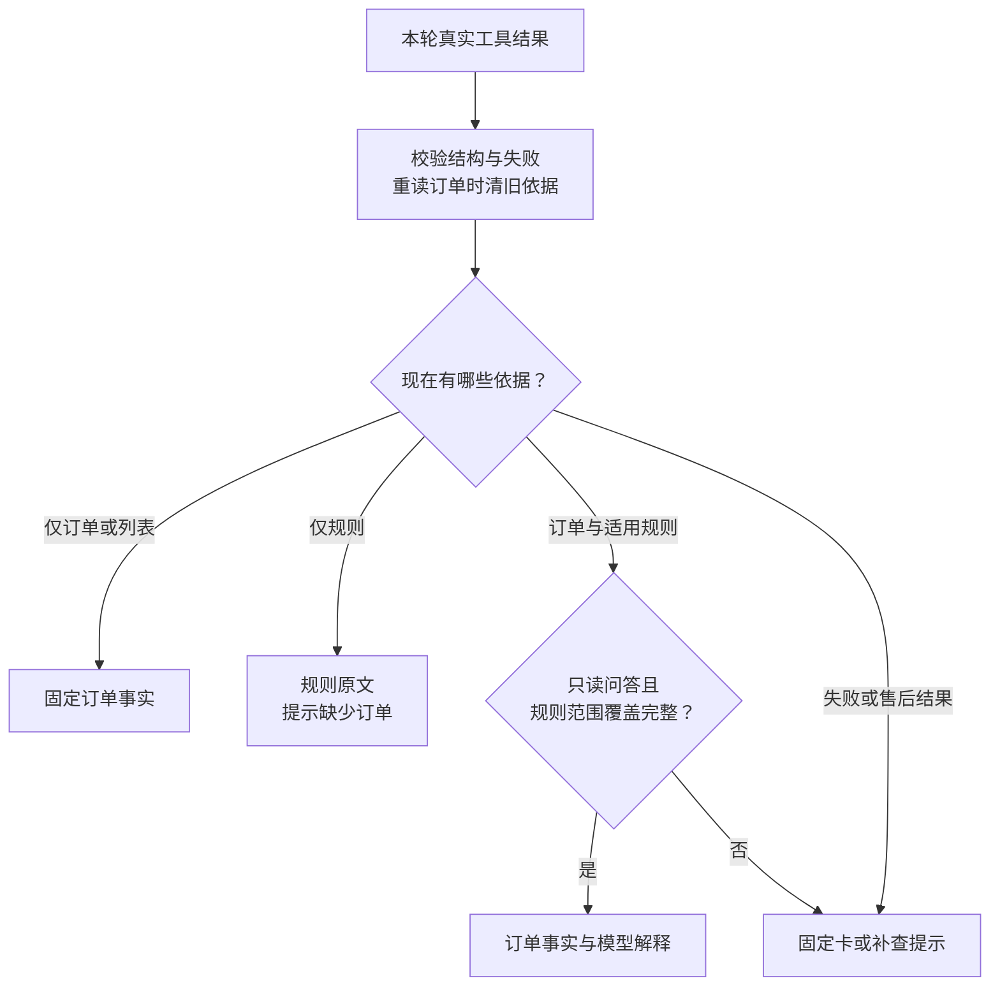

# 5.3 订单查对了，为什么回答仍可能出错？

客户问：“这张券我实付多少？还没用能不能退？”客服展示一张金额为 79.80 元的订单卡，又附上退款规则编号。读者很容易把这两样看成“整个回答可靠”的信号，但它们分别只能解决部分问题。

跟着这次提问走一遍：先确认谁在问，再查本人订单和适用规则，最后把工具结果变成订单卡与解释。读完就能看出，金额、规则和“能否办理”各自依赖什么。

## 1. 先认清查询链里的对象

“订单”记录购买与支付；“券”记录可使用凭证及核销状态；“规则”描述条件和流程；“可信身份”来自 QQ 等接入层确认的发送者。模型可以提出查询哪个订单，但不能自行指定“我代表哪个客户”。

Pi 负责模型与工具之间的循环。模型选择业务入口以后，模型外的业务控制层 Harness 会检查本轮范围，并在必要时经 Pi 补查订单和规则；数据库再检查归属和状态。三者各自承担一段工作。

一轮查询可概括为：用户提出问题 → 模型选择查单 → Harness 注入身份 → 数据库读取本人订单 → 按门店套餐查规则 → 组装卡片与回答。对象不明确时先列出本人最近订单并让用户选择；选单只解决定位，不能继承旧状态或退款许可。

## 2. 模型只能给订单号，身份由 Harness 带入

`get_order` 的模型参数只有 `orderId`，额外字段会被参数校验拒绝。实际执行时，客户身份从 Harness 的会话环境中带入：

```typescript
// get_order 的执行逻辑：orderId 来自模型，identity 来自可信会话。
// turn 是当前这一轮；revision 用来识别等待期间是否已失效。
const turn = currentTurn, revision = turn.revision;
try {
  assertCurrent(turn, revision, signal);
  const order = await store.getOrder(identity, orderId);
  assertCurrent(turn, revision, signal); // 等待期间取消或失效，就不再使用结果。

  // 只有结构完整、对象匹配的当前订单才能建立规则查询范围。
  if (order.source === "demo-database" && order.id === orderId
    && typeof order.shop?.id === "string" && order.shop.id
    && Array.isArray(order.items) && order.items.length
    && order.items.every(item =>
      typeof item.productId === "string" && item.productId)) {
    turn.scopes.set(orderId, {
      shopId: order.shop.id,
      productIds: [...new Set(order.items.map(item => item.productId))],
    });
  } else {
    turn.scopes.delete(orderId);
  }
  return {
    content: [{ type: "text", text: JSON.stringify(order) }],
    details: {}
  };
} catch (error) {
  // 读取失败也淘汰尚在等待的旧查询，防止迟到成功重新激活范围。
  retireScopes(turn, revision);
  throw error;
}
```

因此，即使模型在文字里说“我代表另一个客户”，也换不掉执行函数使用的身份。查单成功后才记住本轮可用的门店和商品范围；读取失败则让旧范围一起失效。

数据库还要再核对一次归属。查询把订单与当前账号绑定连起来，只有订单号、应用标识和发送者同时匹配才返回：

```typescript
// JOIN 当前账号绑定后再查订单，不能仅凭订单号读取。
const rows = await this.select(`
  SELECT /*+ MAX_EXECUTION_TIME(3000) */
    o.id, o.status, o.total_cents, o.paid_cents, o.refunded_cents,
    o.created_at, o.paid_at,
    s.id AS shop_id, s.name AS shop_name, s.address, m.name AS merchant_name
  FROM orders o JOIN qq_identities q ON q.customer_id = o.customer_id
  JOIN shops s ON s.id = o.shop_id JOIN merchants m ON m.id = s.merchant_id
  WHERE o.id = ? AND q.app_id = ? AND q.sender_id = ? LIMIT 1`,
  [orderId, identity.appId, identity.senderId], connection,
);
const order = rows[0];
if (!order) throw notFound; // 不存在与不可访问使用相同提示。
```

知道订单号只能定位目标，不能取得权限。查询不到和无权访问统一返回无法查询，避免从报错差异中探测别人的订单。

## 3. 同一次查询为什么使用一致快照

订单总额、券状态、付款记录、退款记录存放在不同表中。如果逐表读取时跨过一次并发退款，可能拼出“订单已退款，退款记录还不存在”之类不一致组合。

`getOrder` 使用只读事务与可重复读隔离：授权查询和后续业务事实共享首次一致读的快照。成功后提交只读事务；失败则回滚，连接设置异常时销毁连接，避免污染下一次借用。返回结果还带 `asOf`，表示这次读取发生的时间。

这张卡可以说明“刚才那次读取的状态”。过一会儿再问有没有核销，就需要重查；准备或执行退款时，也要重新核对状态、批准和金额。

金额使用整数分：7980 表示 79.80 元。这样加减和比较不依赖二进制小数，展示时才转成元。字段校验会拒绝负数、非整数或超出安全整数范围的金额；它不通过改格式把异常值伪装成正常金额。

## 4. 查规则必须使用本轮授权范围

拿到本人订单后，模型应使用订单中的门店与套餐范围调用 `search_faq`。Harness 会在访问规则库之前检查：本轮是否成功读到匹配的本人订单。规则 Store 随后继续检查参数格式、商品与门店关联以及启用状态，按词项排序返回前五篇正文。

工具先检查本轮已经读取的订单范围：

```typescript
// 通用规则可直接查；指定门店或套餐时，须匹配本轮本人订单。
if ((shopId || productId) && ![...turn.scopes.values()].some(
  scope => (!shopId || scope.shopId === shopId)
    && (!productId || scope.productIds.includes(productId)),
)) {
  throw new Error("查询具体门店或套餐规则前，须在本轮先查询匹配的本人订单。");
}
```

范围表每轮重建，历史聊天不会填入它。普通 FAQ 可以不指定范围查询；具体套餐问题则先查本人订单，再取适用规则。

协商查询、协商准备和退款准备也有必要查询。例如进入协商查询后，Harness 会经 Pi 执行“重新查单 → 查各商品规则 → 读协商”。前一步失败，后面的业务服务就不会执行。

## 5. 固定卡片怎样从本轮工具结果生成



图 1：回复只使用本轮结果。售后入口缺少当前协商时仍须补查；来源和范围门槛通过，也不保证每句解释正确。

Harness 在本轮开始时订阅 Pi 的工具结束事件，结束后取消订阅。外层工具、内层查询，以及失败结果都要记录；否则只看到一张成功的外层卡，可能漏掉里面发生的失败。

```typescript
export function toolEvidenceFromEvent(
  event: AgentSessionEvent,
): Evidence | undefined {
  // 只接收真实执行结束事件，历史聊天不会进入本轮证据。
  if (event.type !== "tool_execution_end") return undefined;
  return {
    toolName: event.toolName, // 哪个工具实际执行了。
    isError: event.isError,   // 失败也必须记录，不能继续沿用旧结果。
    // 保留原始内容，由后续结构检查拒绝异常结果。
    content: (record(event.result)
      ? event.result.content : undefined) as Evidence["content"],
  };
}
```

这些结果按实际结束顺序进入回复处理。评测还可以用事件的 `parentToolCallId` 追踪哪个业务工具触发了哪次内层读取。

收到订单结果后，先校验来源、订单号、金额和券字段，再更新卡片。新订单快照出现时，先清掉旧规则与售后卡：

```typescript
// 重新读单后，规则也要重新查，避免旧条件搭配新订单状态。
evidenceIds.clear();
ruleScopes.length = 0;
documents.length = 0;

// 协商、退款卡片及“未查到任务”标记也重新取得。
merchant = undefined;
refund = undefined;
merchantEmpty = false;
refundEmpty = false;
```

```typescript
// 清理旧依据后，接着用 value 这份已校验的新订单填入卡片。
// 金额使用整数分；券状态来自同次读取。
orders.push({
  id: value.id,
  status: value.status,
  paidCents: value.amounts.paidCents,
  refundedCents: value.amounts.refundedCents,
  couponStatuses: value.coupons.map(item => item.status as string),
});
```

接着用新事实填入订单卡。若读单失败，则清掉已有订单和售后卡；后续即便查到另一笔订单，也必须重新查询对应业务结果，才能生成新的售后卡。

有了卡片，是否就能公开模型解释？还需要当前订单、后续取得的规则和匹配范围。检查集中在下面的函数里：

```typescript
// value 是回复层从本轮工具结果整理出的订单、规则、卡片与失败状态。
function allowsBusinessText(value: ReturnType<typeof readEvidence>) {
  // 尚有失败、选单列表或固定售后卡时，先走对应提示与卡片。
  if (!value.evidenceIds.size || value.toolFailed || value.listed
    || value.merchant || value.refund
    || value.merchantEmpty || value.refundEmpty) {
    return false;
  }
  if (!value.orders.length) return false;

  // NULL 是通用规则；具体规则必须匹配订单门店与商品。
  const matches = (
    rule: typeof value.ruleScopes[number],
    order: typeof value.orderScopes[number],
    productId: string,
  ) => (rule.shopId === null || rule.shopId === order.shopId)
    && (rule.productId === null || rule.productId === productId);

  return value.orderScopeKnown && value.orderScopes.length > 0
    // 每篇规则都能匹配到本轮订单里的商品。
    && value.ruleScopes.every(rule => value.orderScopes.some(
      order => order.productIds.some(productId =>
        matches(rule, order, productId)),
    ))
    // 每个订单商品也都有规则覆盖。
    && value.orderScopes.every(order => order.productIds.every(
      productId => value.ruleScopes.some(rule =>
        matches(rule, order, productId)),
    ));
}
```

例如订单包含两个商品，规则只覆盖其中一个，就暂时不给整单的自由解释。通用规则也可以参与匹配；至于原文是否真的回答了问题，还需要单独判断。

| 本轮取得的材料 | 最终回复边界 |
| --- | --- |
| 没有当前业务证据 | 固定澄清，不接纳模型的业务断言 |
| 只有规则 | 展示本轮规则原文，说明尚未核对具体订单 |
| 只有订单，或规则门槛不满足 | 固定订单事实与缺少适用依据的提示 |
| 只读入口有订单及通过门槛的规则 | 可以使用模型解释，并附固定订单卡与来源编号 |
| 开放协商的入口缺少当前协商结果 | 即使已有订单与规则，也不沿用历史批准或拒绝来确认退款方案 |
| 取得当前协商或退款结果 | 按对应固定业务卡表达状态，确认与执行另走 Harness 边界 |

网页发送实时文字前也使用这个检查。它先管住来源和范围，不能替代整段回答评测：卡片写 79.80 元，解释却说 999.99 元，依然是错误。已发送的文字也无法因为之后查询失败而撤回。

## 6. 怎样评价一段完整回答

对开头的问题，先拆成两件事。“实付多少”读取订单支付事实，固定卡片可直接回答；“能不能退”需要券状态、适用规则和必要条件，回答通常是资格或流程说明，不能跳成已批准、已执行。

审阅时把回复拆成几个问题：说的是本人哪一单？金额和状态是哪次读到的？规则条件是否匹配？有没有把“可申请”说成“已批准”或“已退款”？这样更容易找到具体错误。

例如订单有两张券，一张已用，一张未用。规则写“整单未核销可申请”，不能因为其中一张未用就判定整单符合。即使可以展示剩余券对应的实付金额，也没有自动获得部分退款权限。算得出数字与允许执行这笔资金操作，是两道不同的判断。

遇到缺少依据，合适的回复应明确缺失项并推动下一步：“已查到实付金额，但现有规则不足以确认部分使用后的退款条件，需要核实。”这比补出一个貌似完整的答案更有帮助，因为用户知道接下来需要补什么。

## 7. 练习：找出正确字段旁边的错误结论

给定本轮数据：实付 79.80 元、券状态未核销、当前已过期；规则要求商家确认。判断以下三句话：

1. “实付 79.80 元。”——支付事实可以支持。
2. “未核销，所以能自动退款。”——漏掉过期与确认条件。
3. “需要先按流程联系商家，批准后再准备退款方案。”——在相应流程适用时解释下一步，没有宣称结果已发生。

再追问：如果工具失败，而历史里曾显示同一金额，能否生成新的订单卡？不能。历史可帮助定位，但本轮没有取得新事实，就应如实表达无法确认当前状态。

## 参考与复现

实现参考：`src/agent.ts` 的工具注册、`src/coupon-store.ts` 的授权一致读、`src/reply-from-tools.ts` 的本轮字段映射、`src/reply.ts` 的格式化。数据库与售后说明分别位于 `docs/database.md`、`docs/after-sales.md`。

本课讲默认直接工具路线（配置名 atomic）。订单、商家结果和资金均为合成；语义支持判别及更强的知识编排仍是实验候选。源码与确定性检查说明保护怎样工作，真实模型、QQ 传输及商业退款需要各自的验收，历史未通过结果保留在相应记录中。
