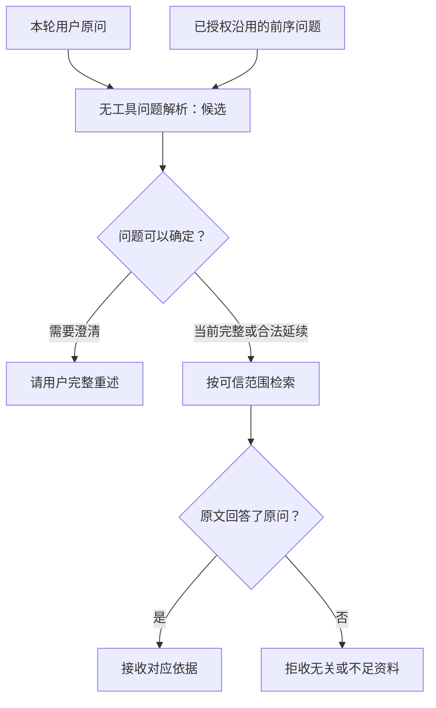

# 5.4 用户只说“刚才那个”，怎样理解又不猜错？

用户先问：“午餐券普通周六能用吗？”后来只说：“刚才那件事，现在可以了吗？”如果中间换过订单、商品范围变了，或同时讨论过多个话题，客服不能凭“未核销”这个状态猜用户一定在问退款。

“刚才那件事”要接到哪句话，是多轮对话真正棘手的地方。本课介绍一个候选方案：只保留用户原来问过的问题，先还原这次诉求，再判断资料能否回答。它仍在研究中，默认流程尚未采用。



图 1：候选路线先接对问题，再判断资料是否回答原问。解析输入不带订单状态、历史答案或检索正文，避免把周末使用问成退款。

## 1. 当前问题、历史答案和订单事实各司其职

用户原始问题是可信入口收到的文字。前序问题记录保存允许沿用的前几轮用户问题及其请求标识。历史答案是模型曾给出的解释，可能有遗漏或错误。订单事实则是本轮重新查询得到的门店、商品、状态与金额。

| 材料 | 可以帮助什么 | 不应承担什么 |
| --- | --- | --- |
| 本轮问题 | 确定这次用户显式说了什么 | 补出没说过的对象或条件 |
| 允许沿用的前序问题 | 恢复省略的前序诉求 | 跨失效范围继续沿用 |
| 当前订单事实 | 检查问题中的条件与适用对象 | 自动生成“用户想退款”的意图 |
| 历史答案 | 帮助理解对话经过 | 成为新业务事实或授权 |

错误经常发生在这几个对象被混成一个大字符串时。比如把“券未核销”补到查询后面，检索系统很容易返回退款规则；可用户原本问的是周六使用时间。找到的文档是真的，回答的问题却被悄悄换掉了。

## 2. 先选对历史，再让模型解析

候选路线的业务控制器 Controller 先选定前序话题，再重新授权读单、比较门店和商品范围。范围变了就不沿用旧问题；多个话题都有可能时，先请用户选清楚。

问题解析器是一个单独的无工具模型请求。它只看到本轮用户原文和允许沿用的前几轮问题，不看到订单状态、检索正文或旧答案。输入越贴近它的单一职责，越不容易把现有材料中的内容误当成用户想问的内容。

构造解析输入时，只带上本轮原文和已选定的前序问题：

```typescript
export function buildSupportQuestionResolutionInput(input: {
  requestId: string; // 区分本轮问题。
  originalQuery: string;
  previousTopic?: TrustedPolicyTopic | null; // 调用方已选定、授权的前序话题。
}): SupportQuestionResolutionInput {
  const previous = input.previousTopic;
  if (previous !== undefined && previous !== null
    && (typeof previous !== "object" || Array.isArray(previous))) {
    throw new Error("咨询问题解析的前序话题无效。");
  }
  // queries 是这个话题允许沿用的原问链，不是模型改写后的问法。
  const queries = previous ? policyTopicQueries(previous) : undefined;
  if (previous && !queries) {
    throw new Error("咨询问题解析的前序原问链无效或超出恢复预算。");
  }
  // 输入只含用户问题，不装入订单状态、检索正文或历史答案。
  const value = {
    requestId: input.requestId,
    originalQuery: input.originalQuery,
    previousTopic: previous
      ? { requestId: previous.requestId, queries: queries! } : null,
  };
  if (!validateSupportQuestionResolutionInput(value)) {
    throw new Error("咨询问题解析输入无效或超出恢复预算。");
  }
  return freezeInput(value); // 校验后固定输入，供解析及结果核对使用。
}
```

问题链最多五个问题，连接本轮后也不能超限，总原文不超过 500 字符。超出时请用户重新说明，避免让这次小小的“接话”任务重新背上全部聊天历史。请求标识只用于区分轮次。

## 3. 解析器只作三种决定

| 决定 | 含义 | 接下来的动作 |
| --- | --- | --- |
| 当前完整 | 这句话本身足以表达问题 | 使用本轮问题 |
| 可以延续 | 当前句需要合法的前序问题才能完整 | 接上指定前序问题记录 |
| 需要澄清 | 无法可靠确定诉求或引用 | 请用户完整重述 |

“当前完整”并不表示资料足够。用户明确问“这张券哪天到期”，问题很完整，但当前资料可能没有日期；这要在后续查询事实和规则时处理。把“听懂问题”和“已有答案”混成一个布尔值，会让系统在不该回答时过早回答。

模型还要指出本轮原文中的连续片段，以及它引用的前序请求。Harness 可以据此核对出处：有没有改写用户原话，有没有接到别的话题。但片段真实，仍不等于模型理解一定正确。

原文和输入校验通过后，再按三种决定检查前序引用：

```typescript
// input 是刚才构造的解析输入；value 是模型返回、等待核验的决定。
// 本轮问题已经完整，就不再引用历史问题。
if (value.decision === "current_complete")
  return value.previousRequestId === null;

// 需要澄清时，可以不引用，也只能指向当前允许的那段历史。
if (value.decision === "needs_clarification") {
  return value.previousRequestId === null
    || Boolean(input.previousTopic
      && value.previousRequestId === input.previousTopic.requestId);
}

// 延续历史时，话题必须匹配；接上本轮后仍须在 5 问、500 字符内。
return Boolean(input.previousTopic
  && value.previousRequestId === input.previousTopic.requestId
  && input.previousTopic.queries.length < 5
  && input.previousTopic.queries.reduce(
    (sum, row) => sum + row.originalQuery.length,
    input.originalQuery.length,
  ) <= 500);
```

例如用户已经完整重述，就不应再接上另一段历史；需要延续时，必须引用这次允许使用的话题。异步解析返回后还会检查选择是否过期。

## 4. 搜索用的问题与判别用的问题可以不同

检索需要一段紧凑、能找到相关资料的查询；支持判别需要足够上下文，判断原文条件是否适用。把所有订单字段都拼给检索，可能让高频状态词盖过真正诉求；把所有字段都删掉，判别又可能不知道当前条件。

候选路线因此区分两份文本：检索文本保留用户真正的问题与已核实商品；判别文本再附加中性的订单状态、券数和有效期事实。附加事实只用来检查条件，不应成为新问题。比如“当前券未核销”不能把周末使用咨询改成退款资格咨询。

查询文本的补充也要看用途：一般咨询保留原问，用户已进入协商或退款准备时才检查对应的业务前提。

```typescript
// prerequisite 表示已经进入协商或退款准备，需要核对业务前提。
if (prerequisite) query = orderRefundState(order!);
// 一般咨询保留用户原问，只补入已核实的商品，帮助检索匹配。
if (order) query += `\n已核实订单商品：${order.items[0]!.productName}。`;
```

这解释了为什么同样是补入订单状态，在两种路径里含义不同。准备退款时它回答“前提满足吗”；周末使用咨询里，却不能因此把问题改成退款。

## 5. 第二道判断：资料是否真的回答了用户的问题

假设已经把省略句还原为“普通周六可否使用午餐券”。检索得到“未核销可以申请退款”。这篇资料可能适用同一商品，原文引文也完全正确，但它没有回答使用日期，应该拒收作为本题依据。

再看“规则没有列出节假日安排”。若用户问“节假日究竟能不能用”，它是不充分资料；若用户问“资料是否说明了节假日安排”，它却可以直接回答边界。支持判断必须以用户原始问题为起点，不能因为资料里只有缺失说明，就把用户问题改造成资料覆盖问题。

连起来看，就是先明确对象和问题，再查当前事实与规则，最后决定是否足以回答。哪一步还拿不准，就在那一步澄清，而不是让后面的流畅文字替它猜答案。

## 6. 澄清也要有退出路径

需要重述时，客服可以说：“请完整说明您想确认的使用条件，例如具体日期或人数。”用户随后明确说“这张午餐券普通周六可以用吗”，系统应按新问题重新查询事实和规则，并清除旧的“待澄清”状态。

若旧标记始终残留，后面即使已回答，也可能每轮继续要求重述。若清除太早，在仍有两个竞争对象时又会误接。这说明澄清是一个有进入和退出条件的对话状态，不是一句万能兜底文案。

测试应检查实际交付给用户的回复。内部模型可能生成过一段完整文字，最后模板却丢掉关键条件；也可能内部判别失误，但最终拒绝错误结论。这些应分别记录，不能拿“最好的一段内部文字”替换真正送出的结果。

## 7. 什么时候值得增加这一层

单独解析多一次请求，意味着延迟、费用和失败点都增加。只有在旧意图污染、歧义续问等可定位问题上看到收益，才值得引入。一次小批对照中，严格业务通过从 9/12 提升到 11/12，中位耗时也从约 4.1 秒增加到约 5.4 秒；改善与成本要一起解释。

这组结果说明候选值得继续研究，但完整、明确的普通问题可能只会多花一次请求。显式选单、限定历史、要求重述仍是更简单的备选。

练习：用户先问人数，后问退款，再说“那它还行吗”。列出至少两个可能含义，然后设计一句不替用户决定意图的澄清。接着假设用户明确重述，说明哪些旧状态要清除、哪些订单事实要重查。

## 参考与复现

实现参考：`src/support-question-resolution.ts`、`src/support-controller.ts`、`src/support-evidence-context.ts`；问题还原与失败分析记录位于 `docs/c1-policy-scope-repair.md`。正文函数和片段足以理解核心输入、引用限制与分工。

上述对照两组各 12 轮，24 轮全部执行，是针对已知失败类型设计的新题小样本；改善属于整套候选，不能单独归因于某一个函数。该候选尚未通过整体在线验收，也没有据此改变默认路线。资料出处校验不等于语义正确，问题还原不提供退款授权。
