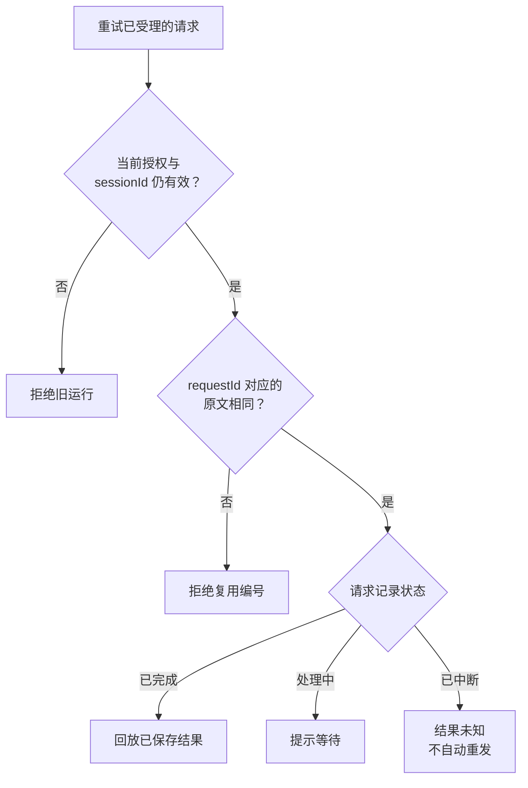

# 6.2 刷新、断线和多标签页，怎样避免丢回复与串会话？

## 页面没收到回复，能不能再发一次

客户发出“这张券普通周六能用吗”，服务端已查询规则并保存答复，网络却在返回时断开。用户只看见等待状态。此时换个请求编号重发，可能重复调用模型；只禁止按钮连点，又挡不住刷新和多个标签页。

先把这次断线拆开看：谁能读取这段聊天，这条消息是否已经处理，迟到回复该放在哪个页面。浏览器归属、请求记录和运行会话分别回答这三个问题。

## 五个对象，各管一件事

| 对象 | 作用 | 不能替代什么 |
| --- | --- | --- |
| 浏览器访问凭证 | 找到这个浏览器保存的对话 | 真实账号登录 |
| `conversationId` | 长期定位同一段已保存对话 | 当前发送权限 |
| `sessionId` | 标记这一次活动运行 | 订单归属授权 |
| `requestId` | 标记这一条用户输入 | 任意新问题的复用编号 |
| 请求结果记录 | 保存原文、处理状态和最终结果 | 逐字流的每个片段 |

访问令牌保存在浏览器的 HttpOnly cookie 中，页面脚本不能直接读取。服务端保存令牌哈希。知道一个公开 UUID 并不等于拥有读取权；打开历史还要核对浏览器归属、客户角色和当前绑定。



图 1：同一请求回放仍要核对当前授权、运行编号与原文。重新打开旧历史会建立新运行，旧请求不能跨运行重放。

## 先看最关键的请求入口

服务端先读取当前客户绑定，再核对页面提交的会话。只有仍属于这次运行的请求，才进入重放或处理判断：

```typescript
// entry 是服务端当前运行记录；sessionId 是页面提交的运行编号。
// 二者必须一致，防止旧标签页串入新对话。
if (entry.public.id !== sessionId) {
  throw new WebChatError(401, "页面会话已失效，请重新连接。");
}
// 按对话、运行和请求三个编号，找这条输入已经保存的处理记录。
const previous = this.history.receipt(
  entry.public.conversationId, sessionId, requestId);
if (previous && previous.text !== text) {
  throw new WebChatError(400, "同一请求编号不能用于不同原文。");
}
const emit = (event: Progress) => {
  if (!entry.active
    || !this.history.active(entry.owner, sessionId, entry.tokenHash)) return;
  // 浏览器断开只影响进度观察，不改变已经受理的请求和结果。
  try { onProgress?.({ ...event, sessionId, requestId }); } catch {}
};
if (previous?.result) {
  emit({ type: "start", replayed: true });
  return structuredClone(previous.result); // 完整结果已在，直接回放。
}
// interrupted 表示上次处理中断、结果未知，不能自动再调用模型。
if (previous?.status === "interrupted") {
  throw new WebChatError(503,
    "本轮结果未知，未自动重发。请继续咨询或新建对话。");
}
if (entry.busy) throw new WebChatError(409, "消息仍在处理中，请等待回复。");
```

假设小林刷新后带着原编号重试，服务端就沿这条判断链继续：

1. 页面还对应当前会话，才有资格查询原请求。
2. 编号和原文都一致，才确定是同一条输入。
3. 已经保存完整答复，就直接取回，不再调用模型。
4. 处理中则等待；上次中断且结果未知，则告知用户，由用户明确下一步。

进度推送只是观察窗口。窗口断开，不应该让已经受理的请求或保存好的结果跟着失败。

## 保存记录用两个短事务

事务是把一组数据库操作作为整体提交或回滚。这里使用本机 SQLite 保存聊天记录；业务订单仍从业务数据库读取。SQLite 中主要有三张表：

- `conversations`：配置、公开消息、轮数和状态。
- `owners`：当前活动运行、令牌哈希、进程与租约到期时间。
- `requests`：每条输入的原文、状态和最终结果记录。

租约表示“这次运行在一段时间内仍拥有处理资格”。旧进程退出或租约过期后，恢复逻辑可把未完成请求标为中断。

完整时序是：**短事务受理 → 事务外等待模型 → 短事务保存结果**。网络调用不能占着数据库写锁等待几十秒，否则其他写入、受理和恢复事务会等待。当前 SQLite 使用 WAL 模式，普通读取通常可以与写入并行。

受理事务先确认活动运行、令牌、轮数和请求编号，再把这条输入与忙碌状态一起保存：

```typescript
// runtime 对应 sessionId，request 对应 requestId。
// 同一短事务内，先登记请求，再记录用户消息和忙碌状态。
this.db.prepare("INSERT INTO requests VALUES(?,?,?,?,'pending',NULL)")
  .run(conversation.id, runtime, request, text);
conversation.messages.push({
  id: `${request}:user`, role: "user", text,
  status: "pending", createdAt: new Date().toISOString(),
});
this.db.prepare(
  "UPDATE conversations SET messages=?,turns=turns+1,"
    + "state='busy',updated_at=? WHERE id=?",
).run(JSON.stringify(conversation.messages), Date.now(), conversation.id);
// 租约给本次处理留出时间，恢复时据此识别过期运行。
this.db.prepare("UPDATE owners SET busy=1,expires=? WHERE owner=?")
  .run(Date.now() + timeout + 5000, owner);
```

这几项要么一起提交，要么一起回滚。只有受理记录确实落下，才开始可能耗时、收费的模型调用。

处理成功后，`complete` 再核对活动租约和 `pending` 状态，把请求结果记录改为 `completed`，追加助手公开回复，并释放忙碌状态。页面收到“完成”之前，服务端已保存最终结果。

## 进程退出以后，恢复什么

假设进程在收到模型答复之前退出。重启后不能猜测远程调用是否完成，更不能把 `pending` 当作未执行。恢复逻辑会保留用户原文，追加“上次咨询未完成”的说明，把请求结果记录标成 `interrupted`。

如果进程在保存结果之后退出，最终结果记录已经存在。同一次仍有效的运行重试可回放；重新打开持久对话会创建新的运行编号，旧请求编号不能跨运行重复使用。用户可先读已保存历史，再明确发起新的咨询。

用户重新打开历史时，还要核对原记录是不是属于现在的他：

```typescript
const saved = this.history.read(conversationId);
// 浏览器、角色、绑定行、客户四项都要与当前授权一致。
if (!saved || saved.owner !== owner || saved.profile !== profileId
  || saved.binding !== binding.bindingId
  || saved.customer !== binding.customerId) {
  throw new WebChatError(404, "找不到当前客户的会话记录。");
}
```

即使是同一浏览器，客户或绑定变化了也不能继续打开旧记录。通过以后，恢复的是公开聊天；当前订单和办理权限仍按新的请求查询。

## 多个标签页为什么要提交预期会话

两个标签页共享 cookie。假设旧页还显示小林的对话，新页已经切换到另一位客户。如果只看新 cookie，旧页发出的半句话就可能落进另一位客户的聊天。

所以旧页还要提交自己显示的 `sessionId`。它与服务端当前运行不一致，就拒绝请求。新建和打开历史也先比较预期值，再切换活动会话，数据库事务中还会复查一次。

迟到的旧消息响应不应清除或覆盖新 cookie。页面遇到失效后保留原稿，先读取当前状态，再让用户明确重新连接或打开历史；不能悄悄把旧问题再发一次。

## 流式文本为什么不是最终回复

页面用 SSE 接收服务器推送的事件。`step` 是“查询订单”“查阅规则”等公开步骤，`delta` 是实际模型文本片段，最终 `result` 事件中的 `reply` 字段才是本轮整理好的结果。推理内容和完整内部工具参数不直接展示给用户。

本轮模型尚未取到依据时，页面只显示公开处理步骤，不公开模型自由文字。否则，最终回复即使拦住“历史已批准”“已核销一律不退”等无据断言，用户也可能已经在逐字流里读到了它们。

每条用户请求都从新的证据数组开始，收集本次真实工具结束事件。Harness 经 Pi 发起的内层查询也在其中，这样不会漏掉必要读取或失败。网页工具仍是查订单、列订单和查规则三项。

先从执行事件中留下工具名、失败标记和内容：

```typescript
export function toolEvidenceFromEvent(
  event: AgentSessionEvent,
): Evidence | undefined {
  // 只接收真实执行结束事件，历史聊天不会进入本轮证据。
  if (event.type !== "tool_execution_end") return undefined;
  return {
    toolName: event.toolName, // 哪个工具实际执行了。
    isError: event.isError,   // 失败也必须记录，不能继续沿用旧结果。
    // 保留原始内容，由后续结构检查拒绝异常结果。
    content: (record(event.result)
      ? event.result.content : undefined) as Evidence["content"],
  };
}
```

随后订阅 Pi 的消息和工具事件。每段助手消息开始时，先根据已取得的本轮证据决定能否公开文字：

```typescript
if (event.type === "message_start" && event.message.role === "assistant") {
  messageId = `assistant-${++messages}`;
  // 这一段助手文字能否公开，取决于此刻已有的本轮证据。
  streamAllowed = canStreamBusinessText(currentEvidence);
  step(messageId, "整理答复", "running");
} else if (event.type === "message_update"
  && event.assistantMessageEvent.type === "text_delta"
  && messageId && streamAllowed) {
  emit({ type: "delta", messageId, text: event.assistantMessageEvent.delta });
} else if (event.type === "message_end"
  && event.message.role === "assistant" && messageId) {
  step(messageId, "整理答复",
    ["error", "aborted"].includes(event.message.stopReason) ? "error" : "done");
} else if (event.type === "tool_execution_start"
  && Object.hasOwn(toolLabels, event.toolName)) {
  // 页面只看到公开步骤标签，不展示完整工具参数。
  const pending = { id: `tool-${++calls}`, label: toolLabels[event.toolName]! };
  // 保存调用编号与页面步骤的对应关系，结束事件回来时更新同一步。
  pendingTools.set(event.toolCallId, pending);
  step(pending.id, pending.label, "running");
} else if (event.type === "tool_execution_end") {
  const evidence = toolEvidenceFromEvent(event);
  // 内层查询和失败也进入本轮证据。
  if (evidence) currentEvidence.push(evidence);
  const pending = pendingTools.get(event.toolCallId);
  if (pending) {
    step(pending.id, pending.label, event.isError ? "error" : "done");
    pendingTools.delete(event.toolCallId);
  }
}
```

把结果分成三种情况，就能看清什么时候显示卡片、什么时候允许模型解释：

| 本轮已经取得什么 | 最终显示什么 | 是否公开模型文字片段 |
| --- | --- | --- |
| 只有订单 | 结构化订单事实及尚缺规则的提示 | 否 |
| 只有合法 FAQ 文档 | 文档标题、来源编号与原文，并说明没有核对具体订单 | 否 |
| 当前订单，随后取得范围匹配的规则，且没有失败或固定卡片冲突 | 订单事实与模型解释 | 可以，使用真实 Pi `text_delta` |

如果只有 FAQ，最终回复仍可以展示规则标题、来源和原文，让用户知道查到了什么：

```typescript
// 只有已校验规则、没有当前订单时，展示原文而非放行模型自由解释。
if (facts.documents.length) {
  return {
    kind: "answer",
    evidenceIds: [...evidenceIds],
    text: "以下仅展示本轮查到的规则原文，尚未核对具体订单；"
      + "不表示订单已满足条件，也不构成退款批准。\n\n"
      + facts.documents.map(document =>
        `${document.title}（${document.sourceId}）\n${document.body}`
      ).join("\n\n"),
  };
}
```

同一轮重新查单后，先清掉之前的规则与售后卡，再接收新事实：

```typescript
// 重新读单后，规则也要重新查，避免旧条件搭配新订单状态。
evidenceIds.clear();
ruleScopes.length = 0;
documents.length = 0;

// 协商、退款卡片及“未查到任务”标记也重新取得。
merchant = undefined;
refund = undefined;
merchantEmpty = false;
refundEmpty = false;
```

例如“查订单 1 的规则 → 查订单 2”，或“查订单及规则 → 又重读同一订单”，都要重新读取适用规则。重新查同一订单还会更新金额、券状态和范围。

共享逻辑也用于售后入口，所以会一起清掉旧协商、退款卡和“未查到任务”标记。切到订单 2 以后，订单 1 的旧退款按钮便不会残留；想展示新卡，就重新查对应业务。网页本身仍只有只读结果。

带门店或商品范围的规则查询还会在工具入口核对本轮已授权读取的订单范围；范围参数不能由模型凭空授予。上一轮的消息和工具结果不进入本轮证据数组。

这层检查管来源、顺序、结构与范围。模型放行后的解释仍可能出错，需要审阅完整回答；而且放行是在每段助手消息开始时决定的，已经发出的文字无法在后续查询失败时撤回。

实时片段改善等待体验，断线时却可能只留下半句话。因此请求记录保存完整回复和步骤，完成后的重试直接恢复答案。前端再用请求号与会话号过滤迟到事件，避免把旧回复追加到新聊天。

## 用三个失败例子检验设计

| 发生了什么 | 服务端依据 | 页面应做什么 |
| --- | --- | --- |
| 保存结果后返回断线 | 存在完整请求结果记录 | 同一有效请求回放原结果 |
| 模型处理中进程退出 | 只有 pending，恢复为 interrupted | 显示未完成记录，用户决定下一步 |
| 另一页已经切换客户 | sessionId 不匹配 | 保留原稿，重新连接后明确目标 |

再想一个问题：同一 `requestId` 改了一个字重发，应不应该接受？不应该。编号绑定的是完整原文；否则服务端无法知道用户想取旧答案，还是提出了新问题。

## 工具拒绝了，为什么答复仍可能不合格

小林输入别人的订单号，工具拒绝读取，也没有返回券状态和金额。但如果页面只说“读取未能完成，请稍后核实”，小林可能以为只是网络故障，于是继续尝试。访问拦住了，解释却还没说清楚。

因此执行拒绝与拒绝说明要分别验收：

| 要回答的问题 | 看什么证据 | 通过条件 |
| --- | --- | --- |
| 是否真的阻止了越权读取 | 实际工具调用、当前身份和返回结果 | 拒绝访问，输出中没有他人订单事实 |
| 用户是否看懂了边界 | 最终页面回复及已公开的流式片段 | 明确只能查本人订单、不披露他人信息，并给出可行下一步 |
| 是否准确解释了失败原因 | 工具错误与固定提示的措辞 | 普通服务故障不能被说成已经确定发生越权，也不能泄露内部诊断 |

这类提示由 Harness 固定返回。订单读取失败时，既说明只支持本人订单，也不给出可能泄露内部情况的细节：

```typescript
// 对外说明本人订单范围，同时把内部读取错误留在服务端。
if (facts.orderFailed) {
  return {
    kind: "notice",
    text: listFailed
      ? "最近订单暂时无法查询，请稍后重试或核对本人身份绑定。"
      : "本轮订单读取未能完成，无法继续展示该轮办理信息。"
        + "仅支持当前客户本人订单，不能代查他人订单或披露其券状态、金额。"
        + "请核对本人订单号或联系人工核实；不能据此判断操作是否执行。",
  };
}
```

提示说明入口能做什么，没有声称这个订单存在，也没有断定失败一定由越权造成。普通读取故障同样可能进入这里。

还有一种容易误导的提示：网页明明只做咨询，却让用户发送退款确认。缺信息时应按当前工具能力决定是否提示确认：

```typescript
// 只有开放协商或退款准备的入口，才附加办理确认提示。
const confirmation = activeToolNames.some(name =>
  name === "prepare_merchant_request" || name === "prepare_refund",
) ? "涉及业务办理时，仍须本人发送对应的完整确认，普通同意不构成授权。" : "";
return {
  kind: "notice",
  text: "你好，请写明要咨询的问题；涉及具体订单时请提供订单号。"
    + "本轮尚未取得最新订单或适用规则依据，不能确认办理条件或结果。"
    + confirmation,
};
```

这样，售后入口仍提示完整确认，只读网页则专注引导补充问题和订单。用户不必从一段通用文案里猜这个渠道到底能办什么。

## 成本与适用范围

SQLite 让单机重启后仍能找回公开历史，避免额外部署一套服务。代价是要处理受理状态、租约、坏记录和容量。当前每段对话最多 20 轮；每个浏览器归属与客户角色最多保存 100 段，全局最多 1000 段。到上限拒绝新增，已有记录仍可查看。

这套设计适合本机只读客服。SQLite 事务不覆盖业务数据库的授权读取、远程模型调用或 HTTP 传输；最后一次授权读取之后发生的撤销仍有窗口。超时会请求取消，但不能保证提供商已停止执行或停止计费。

面试时可以用这次断线说明实现：先保存受理，再调用模型，最后保存完整结果。结果已存在就回放，结果未知就明确保留未知，打开历史再核对身份。

## 参考与复现

固定提示的检查覆盖授权拒绝、普通服务故障，以及只读和售后两组工具能力。修订使用确定性检查，不重跑同一批真实模型追分；历史模型批次的失败继续保留。

正文代码来自 `src/web-chat.ts` 和 `src/web-chat-history.ts`；HTTP 字段与 cookie 规则在 `src/web-chat-server.ts`，前端事件处理在 `web/chat/app.js`。本机持久记录路径是 `.runtime/web-chat/history.sqlite`。

相关工程检查入口为 `node scripts/web-chat-check.ts`、`node scripts/web-chat-history-check.ts` 和 `node scripts/web-chat-ui-check.mjs`；证据出口与真实 HTTP 的 Pi faux 流式检查分别为 `node scripts/atomic-evidence-check.ts`、`node scripts/web-chat-stream-check.ts`。具体环境与历史结果见[网页接口约定与检查记录](<https://github.com/erha1499/dave-agent/blob/fe13c020cf1192de26cf03892df231e356be569d/docs/web-chat.md>)。来源提取、旧规则失效与固定答复分支位于 `src/reply-from-tools.ts`。

2026-10-10 的七轮真实 Web 批次已按预定范围关闭：**工程 7/7，答复与联合 6/7，未准入**。唯一扣分是工具确实拒绝且没有泄露，但最终固定卡没有明确解释不能代查他人订单。缺信息提示中的写入确认说明另记为渠道文案问题，没有事后新增评分标准扣分。固定文案修复使用另外的零远程模型确定性检查，不修改这批冻结结果，也不把它写成 7/7。完整分母、逐题判断与修复边界见[本批脱敏结果](<https://github.com/erha1499/dave-agent/blob/fe13c020cf1192de26cf03892df231e356be569d/data/web-evidence-results-20261010.json>)。该批经过真实模型、HTTP/SSE 与本机只读 MySQL 合成数据，历史使用内存 SQLite；只有首轮实际向用户发出正文 delta，其余六轮由最终结果卡交付。

浏览器与磁盘恢复另行验证，不能与上述模型成绩相加。初次浏览器发送返回 401，会话失效的根因尚未确定；后续标准服务的 Harness 查询、服务重启后磁盘历史恢复、回访后重新查询、客户切换，以及 390×844 视口检查通过，均未调用远程模型。窄屏页面宽度为 390，没有整页横向溢出。它们覆盖的是本机界面、Harness 读取和 SQLite 持久化，不证明浏览器与真实模型的全部联调、所有手机或真实 QQ 已通过；首次失败也没有被后续通过记录抹掉。

当前身份是本机合成角色与浏览器归属，不是跨设备登录。清除归属 cookie 后不能凭对话编号重新认领记录；未发送原稿只在当前页面内保护。
