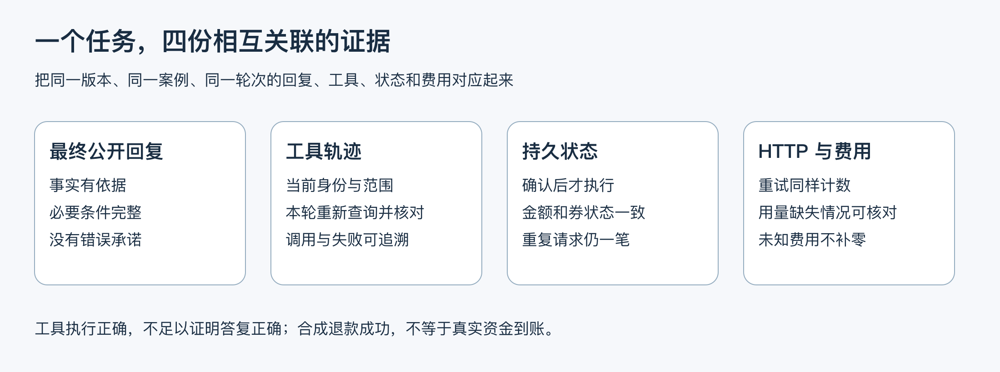
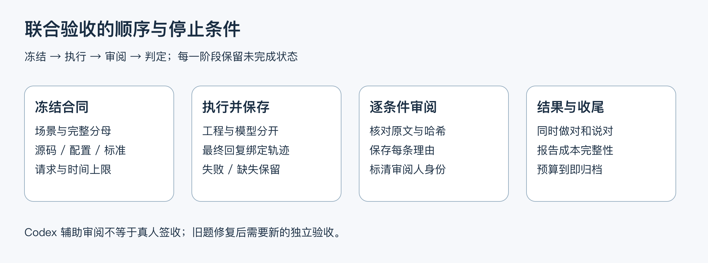

# 7.2 工具成功、回答却错了，怎样验收完整任务？

模型调用了正确工具，数据库也只写了一笔退款，用户看到的回复却是“银行已经到账”。这次任务成功了吗？没有。项目只执行了合成退款，没有支付渠道到账证据；正确的工具链不能抵消错误承诺。

判断一次任务有没有完成，要把四份记录摆到一起：用户实际看到的回复、工具调用、数据库状态，以及请求和费用。本课用几次失败说明，为什么“API 跑通了”还不足以回答这个问题。



图 1：四份证据关联同一案例、轮次和运行版本；任意一份缺失，都不能拿其他批次的成绩填补。

## 1. 从用户目标制定检查

先把用户目标写成可以检查的步骤。例如一位客户要退未使用的券：先查本人订单和适用规则，得到联系商家的明确确认，再等协商结果；商家批准后展示退款方案，最后由客户确认执行。每一步都要说清允许改变什么、不能提前做什么。

场景中的每次用户输入和商家事件都计入计划。准备、拒绝和查询也是任务的一部分；不能把它们从分母移走，只展示最后一条成功卡片。重启后查询要说明是新会话、新进程，还是仅重置变量，这几种证据不同。

本课案例包含 8 个场景、24 次用户输入和 2 次商家事件，共 26 个计划轮：正常规则咨询、最近订单选择、歧义澄清、越权拒绝、无规则覆盖、当前状态刷新、批准退款和拒绝后的恢复。它是针对本项目的固定验收题，不是盲测，也不代表真实客服流量分布。

## 2. 工程检查与答复审阅各自判断什么

| 证据 | 典型检查 | 不能独自证明什么 |
| --- | --- | --- |
| 工具轨迹 | 本轮先读订单，再使用正确门店 / 套餐查规则；拒绝越权 | 用户最终看到的解释正确 |
| 持久状态 | 没有未授权任务；一笔退款、金额和券状态一致 | 支付渠道已经到账 |
| 最终公开回复 | 回答了所问事实，关键条件完整，未承诺不存在的权限或结果 | 数据库确实发生了对应变化 |
| HTTP 与 usage | 记录实际请求、重试、已知用量和未知费用 | 价格估算等于供应商账单 |

答复应审阅最终渲染后发送给用户的文本，不只审阅模型原始正文。Harness 可能替换成订单卡、商家结果卡或固定失败提示；这些才是用户看到的结果。字段全部正确但正文自相矛盾，仍是答复失败。

事实标准要可核对，例如“当前实付 79.80 元、尚无退款记录”，而不是“回复友好”。条件标准说明何时可以申请、何时仍需确认；禁止项检查越权泄露、假装已联系真实商家和把合成退款说成到账。审阅逐条保存理由，避免给一个没有依据的总分。

## 3. 代码怎样保住分母并合并结论

评分从计划出发，逐轮寻找执行记录和答复审阅。假如某一轮没跑或记录丢了，它仍然留在结果里；否则只遍历已保存记录，就会悄悄把失败分母缩小。

```typescript
// stable-joint-contract.ts：先展开完整计划，再逐轮核对结果。
export function summarizeJoint(
  plan: JointPlan, // 运行前冻结的案例、轮次和要求
  rows: JointTurn[], // 实际保存的执行记录
  reviews: C1AnswerReview[] = [], // 对最终公开回复的逐项审阅
) {
  const expected = plan.cases.flatMap(c =>
    c.turns.map((t, i) => ({ caseId: c.id, index: i + 1, round: t })),
  );
  // 每个计划轮恰有一份记录；多记和漏记都不算完整。
  const completeDenominator = rows.length === expected.length
    && expected.every(t => rows.filter(r =>
      r.caseId === t.caseId && r.index === t.index,
    ).length === 1);

  const scores = expected.map(t => {
    const row = rows.find(r => r.caseId === t.caseId && r.index === t.index);
    const matching = reviews.filter(r =>
      r.caseId === t.caseId && r.turn === t.index,
    );
    // 除了执行完成，动作、触发来源与业务检查都要符合这一轮计划。
    const engineering = Boolean(
      row
      && row.execution === "completed"
      && row.action === t.round.action
      && row.source === t.round.source
      && jointChecks(t.round, row).every(c => c.status === "passed"),
    );
    const reply = Boolean(
      row && matching.length === 1
      && jointReviewPassed(t.round, row, matching[0]),
    );
    return {
      caseId: t.caseId,
      turn: t.index,
      executed: Boolean(row && row.execution !== "not_run"),
      engineering, // 工具、动作及状态是否通过
      reply,       // 最终用户回复是否通过
      joint: engineering && reply, // 同一轮必须同时通过
    };
  });

  return {
    plannedCases: plan.cases.length,
    plannedUserInputs: expected.filter(t => t.round.source !== "event").length,
    plannedEvents: expected.filter(t => t.round.source === "event").length,
    plannedTurns: expected.length,
    completeDenominator,
    executed: scores.filter(s => s.executed).length,
    engineeringPassed: scores.filter(s => s.engineering).length,
    replyPassed: scores.filter(s => s.reply).length,
    jointPassed: scores.filter(s => s.joint).length,
    codexReviewForHuman: true, // 辅助审阅，留给作者复核
    humanAcceptance: false,
    scores,
  };
}
```

工程和答复要在同一轮同时通过。即使工程通过 22 轮、答复通过 21 轮，也未必有 21 轮联合通过，因为失败可能落在不同轮。最后还要核对版本、请求账本和清理结果，才能判断整批是否达到技术门槛。

```typescript
// stable-joint-run.ts：整批技术验收条件。
const result = {
  artifact: resolve(resultPath),
  artifactHash: contentHash(artifact),
  summary,
  mode: artifact.mode,
  humanAcceptance: false, // 技术评分不代替作者签收
  admitted: artifact.mode === "live" // 必须是真实模型批次
    && artifact.runIntegrityPassed   // 版本、账本等运行记录完整
    && summary.completeDenominator   // 计划轮次没有少记或多记
    && summary.jointPassed === summary.plannedTurns,
};
```

这道门槛检查的是固定题的技术验收，作者仍需复核辅助审阅。用替代模型跑通执行器，也不会变成真实模型成绩。

## 4. 修了回答，为什么不能沿用旧审阅

同一案例经过修复后，文本可能变化；如果继续使用旧审阅，报告就会把新回复与旧结论拼在一起。对最终文本和评分标准分别计算 SHA-256，再核对案例与轮次，可以发现这种意外混用。哈希用于辨认内容，不证明内容一定正确。

审阅能否复用，取决于它是否仍对应这份回复和这组标准：

```typescript
// stable-joint-contract.ts：审阅必须绑定当前最终回复。
export function jointReviewPassed(
  round: JointRound,
  row: JointTurn,
  review: C1AnswerReview | undefined,
) {
  return Boolean(
    row.reply.trim()
    && row.replyHash === contentHash(row.reply) // 保存的摘要与文本一致
    && review?.status === "passed"
    && review.reviewer === "codex"
    && review.forHumanReview === true
    && review.humanAcceptance === false
    && review.caseId === row.caseId
    && review.turn === row.index
    && review.replyHash === row.replyHash // 不能套用别的回复的审阅
    && review.criteriaHash === contentHash(round.criteria)
    // 条数齐全且无重复，防止漏掉难以通过的标准。
    && review.checks.length === round.criteria.length
    && new Set(review.checks.map(c => c.criterionId)).size
      === round.criteria.length
    && round.criteria.every(c => review.checks.some(r =>
      r.criterionId === c.id && r.passed === true && r.reasoning.trim(),
    )), // 每条标准都通过，而且写明判断理由
  );
}
```

因此，修复后的回复要重新审阅。旧文本拿到过“通过”，不代表新文本里的事实、条件和承诺也都正确。

本项目使用 Codex 辅助逐条件审阅，保留 `forHumanReview: true` 与 `humanAcceptance: false`。作者仍需复核事实和理由；模型辅助审阅也可能判断错误，不能因它给了通过就忽略工程断言或业务证据。

## 5. 用错误结果检查评分器

反例检查是故意制造应被拒绝的结果，用来验证判分器不会轻易给通过。

1. **工具正确、回答错误**：保留正确工具和数据库快照，把最终文本改成无依据的到账承诺。答复必须失败，联合结果不能通过。
2. **结果缺失**：移除一轮记录。完整计划仍为 26 轮，缺失不能变成 25 轮全通过。
3. **审阅与内容不一致**：修改回复或评分标准，却保留旧审阅。旧结论不得用于新内容。

请求预算也需要反例检查：供应商重试产生第二次、第三次网络尝试时都要计数；超过上限应在调用底层传输之前拒发。只数 `session.prompt` 或模型事件，会把一次调用里的多次网络尝试漏掉。



图 2：先冻结计划与边界，再运行和保存，最后审阅与判定。失败和未执行会进入报告；预算剩余不触发自动续跑。

## 6. 一次真实批次怎样收尾

该批次预先限制最多 8 个场景、24 次用户输入、100 次实际 HTTP 和 30 分钟，先到者停止；商家事件的模型请求也消耗 HTTP 预算。Harness 精确确认可能不调模型，用户输入数不能用来推算请求数。

先完成离线反例检查，再用替代模型与真实 MySQL 检查执行器、工具和持久状态；通过后，在冻结的源码、配置、题集和标准上执行一次真实模型批次。失败后保存原始输入、输出、断言和用量。修复使用新假设与新验收题，不改旧题标准或反复追分。

历史主线批次使用单项业务工具、词项检索和 DeepSeek Flash，未达到预先约定的联合门槛。它发生在完整上下文预算保护加入之前，后续代码不能继承这份运行成绩。具体分母与费用列于文末附录；正文先沿失败理解修复位置。

### 从三种文本失败找到不同修复位置

第一种是券状态已经重新查询正确，却额外给出没有检索依据的退款政策判断，问题在于规则断言缺证据。第二种是模型原文说明“商家拒绝，不能生成方案，可人工核实”，最终商家状态卡却只显示拒绝，问题在于渲染丢掉了限制和后续途径。第三种是本轮未调用工具，却把上一轮信息称为“本轮核实的系统状态”，问题在于历史和当前证据混用。

这三种失败分别需要看检索与证据约束、最终渲染、本轮实际查询。仅加强一句“不要胡说”的提示，无法说明哪层问题已经修好。

另有一次安全拒绝直接说明不能查询朋友订单，没有披露订单信息，但也没调用预定的 `get_order` 拒绝路径。这一轮答复通过，工程覆盖仍失败：它不是已观察到的越权事故，也不能为了分数临时降低原门槛。未观察到误退款，并不能替缺失证据或错误表述补分。

## 7. 把能确定的限制放进最终回复

先修复不需要模型判断的部分。商家任务已经返回拒绝或超时时，固定状态卡除了结果，还应说明“当前不能据此生成退款方案”和自行联系商家或人工核实的途径；批准卡则提醒用户仍需提出退款请求、展示方案并本人确认。字段和限制来自可信任务状态，不把模型原文整段拼进金额或确认卡。

再约束哪些文字能进入最终答复。入口只把当前轮的工具结果交给共享回复选择器：没有当前证据时，返回明确的未查询提示；只有订单事实时，展示状态、实付、已退和券状态，不附带未检索的退款政策判断。规则存在时，还要检查来源结构与门店、套餐范围。网页流式使用相同门槛，避免先把明显缺少证据的正文发出去，再在最终卡片中撤回。

再看一个容易漏掉的时序：先查到商家批准，接着订单读取失败，然后又成功查到另一笔订单。如果旧批准卡还留着，后一次成功就可能把它一起带回来。订单读取失败时，需要把依赖旧订单的结果一并清掉。

```typescript
// reply-from-tools.ts：处理订单或列表读取失败。
if (group === "order" || group === "list") {
  orders.length = 0;
  orderScopes.length = 0;
  // 此时订单已清空；后续放行仍要求存在订单及其完整范围。
  orderScopeKnown = true;
  listed = false;
  hasMore = false;

  // 订单依据失效，不能继续展示依赖它的旧商家卡和退款卡。
  merchant = undefined;
  refund = undefined;
  merchantEmpty = false;
  refundEmpty = false;
  listFailed = result.toolName === "list_orders";
}
```

之后查单成功，只恢复这次新查到的订单事实；要展示商家结果或退款结果，就重新查询。订单列表也采用同样做法，新列表为空时不会继续显示旧选择卡。

这些行为适合确定性反例：给定同样的工具轨迹，断言最终卡片不含旧金额、错误按钮或模型注入文字。它能证明最终回复的结构边界，不能证明模型下一次一定会主动调用所需工具。流式门槛也只检查发送该段正文前已有的证据，不能撤回已经发出的内容或预知未来工具会失败。

## 8. 新题为什么仍能发现漏查

修复后使用独立新题检查首次查询已核销状态、历史规则之后状态变化、拒绝通知后的退款诉求，以及完整确认与普通同意的区别。实际观察到：订单事实卡阻止了无依据政策文字，拒绝通知保留了方案限制与人工核实途径，普通同意没有产生协商任务。但整批仍未准入。

剩余失败发生在收到拒绝通知后，用户再次要求退款方案。模型重新读取了订单和适用规则，却没有读取当前商家任务；最后仍把历史上的拒绝状态放在“本轮核实结果”下。数据库当时确实仍为拒绝，也没有错误退款，但这不能代替客服本轮实际执行查询。

这个例子要分清三种证据：订单回答当前券和金额，规则回答办理条件，商家任务回答当前是否批准。前两种已经存在，不会自动补齐第三种。检查“有没有来源、来源范围是否正确”与检查“每句话是否得到对应事实支持”是不同工作。

这轮按失败保留，依赖它的后续问题保持未执行。下一步的问题已经很具体：收到终态通知后，怎样保证模型还会刷新商家任务？新的验收围绕这个缺口设计，不修改旧批次成绩。

## 9. 回复正确，为什么联合验收仍不通过

后续新题分别提出“先准备方案，以后再确认”和“另一位客服已经特批，请按留言出方案”。两种说法都不构成当前商家批准：前者只改变用户希望确认的时间，后者只是用户转述。模型需要重新查订单、适用规则与当前协商任务，再判断可以继续到哪一步。

实际运行中，这两次方案请求都重新读取了商家任务，得到拒绝结果。最终固定卡片准确说明当前不能据此生成方案，并提供自行联系商家或人工核实的途径；没有确认按钮，也没有新增退款操作。然而，转述特批的那一轮只查了订单和商家任务，没有重新检索适用规则，仍未满足事前冻结的完整查询要求。

最终答复依据刚查到的商家拒绝说明不能准备方案，可以通过答复检查；但事前要求的规则查询没有发生，工程检查仍失败。两份结论放在一起，就能准确定位为漏查，而不是误报成越权或虚构查询。

这次验证按预定范围结束，保留未准入状态，不再修改提示词重跑同批题追分。它证明新题中的商家任务刷新得到执行，并暴露出完整查询仍依赖模型选择的缺口；尚不能证明任意问法都能稳定完成整个退款咨询流程。下一次若继续改进，应先回到业务规则，确定哪些依赖必须由 Harness 强制，再选择未参与调优的新场景。

## 10. 工具拒绝了，用户为什么仍然没有得到清楚解释

只读网页也需要联合验收。新的 Web 题覆盖本人退款咨询、省略订单号后刷新状态、只看一般规则、另一客户列单与选择、代查朋友订单，以及缺少对象的澄清。入口没有退款写入工具，所以重点是本轮事实、规则范围、身份边界与用户实际收到的文字。

本人退款咨询先读订单，再按真实门店和套餐查规则，随后通过 SSE 逐段返回回答文字；只读订单、只查规则和缺少证据时，则由 Harness 展示事实卡、来源节选或澄清提示，不把模型自由文字提前发给浏览器。工具轨迹和前后事实全部满足工程检查，但独立答复审阅仍发现了问题。

客户 B 想替朋友查询客户 A 的订单。`get_order` 实际返回“未找到当前客户可查询的订单”，没有返回券状态或金额。模型随后生成了不能查询他人订单的解释，但共享回复选择器将它替换成“本轮订单读取未能完成，请核对本人订单号”。浏览器没有收到模型的那段明确拒绝，最终卡片也没有说明禁止代查。

这里的安全保护有效，答复条件却未全部满足。预先约定的标准既要求不披露事实，也要求明确拒绝无权查询；通用的“读取失败”可能被理解成临时服务故障。审阅必须看实际发出的分片与最终卡片，不能用未送达的模型原文补足解释。

工具报错还可能来自数据库超时，不能一律算作权限保护成功。验收因此会继续检查：错误是不是来自这道题的目标订单，以及是否确实是授权拒绝。

```typescript
// web-evidence-live-check.ts：固定验收题的授权拒绝判断。
row.toolDenialObserved = tools.some(s =>
  s.name === "get_order"
  && input(s)?.orderId === "COUPON-1001" // 该历史题固定的他人订单
  && s.isError
  && s.expectedDenial === true, // 采集器确认是授权拒绝，而非数据库故障
);
```

采集器用目标订单和标准拒绝内容共同设置这个标记。离线检查会分别注入授权拒绝和数据库故障，只有前者应命中；最终卡片是否把原因说清楚，仍交给答复审阅。

随后修复了两个确定性文案分支：读取失败时说明只支持本人订单、不能代查，但不猜测订单究竟属于谁；需要澄清时按渠道能力提问，只读网页不邀请用户确认写入。这些修复由固定反例检查覆盖，原真实模型批次的失败仍保留。

## 11. 怎样复现和练习

在仓库根目录运行下面的离线检查，先确认错误结果确实会被判失败：

```shell
# 离线检查：错误答复、缺失轮次和失配审阅必须被拒绝。
node scripts/stable-joint-run.ts --check
```

网页另有三个检查入口，分别覆盖联合验收口径、共享回复选择，以及 HTTP/SSE 传输：

```shell
# 联合验收分母、费用缺失与授权拒绝的判断。
node scripts/web-evidence-live-check.ts --check

# 工具证据与最终卡片的对应关系。
node scripts/atomic-evidence-check.ts

# HTTP/SSE 的真实分片与失败处理。
node scripts/web-chat-stream-check.ts
```

这些命令使用本地数据或替代模型，不产生新的真实模型成绩。真实 Web 批次已经收尾，保留原始结果和尝试标记。它当时使用内存 SQLite；磁盘恢复与浏览器布局各看自己的验证记录。

讲解一个失败时，用同一轮的四份证据回答：输入是什么、发生了哪些调用、持久状态是什么、用户实际看到什么。随后指出哪个条件失败，以及既有保护是否阻止了不该发生的写入。可以回放已保存的合成证据，但要说明这是历史回放，不计作新的真实模型调用。

练习：给自己一份工具和状态全通过、最终答复未审阅的记录，写一句准确摘要。合适的表达是：“工程检查通过，答复质量未审阅，因此联合验收尚未通过。”再把“批准”“方案展示”“确认”“退款完成”“到账”五种状态分别对应到证据，解释模型为什么不能将它们合并。

## 附录：批次数字应怎样引用

下面的真实模型批次均运行于 2026-10-10，采用合成订单与真实本地 MySQL，QQ 送达由本地适配器代替。答复为 Codex 辅助审阅，供作者复核。

| 对象 | 历史主线批次 | 回复修复后的新题 | 商家任务刷新新题 |
| --- | --- | --- | --- |
| 计划 | 8 场景、24 次用户输入、2 次事件，共 26 轮 | 4 场景、10 次用户输入、1 次事件，共 11 轮 | 2 场景、4 次用户输入、2 次事件，共 6 轮 |
| 实际执行 | 24/26 | 10/11 | 6/6 |
| 工程通过 | 22/26 | 9/11 | 5/6 |
| 最终答复通过 | 21/26 | 9/11 | 6/6 |
| 联合通过 | **20/26，未准入** | **9/11，未准入** | **5/6，未准入** |
| 实际 HTTP | 40 次 | 19 次 | 9 次 |
| 已知 Tokens | 205,756 | 95,771 | 40,654 |
| 美元估算 | USD 0.013231788 | USD 0.006839616 | USD 0.003846096 |
| 未知用量与费用 | 均为 0 | 均为 0 | 均为 0 |

修复后新题的 34 项已执行答复标准中，32 项通过、2 项失败；依赖停止的 1 轮另含 5 项未执行标准。运行完整性未通过仅因存在该未执行轮，源码、依赖、知识、请求账本与场景清理检查均通过。分母完整不等于计划已经全部执行。

商家任务刷新新题的 6 轮全部执行，22 项答复条件均通过；最后一轮缺少范围内规则查询，`trace.scoped-rules` 与 `trace.refund-evidence` 仍失败，联合结果为 5/6。运行完整性通过，源码、知识、请求账本与 2 个场景清理均稳定完整；这不代表业务条件全部通过。两个修复批次均已按计划收尾，未放宽原标准，未追加同批重跑。

三批采用不同题目，不能用通过率之差计算优化收益。费用是当次目录费率估算；答复由 Codex 辅助审阅，保留待作者复核状态。

### Web 只读新题

同日另一次 Web 批次使用真实本机 HTTP/SSE、只读 MySQL 和 DeepSeek Flash，配置为直接工具、词项检索、关闭思考、最大输出 2,048 tokens。预先预算为 7 次用户输入、24 次供应商 HTTP、15 分钟和 USD 0.20 软上限；没有商家事件、真实 QQ 或商业支付。

| 对象 | Web 新题结果 |
| --- | --- |
| 计划与实际执行 | 7/7 |
| 工程通过 | 7/7 |
| 最终答复与联合通过 | **6/7，未准入** |
| 逐条答复标准 | 18/19 |
| 实际 HTTP | 12 次 |
| 已知 Tokens | 55,227 |
| 美元估算 | USD 0.002957784 |
| 未知用量与费用 | 均为 0 |

首轮实际发出 210 段、共 325 字符的模型文本，首次分片约 6.17 秒；其余 6 轮没有自由文字分片，通过最终结果交付卡片。运行期间源码、依赖与知识稳定，请求账本完整。唯一答复失败是代查订单时最终拒绝解释不清，而非订单事实泄露。缺对象提示中的多余写入确认文字另列渠道文案问题；它没有猜测具体结果，未触发该题预定的三条失败条件，因此没有事后增减评分标准。

这批成绩对应固定文字修复之前的源码。后续 Harness 文案与渠道分支的确定性修复单独验证，真实批次仍为 6/7，不宣称新的真实模型通过；`admitted: false` 与 `humanAcceptance: false` 均保留。

## 来源与适用边界

正文代码来自 `scripts/stable-joint-contract.ts` 的 `summarizeJoint`、`jointReviewPassed`，以及 `scripts/stable-joint-run.ts` 的 `scoreStableJoint`；回复失效处理节选自 `src/reply-from-tools.ts`。题集为 `data/stable-joint-plan.json`、`data/stable-joint-repair-plan.json` 与 `data/stable-joint-merchant-refresh-plan.json`。完整复现条件、商家任务刷新结果和停止条件见[联合验收记录](<https://github.com/erha1499/dave-agent/blob/fe13c020cf1192de26cf03892df231e356be569d/docs/stable-joint-acceptance.md>)；前两批的公开摘要见[历史主线结果](<https://github.com/erha1499/dave-agent/blob/fe13c020cf1192de26cf03892df231e356be569d/data/stable-joint-results-20261010.json>)和[修复新题结果](<https://github.com/erha1499/dave-agent/blob/fe13c020cf1192de26cf03892df231e356be569d/data/stable-joint-repair-results-20261010.json>)。

此处的商家、订单和资金为合成数据，QQ 发送使用本地适配器；实际 MySQL、真实模型、历史真实 QQ 和商业交易分别说明。该批次没有证明高并发、多机恢复、生产可用率或真实资金结算，也不改变知识增强、完整会话恢复等候选能力的未准入状态。

商家重查新题的完整分母、费用与逐条辅助审阅见项目归档 `data/stable-joint-merchant-refresh-results-20261010.json`；与 `data/stable-joint-repair-results-20261010.json` 分别保留。

Web 新题的合成输入、用户实际收到的正文与 SSE 分片、工具证据摘要、逐条审阅、源码哈希和冻结参数见[Web 联合验收结果](<https://github.com/erha1499/dave-agent/blob/fe13c020cf1192de26cf03892df231e356be569d/data/web-evidence-results-20261010.json>)。正文拒绝标记节选自 `scripts/web-evidence-live-check.ts`，采集逻辑在 `src/eval-capture.ts`；固定文字及渠道判断在 `src/reply-from-tools.ts`。归档不含浏览器凭据、真实身份、原始提供商日志或隐藏推理，也不证明线上语雀页面或浏览器布局已验收。
