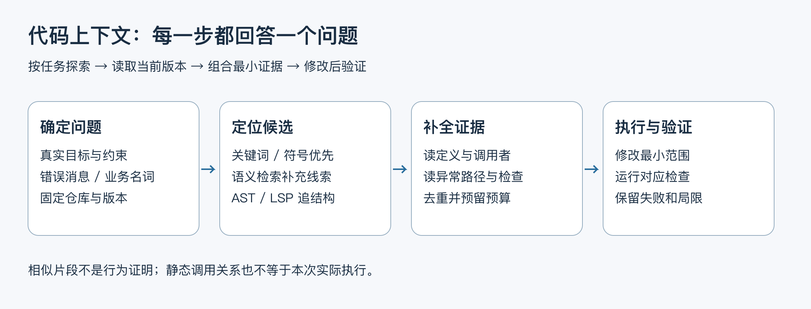
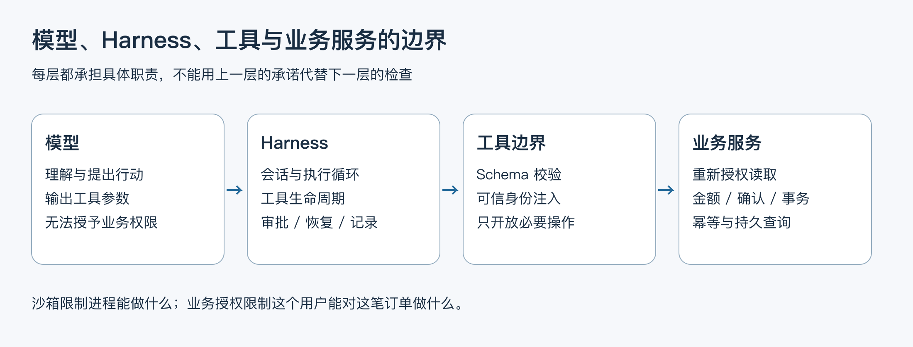

# 选修：仓库太大放不进上下文，Coding Agent 怎么办？

面试官问“几十万行代码放不进上下文怎么办”，可以先从一个更小的问题回答：如果要修复重复退款，你会先读哪里，又凭什么知道没有漏掉关键调用？上下文管理的难点，往往是选对证据，而不是一次装下更多代码。

本课用 dave-agent 练习一条可操作的路径：搜索入口、补齐调用链、修改、验证。项目本身是客服 Agent；大型仓库索引、向量检索与调用图在这里用于讨论设计选择。



图 1：检索只产生候选，必须通过读取定义、调用者与检查补成当前任务的证据。预算不足时逐步探索，不把整个仓库塞入请求。

## 1. 先把任务变成可搜索的线索

例如“退款重复确认会不会产生第二条记录”，先从业务名词寻找确认入口、RefundStore 和幂等检查。已知精确符号时，用关键词或符号查询比向量召回更直接；只知道“网络断开后不能再退款”这类自然语言描述时，语义检索可能提供线索，但召回片段本身不能证明行为。

```shell
# 在仓库根目录运行：先找确认入口与幂等状态。
rg -n 'confirmRefund|confirm\(|class .*Refund|succeeded' \
  src/refunds.ts src/refund-entry.ts src/qq-agent.ts scripts

# 再追事务和数据库锁。
rg -n 'commit\(|rollback\(|FOR UPDATE|refunds' src/refunds.ts

# 最后找对应的恢复与进程故障检查。
rg -n 'checkAtomicRefundRecovery|atomic-refund-recovery|refund-crash-window' \
  scripts docs
```

先在仓库根目录运行这些搜索，找到入口后再读周围代码。路径改名或没有匹配时，用 rg --files src scripts 重新定位；同时记下当前提交与本地差异，避免混读两个版本。

第一轮只找入口。第二轮读函数周围的控制流和异常处理。第三轮追调用者、依赖与检查，弄清返回值在哪一层展示、失败后是否重试，以及工具和 Harness 谁持有授权。每次读取应回答一个明确问题，避免无限扩大上下文。

## 2. 四类技术分别解决什么

| 方法 | 擅长什么 | 主要限制 |
| --- | --- | --- |
| 关键词 / 文件搜索 | 精确标识符、错误消息、配置名、SQL 表名 | 用户描述与代码命名不同会漏召回 |
| 向量检索 | 自然语言与不同命名之间的语义线索 | 相似不等于适用，需回读当前源文件；索引可能过期 |
| AST 分析 | AST 是抽象语法树，可识别函数、类、导入、语法范围，辅助结构化改写 | 语法树本身不能完整解析跨模块类型或运行时调用 |
| LSP / 静态引用分析 | LSP 是语言服务器协议，可向语言服务查询定义、引用、类型及调用层次 | 具体能力依赖语言服务与工程配置；反射、动态分派和生成代码仍有盲点 |

运行时追踪回答“这次请求实际调用了谁”，静态调用图回答“哪些路径可能可达”。两者不能互相替代：一次追踪没经过某条分支，不代表那条分支不存在；静态图可达，也不代表此次发生了调用。

对当前小型 TypeScript 仓库，文件与关键词搜索、类型检查和专项检查已能完成大量任务。只有出现明确漏召回和阅读成本证据，才值得引入长期索引。索引方案还需要说明仓库、分支、提交、文件哈希、增量更新和删除；不能把旧分支的嵌入结果当当前实现。

## 3. 怎样组装当前任务的上下文

优先放入：用户的真实目标与约束、被修改的定义、关键调用者、相关类型、失败证据、需要保持的业务不变量，以及最小相关检查。完整日志和大文件可以留在工具中按需再读，不必一次全部发送。

组装时按文件与范围去重，保留路径、行号和版本；读取片段太短导致缺少异常处理时补读上下文，而不是让模型猜。给输出和后续工具结果预留空间，超预算时缩小探索步骤，不能删除身份、金额和幂等约束换取更多代码。

修改后至少追问：调用者是否仍满足新的接口与行为约定，失败路径是否改变，检查能否捕获原始缺陷。针对退款事务，还需要真实数据库的事务与故障窗口验证；TypeScript 编译通过不能证明提交后断连安全。

## 4. Harness 到底负责什么



图 2：模型提出行动；Harness 管理会话、工具、执行、恢复与权限交互；业务服务继续负责身份、金额和幂等。不同层的职责不能通过一张工具白名单互相替代。

Harness 是模型执行任务时的运行环境：它送入上下文、接收工具请求、执行动作，再把结果交回模型，同时管理权限和人类交互。业务服务还要继续检查自己的规则。例如外层允许调用退款工具，内层仍需检查这笔订单属于谁、有没有批准，以及是否已经退过。

| 对象 | 官方资料描述的重点 | 学习时应检查的具体问题 |
| --- | --- | --- |
| Claude Code | 收集上下文、行动、验证的循环；使用文件、搜索、终端等工具，并提供权限规则 | 工具请求怎样获准，哪些操作受沙箱约束，何时读取更多文件与执行检查 |
| OpenCode | 可配置工具与 allow / ask / deny 权限；文档提供需启用的实验性 LSP 工具 | 工具是否启用、权限具体应用到哪里、语言服务是否正确初始化 |
| Codex | Harness 用于 app、CLI、IDE；app-server 提供线程、轮次、事件与审批协议；沙箱与审批分工 | Harness 接入哪些协议事件，如何设置执行边界，重连后如何恢复可见状态 |
| dave-agent 复用 Pi | 复用模型 / 工具循环和会话生命周期；工具集合只开放客服业务能力 | 哪些来自 SDK，哪些是自己实现的可信身份、业务状态、展示确认与评测 |

读这张表时，关注的是各层承担什么职责。文件搜索不等于完整调用图，工具白名单也不等于操作系统沙箱。查源码前还要确认具体仓库和许可证，不能把一个产品的所有组件笼统当成开源实现。

对 dave-agent，个人实现聚焦可信身份、业务控制、工具边界、证据接收、售后恢复和评测；模型与工具循环、会话生命周期复用 Pi。面试时可以解释这些 Harness 工程为何重要，但不要把客服工具注册说成自己实现了文件检索、命令沙箱或 Coding Agent。

## 5. 带着问题读一条源码链

以“同一退款方案重复确认会不会生成第二条退款”为例，不能看到函数名包含 `confirm` 就结束。需要先找到 Harness 接收用户确认的入口，再读数据库写入路径，最后检查返回结果如何呈现。

先找到确认入口：它只接受完整的“确认退款 操作编号”，再调用 RefundStore.confirm。真正的写入回调会经过下面的共享入口，先查身份和当前操作。

```typescript
// refunds.ts：私有方法，供展示登记和退款确认共用。
private async withOperation(
  identity: QQIdentity,
  sourceKey: string, // 入口提供的来源标识，须与方案记录一致
  operationId: string,
  // 调用方传入展示登记或退款确认；共用下面的授权与锁检查。
  action: (
    connection: PoolConnection,
    order: RowDataPacket,
    row: RowDataPacket,
  ) => Promise<RefundOperation>,
): Promise<RefundOperation> {
  validate(identity, sourceKey);
  if (!uuid.test(operationId)) throw new BusinessError(unavailable);
  return this.controlled(async () => {
    // 操作编号只用于定位订单，不授予读取或退款权限。
    const [lookup] = await this.pool.execute<RowDataPacket[]>(
      "SELECT order_id FROM refund_operations WHERE operation_id = ?",
      [operationId],
    );
    if (!lookup[0]) throw new BusinessError(unavailable);
    return this.transaction(async connection => {
      // 同一事务里，先锁订单并检查归属，再锁操作并检查会话来源。
      const order = await this.lockOrder(
        connection, identity, lookup[0]!.order_id as string,
      );
      const row = await this.current(connection, identity, sourceKey, order);
      if (!row || row.operation_id !== operationId) {
        throw new BusinessError(unavailable);
      }
      if (row.status === "succeeded") return operation(row); // 幂等回读
      if (!row.valid) {
        throw new BusinessError(
          "退款方案已过期，请重新获取方案并确认新的操作编号。",
        );
      }
      return action(connection, order, row); // 当前有效操作才进入后续处理
    });
  });
}
```

注意第一条查询的用途：它只帮助找到订单。真正的授权在事务中完成，成功结果也必须经过这一步才能返回。

接着追问并发：两个确认同时到来，会不会都看到“还没退”？继续打开 lockOrder，检查它怎样让两个请求排队。

```typescript
// refunds.ts：所有退款修改先锁同一订单，串行处理并发确认。
private async lockOrder(
  connection: PoolConnection,
  identity: QQIdentity,
  orderId: string,
) {
  const [rows] = await connection.execute<RowDataPacket[]>(`
    SELECT o.* FROM orders o
    JOIN qq_identities q ON q.customer_id = o.customer_id
    JOIN merchant_demo_scenarios s ON s.order_id = o.id
    WHERE o.id = ? AND q.app_id = ? AND q.sender_id = ?
    FOR UPDATE OF o FOR SHARE OF q, s
  `, [orderId, identity.appId, identity.senderId]);
  // o 取排他行锁，身份绑定 q 和场景 s 取共享锁。
  if (!rows[0]) throw new BusinessError(unavailable);
  return rows[0];
}
```

有了同一订单的行锁，后一个确认要等前一个事务结束，才能继续重读操作状态。确认、退款记录和相关状态更新都在这套事务内衔接起来，重复请求才能回到同一结果。

最后还要读事务提交、回滚和入口的失败提示。数据库已提交但结果回复未返回时，用户看到超时并不等于没有退款；正确动作是按订单查询持久结果。只有把入口、锁、状态、写入和失败提示放在一起，才组成回答这个问题所需的代码上下文。

到这里，一条“重复确认为什么不会再退一次”的讲解才齐全：入口限定确认格式，事务重新授权，行锁处理竞争，状态判断决定回读还是执行，错误提示告诉用户如何恢复。每次补读都回答一个新问题，没有必要先读完整个仓库。

## 6. 最小练习：从证据到可验证结论

1. 用搜索找精确确认的 Harness 入口，解释为什么模型工具不能自行确认。
2. 追到事务，写出身份、归属、批准期限、金额和当前状态的检查顺序。
3. 找出退款记录与操作状态怎样一同提交，再读重复请求如何返回同一结果。
4. 找到成功检查与失败检查；区别正常重启查询和事务提交窗口的进程终止验证。
5. 记录一条结论及局限，例如“本地 MySQL 合成退款验证幂等，不代表真实支付网关 exactly-once”。

练习交付一页源码路线与检查结果就够了。若以后规模扩大，出现搜索漏掉关键调用或定位过慢的证据，再比较索引、语言服务和调用图能减少多少工作。

面试时可以这样回答：“我会先把任务变成符号、错误信息和业务约束，用文件搜索定位入口；缺少线索时再用语义召回。候选片段要回读当前源文件，补上调用者、异常路径和检查。AST 或语言服务帮助找结构，但不能代替运行结果。修改后按影响范围验证，涉及事务就补数据库检查。我的客服项目实现了业务边界与评测，没有实现大型仓库索引，后者是基于这些经验提出的设计方案。”

## 参考与实现边界

本仓库入口：`src/agent.ts`、`src/qq-agent.ts`、`src/refunds.ts`、`scripts/atomic-refund-recovery-db-check.ts`、`scripts/refund-crash-window-check.ts`；后者的两个真实 MySQL 受控终止窗口已有[独立结果](<https://github.com/erha1499/dave-agent/blob/fe13c020cf1192de26cf03892df231e356be569d/docs/refund-crash-window-validation.md>)，不与正常退出后查询混算。实际检查以对应冻结源码和记录为准。外部产品仅作职责比较，不是本项目已实现能力、实测结果或对招聘公司的内部系统描述。

外部资料于 2026-10-10 查阅，均为可能继续更新的官方文档；本课没有安装或横向测评这些产品，不给出固定版本性能排名。[Claude Code 的运行说明](<https://code.claude.com/docs/en/how-claude-code-works>)和[权限文档](<https://code.claude.com/docs/en/permissions>)介绍循环与权限；[OpenCode 工具文档](<https://docs.opencode.ai/docs/tools/>)介绍工具权限及实验性 LSP 范围；[Codex 官方 Harness 文章](<https://developers.openai.com/blog/codex-as-a-platform>)介绍 app-server 与 Harness 职责，[沙箱说明](<https://learn.chatgpt.com/docs/sandboxing>)区分执行边界和审批。
