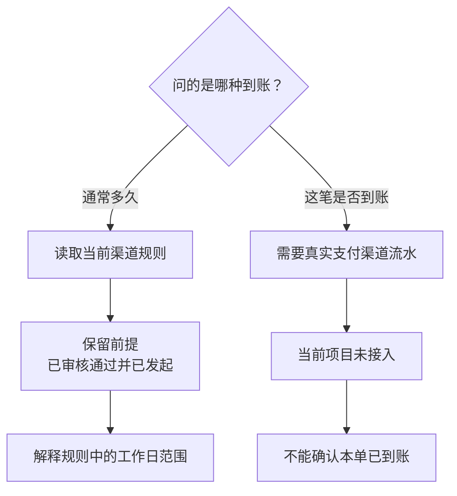

# 案例：问“多久到账”和问“已经到账了吗”，差在哪？

## “多久到账”先分清问的是什么

客户问：“退款走银行卡，通常多久能到？”另一位问：“我的这笔退款已经到账了吗？”前一句需要渠道时效规则，后一句需要真实交易状态。两句都包含“到账”，但需要的数据、权限和回答方式完全不同。

本课看的是前一种问题。项目提供“查询到账”命令，按指定渠道解释规则时效；规则以“退款已审核通过并已发起”为前提。教学数据中，银行卡为三至七个工作日，电子钱包为一至三个工作日。

选择“银行卡”，只是告诉系统你想咨询哪个渠道；填写订单号，也只是帮助查找适用规则。它们都不表示这笔退款已经发起。因此回答要始终分清“通常多久”和“这一笔到哪一步了”。



图 1：时效规则回答“通常多久”，支付流水才回答“这一笔到了没有”。订单号可帮助确定规则范围，不能证明退款已发起或到账。

## 命令中的三个对象

| 对象 | 本课的作用 | 示例 |
| --- | --- | --- |
| 可信身份 | 决定能读取谁的订单 | 入口提供的应用与发送者 |
| 商品范围 | 决定哪些规则适用 | 当前订单对应的门店和商品 |
| 渠道 | 选择要咨询的假设时效 | 银行卡或电子钱包 |

“工作日”是规则采用的计时单位，不能随意换成自然日，也不能仅凭范围计算出准确到账日期。“规则前提”是这段时效成立之前必须满足的条件；本课明确是已审核通过并已发起，不能省略成“从你现在发问起再等三天”。

这条命令由项目的 Harness 处理：识别完整输入、读取订单、校验规则并构造固定回答；Pi 负责普通问答中的模型与工具循环。因此，时效数字可以直接来自当前规则，无需让远程模型重新生成。

## 为什么不借用“刚才那单”

不带订单的命令只问全局渠道规则，不借用聊天中的“刚才那单”。如果要按订单 1 的商品查规则，就显式带上它的完整订单号。这样用户刚切过单，或很久后回来继续问，也不会悄悄查错对象。

完整命令也不接受混合动作，例如“查询到账 银行卡，顺便帮我退了”。程序返回格式提示，不把后半句悄悄删掉，再假装用户只问规则；更不能从这句话里推导出退款确认。

先看解析：整行输入必须是查询命令，不能把混在后面的退款动作一起放行。

```typescript
// arrival-consultation.ts：只接受完整命令及一个渠道。
// originalText 是入口收到的用户原文，解析前不删改。
// 三段分别匹配命令、可选订单号和渠道；String.raw 保留反斜杠。
const command = new RegExp(
  String.raw`^[\p{Zs}\t]*查询到账[\p{Zs}\t]+`
    + String.raw`(?:(COUPON-\d{4})[\p{Zs}\t]+)?`
    + String.raw`(银行卡|电子钱包)[\p{Zs}\t]*$`,
  "u",
).exec(originalText);
if (
  !command
  || originalText.length > 200
  // 允许普通空格和 Tab，拒绝换行、控制字符等混入命令。
  || /[\p{C}\p{Zl}\p{Zp}]/u.test(originalText.replace(/\t/g, ""))
) {
  return finish(notice(instruction));
}
// trace 记录本次咨询；捕获组依次给出可选订单号与渠道。
trace.orderId = command[1] ?? null; // 不写订单号就咨询全局规则
trace.channel = command[2] as Channel;
// 补齐检索前提，但不把它当作本单已发起退款的事实。
trace.canonicalQuestion =
  `假设退款已审核通过并已发起，${trace.channel}渠道通常何时到账？`;
```

不符合格式就直接返回提示。只有完整命令通过，程序才继续查订单和规则。

代码生成的标准问题会补上“假设已审核并发起”，方便检索聚焦。这个“假设”也必须留在答复里，不能经过一次问题改写，就变成用户真的已经完成了审核。

## 先查当前范围，再查可用规则

带订单时，`getOrder` 使用可信身份重新检查归属，返回门店、商品与其他订单事实。处理器要求范围可明确到单一商品，否则不能任意挑一个商品规则回答。无订单时则使用全局范围，不读取此前选单来补齐。

规则不仅有正文，还包含结构化的覆盖说明：渠道、前提、最少与最多工作日、适用范围及对应引文。代码检查数字是合理整数、上下限顺序正确、范围与来源一致，以及完整引文确实存在于正文。一个标题叫“退款时效”的文档，不代表它覆盖了用户所问的渠道和前提。

查到相关资料后还要看它是否完整覆盖当前问题。没有适用规则就请用户核实；规则之间冲突就暂停承诺；不能只挑一条看起来顺眼的数字回答。

## 为什么查到规则后还要重新授权

读取订单之后，系统还要等待规则读取和检索。等待期间可能发生两类变化：账号与订单归属变化，或者规则本身更新。两类状态在不同位置，不会因为其中一种已检查，就把另一种冻结。

正常顺序是：第一次读取本人订单取得范围 → 读取和复检规则 → 再读本人订单确认范围与授权 → 最后再读规则确认没有变化 → 生成回答。

第二次读订单之后，再读一次规则，顺序不能互换：

```typescript
// arrival-consultation.ts：查完规则后，再核对当前订单权限和范围。
// trace.scope 来自首次查单；重读后必须仍是同一门店与商品。
if (trace.orderId) {
  if (!sameScope(
    trace.scope,
    scopeOf(
      await wait(() => store.getOrder(trusted, trace.orderId!)),
      trace.orderId,
    ),
  )) {
    throw new Error("scope_changed");
  }

  // 上面的授权读取也可能等待；完成后再检查规则是否发生变化。
  const currentRules = validateRules(await wait(readRules));
  trace.lastRulesCheck = {
    stage: "post_order_authorization",
    observedAt: new Date().toISOString(),
    hash: contentHash(currentRules),
  };
  // rulesHash 是首次读取规则时保存的内容摘要。
  if (trace.rulesHash !== trace.lastRulesCheck.hash) {
    throw new Error("source_changed"); // 不拼接两版规则继续回答
  }
}
```

第二次读订单解决的是“等待之后还能不能查这笔订单”。这次读取本身又要等待，所以紧接着再查规则，避免等待期间规则变了却仍引用旧版本。

比较的是两次规则内容是否一致，读者无需记住内容摘要的字符串。只要观察到变化，就结束本次回答并提示重试，避免把两版事实拼在一起。

## 没有规则、规则冲突时怎样说

规则缺失和规则冲突会走不同提示，但都不会猜一个到账时间：

```typescript
// arrival-consultation.ts：从复检后的规则中选择当前渠道。
// snapshots[1] 是第二次读取的规则，已与首次内容核对一致。
// 带订单时，还要求授权后的最后一次读取与它一致。
// visible 保存适用于当前门店、商品范围的来源编号。
const candidates = snapshots[1]!.filter(rule =>
  visible.has(rule.source.id) && rule.coverage?.channel === trace.channel,
);
if (!candidates.length) {
  trace.reason = "coverage_unknown";
  return finish(notice(
    "当前来源没有覆盖此渠道及完整前提的审阅规则，请向人工核实；"
      + "不能使用通用到账数字代替。",
  ));
}

// 将每条规则的工作日范围去重；不同范围并存就说明有冲突。
const claims = new Set(
  candidates.map(rule => JSON.stringify(rule.coverage!.businessDays)),
);
if (claims.size !== 1) {
  trace.reason = "rule_conflict";
  return finish(notice(
    "当前适用的模拟规则存在时限冲突，请人工核实；本次不承诺到账时限。",
  ));
}
```

假如两条银行卡规则分别写三至七个工作日、五至十个工作日，取平均或挑较短数字都会制造一个规则里没有的承诺。代码因此保留冲突，让后续人工核实有明确原因。

这里依次确认三件事：资料覆盖了这个渠道吗，适用于当前订单吗，相互之间一致吗。仅仅标题包含“退款时效”，还回答不了这些问题。

成功时可以回答：“假设退款已审核通过并已发起，银行卡渠道通常在三至七个工作日到账。”随后说明这次查的是规则，没有办理退款，也没有查询本单的实际到账状态。

## 正常与异常例子

正常例子：用户发送 `查询到账 银行卡`，系统读取全局合成规则，解释带前提的三至七个工作日，并说明未绑定订单。这里没有必要询问“刚才那单是不是你要退的”，因为这次命令本来就是无订单咨询。

带订单的例子：客户明确选择订单 1，并指定咨询电子钱包。程序先核对订单归属，再按商品查规则；回答的是该渠道的假设时效，不据此推断订单当初使用了电子钱包付款。

失败例子：第一次读取订单后账号改绑，第二次读取不能再授权；或者第二次授权等待期间规则改变，最后比较失败。两种情况都应停止给出承诺。规则数字看起来仍正确，也不能继续输出属于失效范围的回答。

在网页中先选一张订单，也不会改变无订单完整命令的含义；命令会结束旧待选流程。之后点击旧卡片不能恢复之前尚未明确的退款诉求。显式命令提供了一个清楚的上下文切换点。

## 取舍与练习

完整命令的代价是用户要按格式输入，好处是对象、渠道和前提都能明确处理。普通口语“钱什么时候到”仍由原有问答路线处理，不能拿完整命令的表现代替它的验收。

多次读取增加了等待，却覆盖了真实存在的变更窗口。它仍不能把数据库和规则文件冻结成一个事务：最终检查后，状态还可能继续变；当前做法是在已经发现变化时停止作答。

练习：在“第一次读订单、规则复检、第二次读订单、最后读规则”四个位置之间分别插入一次变化，指出由哪一步发现。再写出两个答复：一个回答规则，一个回答实际到账状态；标出后者需要哪些当前项目并未接入的支付事实。

## 参考资料与实现边界

- 实现位置：src/arrival-consultation.ts、src/coupon-store.ts 与规则数据。仓库的订单编号使用 COUPON- 加四位数字，代码中保留该格式。
- 复现入口：`scripts/arrival-consultation-check.ts`、`scripts/arrival-entry-check.ts`；只读数据库检查与历史适用范围见 `docs/c1-channel-consultation-contract.md`。
- 复现时可输入“查询到账 银行卡”，或使用绑定在当前身份下的实际订单，例如“查询到账 COUPON-1001 电子钱包”。时效是项目原创合成规则；当前没有接入支付渠道，也不能查询真实到账。
