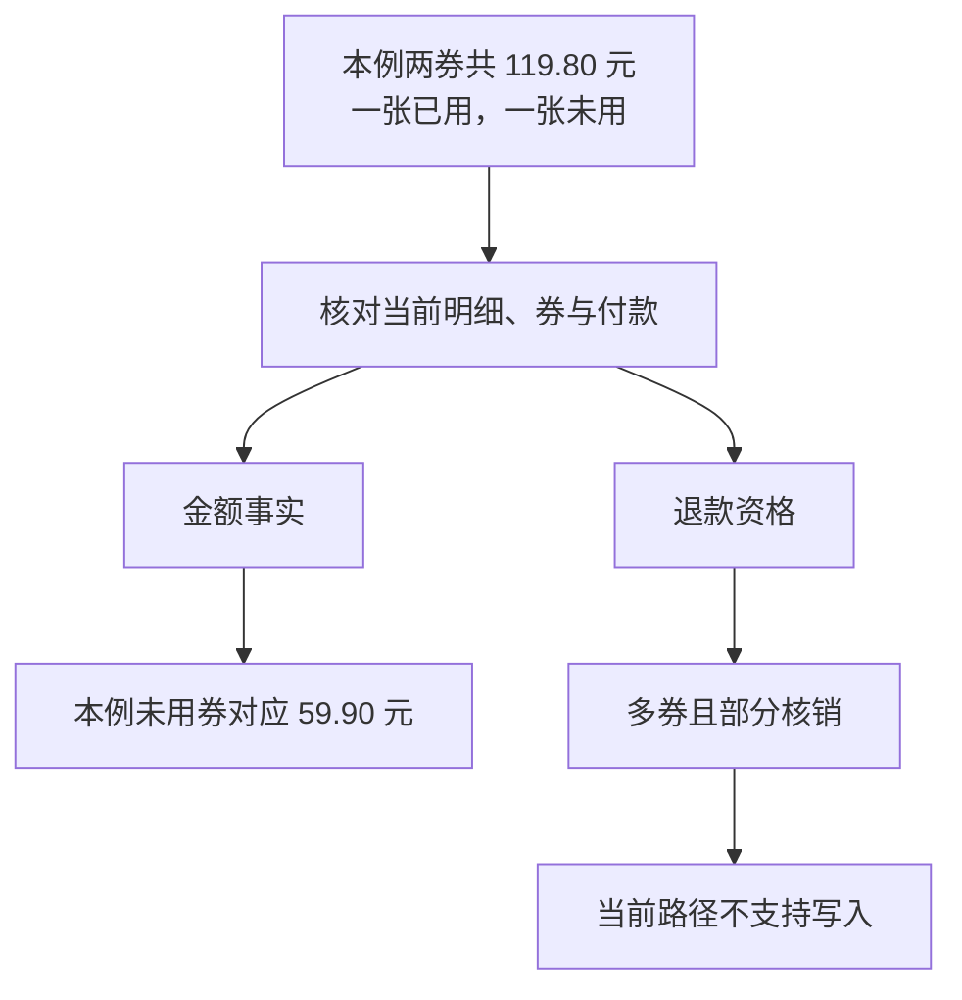

# 案例：一张券用掉了，剩下的钱能直接退吗？

## 用掉一张券，剩下的金额能直接退吗

小林的订单 1 有两张等价团购券，共付 119.80 元，已经用掉一张。他问：“剩下的 59.90 元，能直接帮我退了吗？”先别急着点头：还剩哪张券、对应多少钱、现在能不能退款，是三个需要分别回答的问题。

本课沿这三个问题往下看。当前系统可以解释剩余券和金额，但退款写入只支持单张未核销券的整笔退款。算出 59.90 元，并不会自动获得部分退款能力。



图 1：本例无优惠且数据一致，才能解释剩余 59.90 元；金额事实与执行资格分开判断，不能从金额直接跳到退款。

## 把订单、券、核销和支付分开

订单记录整笔购买；商品明细描述买了什么、数量与单价；券是每一份可消费凭证；核销表示某一张券已经被消费；支付记录实际付出的金额。一个订单可以有多张券，所以“订单已支付”不等于“其中每张券都未使用”。

| 层次 | 本例事实 | 可以得出的结论 |
| --- | --- | --- |
| 订单 | 实付 11980 分，已退 0 分，部分核销 | 付了 119.80 元，不能把整单说成未用 |
| 明细 | 两份，每份 5990 分，总计 11980 分 | 本例是无优惠的等价两券 |
| 券 | 一张已核销，一张未核销 | 剩余对象是未核销的那一张 |
| 支付 | 一笔成功付款 11980 分 | 支付与本例整单金额一致 |

这笔订单没有优惠，两张券价格相同，明细、付款和券数也对得上，所以能把剩余一张解释为 59.90 元。后面换成有优惠的订单，就会看到为什么不能照搬这个算法。

金额用整数分保存，11980 分就是 119.80 元。整数分避免浮点表示误差；它没有规定优惠券、满减或套餐差价应该怎么分摊。表示方式与业务分配规则是两层问题。

## 订单号不能代替本人身份

模型调用订单工具时只给订单号，身份由可信入口注入。Store 通过账号绑定与订单客户联查，重新检查是否为本人。用户说“我是订单主人”、提供别人的订单号，或者旧历史里留着订单内容，都不能跳过这个检查。

一次订单读取涉及订单、明细、券、支付和退款多张表。项目在只读可重复读事务中读取它们，使授权与事实共享同一快照，避免把“核销前的订单总状态”和“核销后的券列表”拼成互相矛盾的结果。

先看读取：同一个数据库快照里，同时核对本人身份和订单事实。

```typescript
// coupon-store.ts · getOrder：本次读取使用只读、可重复读事务。
await connection.query(
  "SET TRANSACTION ISOLATION LEVEL REPEATABLE READ, READ ONLY",
);
await connection.beginTransaction();
started = true;
const asOf = new Date().toISOString(); // 本次读取时间标签，不是数据库提交时间

// 用入口身份重新关联客户；模型只提供订单号，不能指定客户身份。
const rows = await this.select(`SELECT /*+ MAX_EXECUTION_TIME(3000) */
  o.id, o.status, o.total_cents, o.paid_cents, o.refunded_cents,
  o.created_at, o.paid_at,
  s.id AS shop_id, s.name AS shop_name, s.address, m.name AS merchant_name
  FROM orders o JOIN qq_identities q ON q.customer_id = o.customer_id
  JOIN shops s ON s.id = o.shop_id
  JOIN merchants m ON m.id = s.merchant_id
  WHERE o.id = ? AND q.app_id = ? AND q.sender_id = ? LIMIT 1`,
  [orderId, identity.appId, identity.senderId], connection,
);
```

随后继续从同一事务读取商品、券、支付和退款记录。这样返回的“部分核销”与“一张已用、一张未用”才属于同一时点，不会互相打架。

固定订单卡可以直接展示这些结构化事实；模型组织说明时仍可能说错，所以“数据库查对了”和“回复说对了”需要分别核对。

## 如何回答这位客户

合适的回答先说明对象和事实：“这笔订单实付 119.80 元，有两张等价券，其中一张已核销，另一张未核销。本例未用券对应 59.90 元。”然后说明当前动作边界：“当前系统不支持这类订单的部分退款，不能直接执行，需另行核实处理。”

不合适的回答是：“剩余 59.90 元，我已给你退了。”前半句金额可能正确，后半句却捏造了操作。另一种错误是“整单还有 119.80 元可退”，它忽略已经消费的一张券。也不能只说“无法退款”而不解释剩余对象，让客户误以为已使用和未使用部分没有区别。

知识规则可以介绍逐券核对、未用部分按实付解释的思路，却不能生成商家批准、用户确认或退款记录。检索内容提供解释依据，资金执行仍受代码边界约束。

## 执行入口怎样拒绝不支持的状态

当前退款写入只接受单份商品、单张未用且未过期的券。检查直接读取数据库事实，不让模型自己声明“这笔单可以退”。

```typescript
// refunds.ts · eligible：任一条件不满足，就拒绝进入单券退款流程。
if (
  // 整单全额支付，金额有效，而且此前没有退款。
  order.status !== "paid"
  || !Number.isSafeInteger(order.paid_cents)
  || order.paid_cents <= 0
  || order.paid_cents !== order.total_cents
  || order.refunded_cents !== 0
  // 只能有一份商品，金额与门店均匹配。
  || items.length !== 1
  || items[0]!.quantity !== 1
  || items[0]!.shop_id !== order.shop_id
  || items[0]!.total_cents !== order.paid_cents
  // 只能有一张尚未使用、尚未过期的券。
  || coupons.length !== 1
  || coupons[0]!.status !== "unused"
  || !coupons[0]!.valid
  || coupons[0]!.redeemed_at !== null
  // 支付记录与实付一致，没有已有退款记录。
  || payments.length !== 1
  || payments[0]!.status !== "succeeded"
  || payments[0]!.amount_cents !== order.paid_cents
  || refunds.length !== 0
) {
  throw new BusinessError(
    "首版仅支持已全额支付、未退款、单张未核销且未过期的演示团购券。",
  );
}
```

部分核销或多券订单会被这些条件挡住，用户口头同意也不能改变支持范围。即使单券资格通过，后面仍要核对商家批准、方案展示和操作确认。

因此，多券订单能查、能解释，却不能沿这条单券路径退款。这是系统刻意保留的范围：先把一种资金状态完整做好，再为其他类型补规则和验收。

## 为什么不能直接把总价除以二

把例子稍作改变：商品仍标每张 59.90 元，顾客用了 10 元优惠，整单实付变成 109.80 元。剩余券是 59.90 元还是 54.90 元？两种答案都需要额外业务规则。

若优惠平均分摊，每张可能实付 54.90 元；若优惠只抵第一张，第二张可能仍值 59.90 元。还可能存在退款后优惠门槛不成立、需要追回优惠的规则。算术并不难，缺的是该采用哪条业务规则。

因此，`unitPriceCents` 只是明细单价，不能随意当成所有订单的逐券净实付。总实付、明细合计、成功支付、券数必须先对齐；缺项或不一致时应澄清，不从自然语言猜分摊方式。

## 代码怎样限制可解释的金额范围

可选的 Controller 编排模式由 Harness 串起查单与金额核对。下面的函数接收刚查到的订单，先判断数据是否支持“明细单价就是每份实付”，不满足就不给出这个换算。

```typescript
// support-context.ts：只在数据一致、实付等于总价时解释每份金额。
export function paidUnits(order: Order) {
  const money = (value: number) => Number.isSafeInteger(value) && value >= 0;
  if (
    !money(order.amounts.totalCents)
    || order.amounts.totalCents <= 0
    || order.amounts.paidCents !== order.amounts.totalCents
    // 每项数量有效，明细金额正确，发出的券数与购买数量相同。
    || order.items.some(item =>
      !Number.isSafeInteger(item.quantity)
      || item.quantity <= 0
      || !money(item.unitPriceCents)
      || item.unitPriceCents <= 0
      || item.totalCents !== item.quantity * item.unitPriceCents
      || order.coupons.filter(coupon => coupon.orderItemId === item.id).length
        !== item.quantity,
    )
    || order.items.reduce((sum, item) => sum + item.totalCents, 0)
      !== order.amounts.totalCents
    // 成功付款合计必须与订单实付一致。
    || order.payments.filter(payment => payment.status === "succeeded")
      .reduce((sum, payment) => sum + payment.amountCents, 0)
      !== order.amounts.paidCents
  ) return []; // 条件不齐就不解释逐份实付，不猜优惠分摊

  // 按商品明细返回每份实付，后续再关联到具体未用券。
  return order.items.map(item => ({
    itemId: item.id,
    productId: item.productId,
    paidCents: item.unitPriceCents,
  }));
}
```

本例各项数据一致，因此会返回每份 5990 分。若实付小于总价，或券数、明细和支付对不上，就返回空列表，不提供逐券实付推算。

如果客户接着问“剩下这张券的实付，和上次说的一样吗”，系统就要比较旧金额与新事实。旧金额来自此前查单时保存的结构化记录，绑定身份、会话、订单和商品；当前查询还须确认已有券被使用、只剩一张有效未用券，而且没有已退款金额。比较结果保留 refundApproved: false，只回答金额是否一致，不提供退款许可。

所以“记得上次说过 59.90 元”的用途，是找到要核对的金额。重新查询发现变化时，就说明变化，而不是把旧聊天当作现在仍然正确的证据。

## 读取更多，不代表允许写更多

咨询要看懂客户为什么卡住，因此需要读多券、过期、部分核销等订单。写入则只开放规则和状态流转已经明确的类型。读得更广、写得更窄，让系统既能解释问题，又不把每一种查得到的订单都当成可退款订单。

## 扩展部分退款前，必须先回答什么

如果未来确实要支持部分退款，至少要明确每张券的实付与已退金额、优惠分摊、核销后的允许状态、商家批准覆盖哪张券、用户确认哪一部分，以及重复操作如何不超额退款。否则新增一个 `amount` 参数，只是把本来缺少的业务规则交给模型猜。

当前选择让咨询覆盖更丰富的场景，而写入保持单券整笔范围。这减少了资金状态组合，方便完整复现成功、拒绝和重试恢复。代价是遇到多券或优惠订单时只能解释、澄清或转人工，不能自动完成所有售后诉求。

练习：分别为“无优惠两券”“整单优惠十元”“两券价格不同”“已有部分退款”列出要读取的事实。尝试给出金额后，再单独回答是否可执行；若第二问只能引用第一问的数字，说明还缺授权或状态流转规则。

## 参考资料与实现边界

- 本例在合成数据 db/02-seed.sql 中对应 COUPON-1005；核心实现为 src/coupon-store.ts、src/refunds.ts、src/support-context.ts。售后写入入口只接受 COUPON-2xxx 范围，因此直接使用这笔例单会先在编号入口被拒绝；即使编号符合，资格检查仍拒绝多券或部分核销。
- 订单事实检查与候选金额比较分别有 `scripts/coupon-db-check.ts`、`scripts/support-controller-check.ts`；它们验证的对象不同，不能合并成通用回答准确率。
- 当前部分退款尚未实现，项目也没有真实商业退款。若要扩展，需先补逐券实付、优惠分摊和批准范围，再设计确认与防超退检查。
